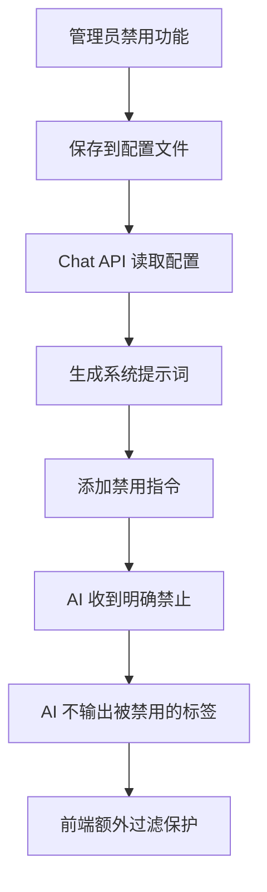
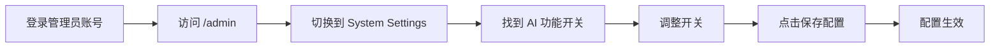
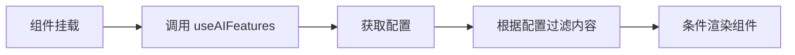

# AI 功能管理后台 - 实现总结

## 🎯 功能概述

在管理员后台（`/admin` 页面）新增了 **AI 功能开关** 面板，允许管理员**真正禁用** AI 助手的标签输出功能。

## ⚡ 核心特性

### 真正的禁用功能
- **后端层面禁用**：在系统提示词中明确禁止 AI 输出被禁用的标签
- **前端层面过滤**：即使 AI 违规输出，前端也会过滤掉
- **双重保护机制**：确保被禁用的功能完全不可用

### 工作原理



### 示例：禁用任务规划器

**配置文件：**
```json
{
  "enableTaskList": false
}
```

**系统提示词自动添加：**
```
## 🚫 禁用的功能
**重要：以下标签已被管理员禁用，严禁输出！**

禁用的标签：<TASK_LIST>

**严格规则：**
- ❌ 不要输出上述任何标签
- ❌ 不要尝试使用这些功能
- ❌ 不要在回复中提及这些功能
- ✅ 使用其他方式完成用户请求

如果用户请求的功能已被禁用，请礼貌地告知用户该功能暂时不可用。
```

**AI 的行为：**
- 不会输出 `<TASK_LIST>` 标签
- 如果用户要求任务规划，会礼貌地说明该功能暂时不可用
- 会尝试用其他方式（如文字描述）完成用户请求

## 📁 文件结构

```
components/admin/
  └── ai-features-settings.tsx          # 管理界面组件

app/api/
  ├── admin/ai-features/
  │   └── route.ts                      # 管理员 API（需要权限）
  └── ai-features/
      └── route.ts                      # 公共 API（所有用户可访问）

lib/hooks/
  └── use-ai-features.ts                # React Hook

data/
  └── ai-features-config.json           # 配置文件（运行时生成）

docs/
  ├── AI_FEATURES_ADMIN_CONTROL.md      # 功能文档
  ├── AI_FEATURES_INTEGRATION_EXAMPLE.md # 集成示例
  └── AI_FEATURES_ADMIN_SUMMARY.md      # 本文档
```

## 🔧 技术实现

### 后端 - 真正的禁用机制

#### 1. 配置读取
```typescript
// app/api/chat/route.ts
async function getAIFeaturesConfig(): Promise<AIFeatureConfig | undefined> {
  try {
    const configPath = path.join(process.cwd(), 'data', 'ai-features-config.json')
    const data = await fs.readFile(configPath, 'utf-8')
    return JSON.parse(data)
  } catch (error) {
    return undefined // 使用默认配置（所有功能启用）
  }
}
```

#### 2. 系统提示词生成
```typescript
// lib/ai/prompt-templates.ts
export function generateCompactSystemPrompt(options: {
  basePrompt: string;
  enableDeviceControl: boolean;
  enableReasoning: boolean;
  mcpToolNames: string[];
  contextCompressed: boolean;
  aiFeatures?: AIFeatureConfig; // 新增配置参数
}): string {
  const parts = [options.basePrompt];
  
  // 生成禁用功能警告
  const disabledInstruction = generateDisabledFeaturesInstruction(options.aiFeatures);
  if (disabledInstruction) {
    parts.push(disabledInstruction); // 明确告诉 AI 不要使用这些功能
  }
  
  // 只列出启用的功能
  parts.push(generateEnabledFeaturesInstruction(options.aiFeatures));
  
  return parts.join('\n\n');
}
```

#### 3. 禁用指令生成
```typescript
function generateDisabledFeaturesInstruction(aiFeatures?: AIFeatureConfig): string {
  const disabledFeatures: string[] = []
  
  if (aiFeatures?.enableTaskList === false) disabledFeatures.push('<TASK_LIST>')
  if (aiFeatures?.enableDeviceBento === false) disabledFeatures.push('<DEVICE_BENTO>')
  // ... 其他功能
  
  if (disabledFeatures.length === 0) return ''
  
  return `## 🚫 禁用的功能
**重要：以下标签已被管理员禁用，严禁输出！**

禁用的标签：${disabledFeatures.join(', ')}

**严格规则：**
- ❌ 不要输出上述任何标签
- ❌ 不要尝试使用这些功能
- ❌ 不要在回复中提及这些功能
- ✅ 使用其他方式完成用户请求

如果用户请求的功能已被禁用，请礼貌地告知用户该功能暂时不可用。`
}
```

#### 4. 启用功能列表
```typescript
function generateEnabledFeaturesInstruction(aiFeatures?: AIFeatureConfig): string {
  const enabledTags: string[] = []
  
  if (aiFeatures?.enableTaskList !== false) {
    enabledTags.push('- <TASK_LIST></TASK_LIST> - 任务规划器')
  }
  // ... 只列出启用的功能
  
  return `## 可用的 UI 标签
${enabledTags.join('\n')}

只使用上述列出的标签，不要使用未列出的标签。`
}
```

### 前端

#### 1. 管理界面
- 使用 Shadcn UI 组件
- 响应式设计
- 实时状态更新
- 加载和保存状态提示

#### 2. React Hook
```typescript
const { config, loading, refetch } = useAIFeatures()
```

#### 3. 集成方式
- 在组件中使用 hook 获取配置
- 根据配置条件渲染组件
- 在内容处理时过滤标签

## 📊 功能列表

### UI 组件类（7 个）
1. ✅ 任务规划器 - `<TASK_LIST>`
2. ✅ 设备状态卡片 - `<DEVICE_BENTO>`
3. ✅ 设备控制面板 - `<CONTROL_BENTO>`
4. ✅ 监控画面 - `<MONITOR>`
5. ✅ 定时任务列表 - `<SCHEDULED_TASKS>`
6. ✅ 数据图表 - `<CHART>`
7. ✅ 光谱数据 - `<SPECTRAL>`

### 功能增强类（3 个）
8. ✅ 思考过程 - `<REASONING>`
9. ✅ 引用来源 - `<SOURCES>`
10. ✅ 工具调用记录 - `<TOOL_USED>`

### 操作执行类（2 个）
11. ✅ 定时任务创建 - `<SCHEDULE_TASK>`
12. ✅ 设备控制指令 - JSON Control

### 预览类（2 个）
13. ✅ HTML 预览 - HTML Preview
14. ✅ 网页预览 - `<WEB_PREVIEW>`

## 🚀 使用流程

### 管理员操作流程



### 前端集成流程



## 💡 使用场景

### 1. 调试模式
关闭不需要的功能，简化输出，便于调试：
```
关闭 enableTaskList → 不显示任务规划器
关闭 enableReasoning → 不显示思考过程
```

### 2. 性能优化
关闭资源密集型功能：
```
关闭 enableChart → 减少图表渲染
关闭 enableMonitor → 减少视频流加载
```

### 3. 功能限制
根据业务需求限制功能：
```
关闭 enableDeviceControl → 禁止设备控制
关闭 enableScheduleTask → 禁止创建定时任务
```

### 4. 用户体验优化
根据用户反馈调整：
```
关闭 enableToolUsed → 隐藏技术细节
关闭 enableReasoning → 只显示结果
```

## 🔒 安全性

### 权限控制
- 只有管理员可以修改配置
- 所有用户可以读取配置（用于前端渲染）
- API 使用 `getCurrentUser()` 验证身份

### 数据验证
- 后端验证所有配置字段
- 使用默认值处理缺失字段
- 防止无效配置导致系统异常

## 📈 性能考虑

### 1. 配置缓存
- 前端在组件挂载时加载一次
- 避免重复请求
- 考虑使用 Context 或全局状态

### 2. 文件 I/O
- 配置文件较小（< 1KB）
- 读写操作快速
- 异步处理，不阻塞主线程

### 3. 标签过滤
- 使用正则表达式批量过滤
- 在内容处理阶段执行
- 不影响渲染性能

## 🔄 未来扩展

### 短期计划
1. ✅ 基础功能实现
2. ⏳ 在 AI 助手页面集成
3. ⏳ 添加配置变更日志
4. ⏳ 实现配置导入/导出

### 长期计划
1. 用户级别配置（每个用户自定义）
2. 配置模板系统（预设方案）
3. 实时配置推送（WebSocket）
4. 配置版本管理
5. A/B 测试支持

## 📝 注意事项

### 1. 配置生效时机
- 保存后立即生效
- 已渲染内容不受影响
- 新的 AI 回复应用新配置

### 2. 向后兼容
- 新增字段使用默认值
- 旧配置文件仍然可用
- 不破坏现有功能

### 3. 错误处理
- 配置文件不存在 → 使用默认配置
- 配置文件损坏 → 使用默认配置
- API 请求失败 → 使用默认配置

### 4. 用户体验
- 提供清晰的功能说明
- 显示实时状态反馈
- 支持一键重置

## 🧪 测试清单

### 功能测试
- [ ] 管理员可以访问配置页面
- [ ] 非管理员无法访问配置页面
- [ ] 开关可以正常切换
- [ ] 配置可以成功保存
- [ ] 配置可以成功加载
- [ ] 重置功能正常工作

### 集成测试
- [ ] 前端可以获取配置
- [ ] 标签过滤正常工作
- [ ] 组件条件渲染正常
- [ ] 配置变更后生效

### 边界测试
- [ ] 配置文件不存在时使用默认值
- [ ] 配置文件损坏时使用默认值
- [ ] 网络请求失败时使用默认值
- [ ] 并发保存配置不冲突

## 📚 相关文档

- [AI_FEATURES_ADMIN_CONTROL.md](./AI_FEATURES_ADMIN_CONTROL.md) - 详细功能文档
- [AI_FEATURES_INTEGRATION_EXAMPLE.md](./AI_FEATURES_INTEGRATION_EXAMPLE.md) - 集成示例代码
- [AI_REASONING_MODE_FIX.md](./AI_REASONING_MODE_FIX.md) - 思维链修复文档

## 👥 贡献者

- 实现日期：2026-04-16
- 版本：v1.0.0

## 📄 许可证

与主项目保持一致
