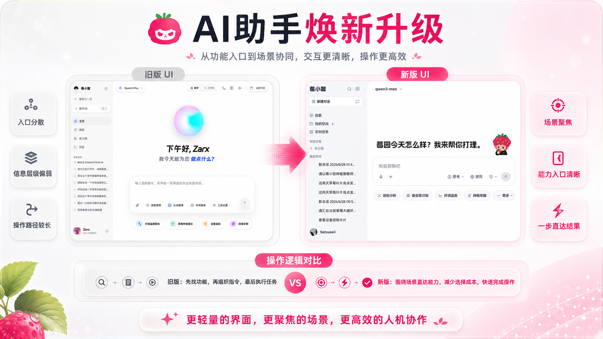
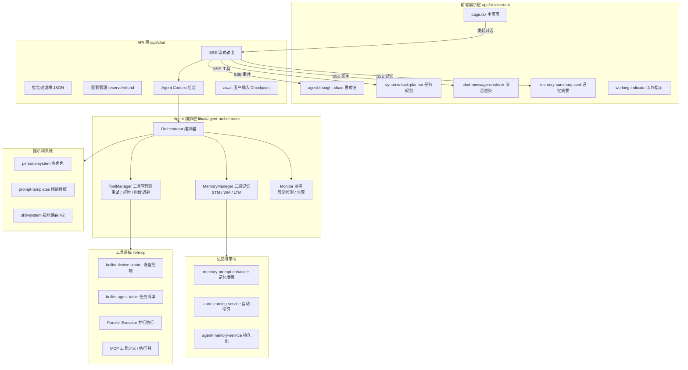
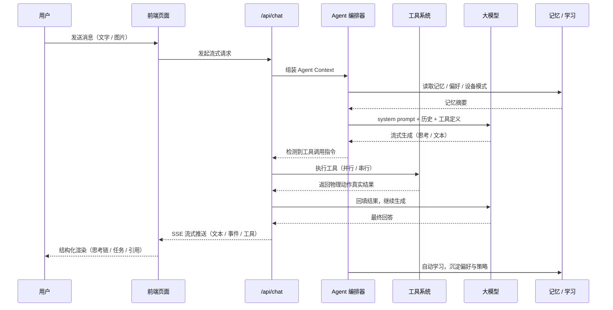

<div align="center">

# Stravision · 莓界

### 智慧农业物联网 + 大模型 一体化平台

<p>
  <a href="https://opensource.org/licenses/Apache-2.0">
    
  </a>
  <a href="https://nextjs.org/">
    
  </a>
  <a href="https://www.typescriptlang.org/">
    
  </a>
  <a href="https://ant.design/">
    
  </a>
  <a href="https://www.prisma.io/">
    
  </a>
  <a href="https://www.docker.com/">
    
  </a>
</p>

<p>
  
</p>

<p>
  <strong>感知 · 决策 · 控制 · 协同</strong><br/>
  为现代设施农业构建的「闭环式」智能管控平台
</p>

<p>
  <a href="#快速开始"><strong>快速开始</strong></a> ·
  <a href="#核心能力"><strong>核心能力</strong></a> ·
  <a href="#技术架构"><strong>技术架构</strong></a> ·
  <a href="#项目结构"><strong>项目结构</strong></a> ·
  <a href="PROJECT_HANDOVER.md"><strong>开发文档</strong></a>
</p>

</div>

---

## 项目简介

**Stravision（莓界）** 是一套面向草莓及设施农业场景的综合智能物联网管理平台。平台深度融合 **物联网（IoT）** 与 **大语言模型（LLM）** 技术，构建「感知 → 分析 → 决策 → 控制」全链路闭环，推动农业生产向 **标准化、无人化、智能化** 转型。

> 平台代号 **莓小智（Berry Smart）** —— 既是 7×24 小时在线的农业专家，也是听得懂、看得见、会思考的智能管家。

官方网站：[https://stravision.site/](https://stravision.site/)

---

## 核心能力

### 1. 全栈环境感知与可视化监控

通过多模态传感器网络与高清摄像头，对温室大棚进行 7×24 小时实时监测：

| 维度 | 能力 |
| --- | --- |
| 基础环境 | 空气温湿度、光照强度、CO₂ 浓度 |
| 土壤状况 | 土壤温湿度、EC 电导率、pH 值、氮磷钾 |
| 视觉巡检 | 摄像头云台（PTZ）控制 + VLM 视觉分析（病虫害 / 生长状态识别）|
| 数据可视化 | 可拖拽仪表盘、历史趋势图、多维度数据分析 |

### 2. 智能决策与自动化控制

基于专家模型与实时环境数据，自动执行精准调控策略：

- **自动化规则引擎**：基于 ReactFlow 可视化编排，支持条件触发、设备联动、定时任务
- **设备联动**：无缝对接水泵、风机、补光灯、遮阳网、卷膜机、步进电机云台
- **远程控制**：Web 端 + 移动端 PWA，随时随地手动接管
- **边缘容灾**：关键控制逻辑可下沉至边缘网关，断网不断控

### 3. AI 农业助手 · 莓小智

内置基于大模型的智能助手，覆盖对话、问答、设备控制、任务调度全场景：

- **病害诊断**：上传作物照片，AI 识别病虫害并给出防治建议
- **种植咨询**：实时问答，解答种植过程中的技术难题
- **语音交互**：纯 Omni 实时多模态架构，支持打断、低延迟、自然对话
- **工具调用**：标准 Function Calling，封装 `task_create` / `cron_create` / `ask_user_question` 等工具
- **计划模式**：Plan Mode 调研 → 提交 → 审批 → 执行，复杂任务可观测可回滚
- **多 Persona**：专家 / 助手 / 朋友等多种角色，响应风格差异化

#### AI 助手创新架构

`app/ai-assistant` 是平台的核心交互入口，采用「**分层 Agent 编排 + SSE 流式 + 结构化渲染**」的设计，下面从整体架构与单次对话数据流两个维度展开。

---

**整体分层架构**



---

**单次对话数据流**



---

**1. Agent 编排器与工具调用框架**

`app/ai-assistant` 后端的核心由一套 **Agent 编排器**（[`lib/ai/agent-orchestrator/`](file:///c:/Users/24121/Documents/stravision/meijie/berry-realm-v4.0/lib/ai/agent-orchestrator)）驱动，统一管理工具调用、记忆与执行监控；`orchestrator.ts` 持有多名子管理者，`global-manager.ts` 提供全局会话管理。

- **容错工具调用**（`tool-manager.ts`）：指数退避重试（默认 2 次）、超时控制（默认 60s）、执行日志
- **按工具差异化超时**：设备类工具涉及物理动作，单独覆盖超时——继电器 10s、LED 8s、电机云台 90s、摄像头抓帧 20s、移动+截图组合 120s，避免统一超时误杀长任务
- **并行工具执行**（`parallel-tool-executor.ts`）：解析工具依赖图，无依赖的独立工具并行执行，实测 3 个独立工具延迟从 12~15s 降至 4~6s
- **设备控制原生工具化**：`toggle_relay` / `set_led` / `control_camera` / `take_camera_snapshot` / `move_camera_and_look` 均为原生工具调用，工具阻塞等待物理动作完成并返回 `confirmed` / `stable` 真实状态，严禁裸 JSON 输出

**2. 流式响应与结构化解耦**

`/api/chat` 以 **SSE 流式**逐 token 推送，前端按事件类型解耦渲染：

- **智能 JSON 过滤**（`filterBareTaskListJson`）：拦截 AI 误输出的裸露 `<TASK_LIST>` JSON，避免污染界面，同时保留正确包裹的合法结构
- **结构化渲染组件**：思考链（`agent-thought-chain`，基于 Ant Design X ThoughtChain）、动态任务规划（`dynamic-task-planner`）、工作指示（`working-indicator`）、AI 动作摘要（`ai-action-summary`）、记忆摘要卡（`memory-summary-card`）——AI 的「思考 → 行动 → 结果」全程可观测

**3. 记忆与自动学习**

- **三层记忆**（`memory-manager.ts`）：短期记忆（STM，滑动窗口记录最近动作/观察）、工作记忆（WM，当前目标/子目标/挂起动作）、长期记忆（LTM，用户偏好/设备模式/成功策略）
- **记忆增强**（`memory-prompt-enhancer.ts`）：将记忆摘要注入系统提示词，让 AI 具备上下文感知
- **自动学习**（`auto-learning-service.ts`）：从对话与设备动作中自动提取偏好、识别设备使用模式（昼夜周期/天气响应/手动覆盖）、沉淀成功策略，并持久化到 `agent-memory-service`

**4. 技能路由系统（Skill Router V2）**

基于模块化技能系统（[`lib/ai/skill-system/`](file:///c:/Users/24121/Documents/stravision/meijie/berry-realm-v4.0/lib/ai/skill-system)），按用户消息语义匹配技能并注入提示词，支持**内置技能 + 磁盘技能 + 数据库技能**三级来源，配合 `skill-router-cached` 做结果缓存，让 AI 按需调用领域能力。

**5. Persona 多角色差异化**

内置 `expert`（种植专家）、`friendly`（新手向导）、`engineer`（技术工程师）三种 Persona，每种拥有专属的 system prompt 增量、决策偏好、语气约束与 few-shot 示范，回复风格在开头即可感知差异。

**6. 多 Provider 与多模态**

- **多 Provider 解析**（`provider-resolver.ts`）：按模型 ID 动态解析 baseUrl / apiKey / model，支持 OpenAI / 通义千问 / DashScope 灵活切换，缺省回退到配置的默认模型
- **多模态输入**：消息支持图片 / 文件附件（dataURL 内联），可调用摄像头抓帧 + VLM 视觉分析，实现"看图说话"式巡检

**7. 交互与并发控制**

- **等待用户输入**（`pending-user-input.ts`）：Agent Loop 输出 `<CHECKPOINT>` / `<CLARIFY>` 时挂起等待，前端渲染表单，用户提交后经 `/api/chat/respond` 回传并继续迭代；同一会话同一时间只允许一个挂起点
- **配额管理**（`ai-quota-service`）：发送前 `reserveAiUsage` 预占、异常时 `refundAiUsage` 回退，按时长/次数/会员档位（free / pro / plus）精细控制
- **响应缓存**（`response-cache.ts`）：对可缓存请求命中缓存，降低延迟与成本

### 4. 实时通信与语音助手

- **WebSocket 服务**：独立 `ws-server.js`，承载语音流、设备事件、协同光标
- **实时多模态**：纯 Omni 架构，端到端语音对话，VAD 静音检测（Silero WASM）
- **浏览器原生 ASR**：可选 SpeechRecognition API，零成本、零延迟、国内推荐 Edge
- **多 Provider 适配**：OpenAI / 通义千问 / DashScope，TTS / ASR / Omni 灵活切换
- **企业级安全**：Omni API Key 采用 AES-256-GCM 加密存储，仅管理员可配置

### 5. 组织化协作

- **组织 / 温室层级**：管理员创建组织、邀请成员、分配设备控制权限
- **双向同步**：邀请进组织自动建立好友关系并授予 `deviceControl`，移除组织自动回收
- **角色体系**：`super_admin` / `admin` / `user` 三级权限，敏感操作严格鉴权

---

## 技术架构

Stravision 采用现代化的前后端分离架构，确保高性能、可扩展与易维护。

### 前端（Frontend）

| 类别 | 技术选型 |
| --- | --- |
| 框架 | Next.js 16（App Router）+ React 19 |
| 语言 | TypeScript 5 |
| UI 组件库 | Ant Design 6 + Radix UI + Shadcn UI |
| 设计协议 | A2UI（Berry Protocol）|
| 图标 | lucide-react（strokeWidth 1.75，Trae Work 风格）|
| 可视化 | ECharts、Recharts、@ant-design/plots、React-Three-Fiber |
| 流程编排 | ReactFlow（@xyflow/react）|
| 动效 | Framer Motion、GSAP、Lenis |
| 状态管理 | Zustand、React Context |

### 后端（Backend）

| 类别 | 技术选型 |
| --- | --- |
| API | Next.js API Routes + Server Actions |
| 数据库 | PostgreSQL + Prisma 7 ORM |
| 实时通信 | WebSocket（ws）+ SSE |
| 物联网协议 | MQTT（设备通信）|
| AI 集成 | OpenAI SDK、Vercel AI SDK、DashScope |
| 文档处理 | mammoth、docx、jspdf、xlsx |
| 安全 | AES-256-GCM、bcrypt、JWT、SSRF Guard、HTML Sanitize |

### 部署与运维（DevOps）

| 类别 | 技术选型 |
| --- | --- |
| 容器化 | Docker + Docker Compose |
| 反向代理 | Nginx（含维护页）|
| CI 构建 | 低内存构建脚本（`build-low-memory.sh` / `.ps1`）|
| 代码混淆 | javascript-obfuscator / webpack-obfuscator |
| 监控 | 自定义日志 + 健康检查 + 速率限制 |

---

## 快速开始

### 前置要求

- **Node.js** v18+（推荐 v20）
- **pnpm** v10+（包管理器）
- **Docker & Docker Compose**（用于 PostgreSQL 等基础设施）
- **PostgreSQL** v14+（可选，亦可通过 Docker 启动）

### 安装步骤

1. **克隆仓库**

   ```bash
   git clone https://github.com/your-username/Stravision-IOT-PlatForm.git
   cd Stravision-IOT-PlatForm
   ```

2. **安装依赖**

   ```bash
   pnpm install
   ```

3. **配置环境变量**

   ```bash
   cp .env.example .env
   # 编辑 .env，填入数据库连接、AI API Key、MQTT Broker 等配置
   ```

4. **启动数据库与基础设施**

   ```bash
   docker-compose up -d
   ```

5. **数据库迁移**

   ```bash
   npx prisma migrate dev
   ```

6. **启动开发服务器**

   ```bash
   pnpm dev          # 启动 Next.js 前端（默认 3000 端口）
   pnpm dev:ws       # 另开终端启动 WebSocket 服务（语音 / 协同）
   ```

   访问 [http://localhost:3000](http://localhost:3000) 即可查看运行中的应用。

### 生产部署

```bash
# 低内存环境构建
pnpm build            # 或 ./build-low-memory.sh

# 启动前端 + WS 服务
pnpm start:all

# Docker 一键部署
docker-compose -f docker-compose.yml up -d
```

---

## 项目结构

```text
berry-realm-v4.0/
├── app/                          # Next.js 应用主目录（App Router）
│   ├── (mobile)/                 # 移动端 PWA 路由
│   ├── api/                      # 后端 API 接口
│   │   ├── admin/                # 管理后台 API（用户 / 模型 / MCP / 文档）
│   │   ├── ai/                   # AI 助手 API（对话 / 定时 / 监控 / 记忆 / 人设）
│   │   ├── auth/                 # 认证（登录 / 注册 / OAuth / 邮箱）
│   │   ├── chat/                 # 即时通讯（直聊 / 群聊 / 上传 / SSE）
│   │   ├── devices/              # 设备控制与历史
│   │   ├── direct-messages/      # 私信
│   │   ├── friends/              # 好友系统
│   │   ├── groups/               # 群组管理
│   │   ├── knowledge/            # 知识库（条目 / 标签 / 搜索 / 统计）
│   │   ├── mqtt/                 # MQTT 设备控制与模拟
│   │   ├── organizations/        # 组织管理
│   │   ├── scheduler/            # 定时任务调度
│   │   ├── voice/                # 语音配置
│   │   └── ...
│   ├── ai-assistant/             # AI 助手页面
│   ├── dashboard/                # 数据仪表板
│   ├── monitor/                  # 实时监控
│   ├── device-control/           # 设备控制台
│   ├── automation/               # 自动化策略编辑器
│   ├── chat/                     # 即时通讯页面
│   ├── blog/                     # 文档库（Blog）
│   ├── admin/                    # 管理后台
│   └── ...
├── components/                   # UI 组件库
│   ├── admin/                    # 管理后台组件
│   ├── ai/                       # AI 助手组件（卡片 / 推理 / 工具 / 引用）
│   ├── chat/                     # 聊天组件（消息项 / 窗口 / 侧栏）
│   ├── ui/                       # 基础 UI（Shadcn + Berry XCard）
│   └── ...
├── hooks/                        # 业务 Hooks（聊天 / 联系人 / 录音）
├── lib/                          # 工具函数与共享逻辑
│   ├── ai/                       # AI 核心（Provider / RAG / Prompt / 调度 / 技能路由）
│   ├── db/                       # 数据库服务层（Prisma + 业务服务）
│   ├── voice/                    # 语音模块（VAD / Omni / 配置）
│   ├── xiaozhi/                  # 莓小智客户端（实时 / 音频 / 命令）
│   ├── mcp/                      # MCP 工具系统
│   ├── automation/               # 自动化引擎
│   ├── security/                 # 安全（SSRF / HTML 净化）
│   └── ...
├── server/                       # 独立 WebSocket 服务（ws-server.js）
├── prisma/                       # Prisma Schema 与迁移
├── public/                       # 静态资源（3D 模型 / VAD WASM / 视频 / 图标）
├── docs/                         # 项目文档
├── nginx/                        # Nginx 配置与维护页
├── docker-compose.yml            # Docker 编排
├── Dockerfile                    # 生产构建镜像
└── ...
```

---

## 关键模块速查

| 模块 | 入口文件 | 说明 |
| --- | --- | --- |
| AI 助手 | `app/ai-assistant/page.tsx` | 莓小智主界面，集成定时任务 / 我的空间 |
| 即时通讯 | `app/chat/page.tsx` + `components/chat/` | 70%/560px 气泡、72px 头像带环、信息卡片 |
| 语音助手 | `lib/voice/` + `lib/xiaozhi/` + `server/ws-server.js` | 纯 Omni 多模态，VAD + ASR + TTS |
| 自动化引擎 | `lib/automation/engine.ts` + `app/automation/editor/` | ReactFlow 可视化规则编排 |
| 设备控制 | `app/device-control/` + `lib/mqtt-service.ts` | MQTT 协议，远程 + 联动 |
| 定时任务 | `lib/scheduler/runner.ts` + `lib/ai/ai-cron-service.ts` | Cron + AI 定时洞察 |
| MCP 工具 | `lib/mcp/` + `app/api/mcp/` | Model Context Protocol 工具系统 |
| 管理后台 | `app/admin/` + `app/api/admin/` | 用户 / 模型 / 文档 / MCP 管理 |

---

## 文档导航

| 文档 | 说明 |
| --- | --- |
| [PROJECT_HANDOVER.md](PROJECT_HANDOVER.md) | 项目交接与全套开发文档（架构 / 数据库 / 部署）|
| [USER_MANUAL.md](USER_MANUAL.md) | 用户层操作手册 |
| [ADMIN_UI_MANUAL.md](ADMIN_UI_MANUAL.md) | 管理后台操作手册 |
| [RELEASE_NOTES.md](RELEASE_NOTES.md) | 版本发布说明 |
| [changelog.md](changelog.md) | 详细变更日志 |
| [docs/CAP_SETUP.md](docs/CAP_SETUP.md) | Capacitor 移动端打包 |
| [docs/MQTT_DEVELOPMENT_MANUAL.md](docs/MQTT_DEVELOPMENT_MANUAL.md) | MQTT 设备开发手册 |
| [docs/SKILL_SYSTEM_GUIDE.md](docs/SKILL_SYSTEM_GUIDE.md) | Skill 技能系统指南 |

---

## 设计规范

- **设计协议**：A2UI（Berry Protocol）
- **配色**：Ant Design 主色 `#1677ff`，纯白底，避免橙色渐变
- **图标**：统一使用 `lucide-react` 线性图标，`strokeWidth=1.75`（Trae Work 风格），禁止使用 emoji 作为图标
- **圆角**：消息气泡 20px 大圆角，卡片 12px，按钮 8px
- **响应式**：桌面 / 平板 / 移动端三档适配，移动端自动隐藏侧栏
- **主题**：纯白光主题，对话区无阴影

---

## 安全与合规

- **认证**：JWT + bcrypt，OAuth（QQ / 支付宝）+ 邮箱验证
- **授权**：三级角色（super_admin / admin / user），组织级 RBAC
- **加密**：Omni API Key 采用 AES-256-GCM 加密存储，GET 接口仅返回脱敏状态
- **防护**：SSRF Guard、HTML 净化、速率限制（聊天 / 设备接口豁免）
- **数据隔离**：所有 API 经 `getCurrentUser` 校验，按 `user_id` 严格隔离

---

## 部署与运维

### 架构总览

本项目采用 **Docker Compose 一键编排**，容器组成如下（`docker-compose.yml`）：

| 服务 | 镜像 / 构建 | 端口 | 职责 |
| --- | --- | --- | --- |
| `web` | 本地构建（多阶段 Dockerfile）| 3000 / 3002 | Next.js 应用 + 语音 WebSocket 服务 |
| `db` | `postgres:16-alpine` | 5432（内网）| PostgreSQL 主数据库 |
| `yjs-ws` | 本地构建 | 1234（内网）| 文档实时协同 WebSocket |
| `onlyoffice` | `onlyoffice/documentserver:8.2` | 8080→80 | Office 文档在线编辑 |
| `nginx` | `nginx:alpine` | 80 / 443 | 反向代理 / TLS / 静态资源缓存 |

所有容器处于同一 `app-network` 网桥，`web` 通过 `depends_on: db` 保证启动顺序。

### 一、Docker 部署（推荐）

> 也可直接运行仓库内的一键脚本 `./deploy.sh`（自动清理缓存、构建并启动）。

**前置要求**

- 服务器已安装 **Docker** 与 **Docker Compose**（`docker compose` v2）
- 已安装 **openssl**（用于自动生成自签证书，仅用于非 HTTPS 场景）
- 服务器内存 ≥ 4GB（构建时 Next.js 需要约 3GB 内存，见下）

**完整步骤**

```bash
# 1. 克隆仓库
git clone <your-repo-url>
cd berry-realm-v4.0

# 2. 准备环境变量
cp .env.example .env
```

**3. 编辑 `.env`，至少配置以下必填项**（其余可按需留空）：

```bash
# 基础
JWT_SECRET=            # openssl rand -hex 48 生成
INTERNAL_API_SECRET=   # openssl rand -hex 32 生成

# 数据库
POSTGRES_DB=stravision
POSTGRES_USER=postgres
POSTGRES_PASSWORD=      # 强密码
# 注意：容器内 DATABASE_URL 的 host 固定为 db，密码与上面一致
DATABASE_URL=postgresql://postgres:你的密码@db:5432/stravision

# MQTT（IoT 设备通信）
MQTT_HOST=              # 你的 MQTT Broker 地址
MQTT_PORT=8883
MQTT_USERNAME=
MQTT_PASSWORD=

# AI
DASHSCOPE_API_KEY=      # 阿里云 DashScope Key
SYSTEM_OPENAI_API_KEY=  # OpenAI 兼容端点 Key
SYSTEM_OPENAI_BASE_URL= # OpenAI 兼容端点 base URL

# 天气
WEATHER_API_KEY=

# 应用地址（生产改为你的域名）
APP_URL=https://your-domain.com
NEXT_PUBLIC_APP_URL=https://your-domain.com
```

**4. 准备 Nginx 证书**

将你的 HTTPS 证书放入 `nginx/certs/`，文件名需与 [nginx.conf](file:///c:/Users/24121/Documents/stravision/meijie/berry-realm-v4.0/nginx/nginx.conf) 中一致（默认 `stravision.site.crt` / `stravision.site.key`）。若仅用 HTTP（80 端口），可跳过，`deploy.sh` 会自动生成自签证书占位。

**5. 构建并启动**

```bash
# 方式一：一键脚本（自动 down+清理+build+up）
./deploy.sh

# 方式二：手动执行
docker compose build --no-cache
docker compose up -d
```

**6. 首次初始化数据库**

```bash
# 进入 web 容器执行迁移
docker compose exec web npx prisma migrate deploy
```

**7. 验证**

```bash
docker compose ps                 # 查看容器状态
curl http://localhost/api/health  # 健康检查（应返回 200）
docker compose logs -f web        # 查看应用日志
```

**8. 常用运维命令**

```bash
docker compose logs -f            # 跟踪所有服务日志
docker compose restart web        # 重启应用
docker compose down               # 停止（保留数据卷）
docker compose down -v            # ⚠️ 停止并删除数据卷（数据将丢失）
docker compose pull               # 拉取镜像更新
```

### 二、云服务器环境搭建（阿里云 / 腾讯云 / 华为云）

以**阿里云 ECS（Ubuntu 22.04，2C4G）**为例，其他云厂商步骤一致。

**1. 云主机准备**

- 在控制台购买 ECS，系统镜像选择 **Ubuntu 22.04 LTS**
- 安全组放行端口：`80`、`443`、`22`（SSH）
- SSH 登录服务器

**2. 安装 Docker 与 Compose**

```bash
# 更新系统
sudo apt update && sudo apt upgrade -y

# 安装依赖
sudo apt install -y ca-certificates curl gnupg lsb-release git openssl

# 添加 Docker 官方源（国内可用阿里云镜像）
curl -fsSL https://mirrors.aliyun.com/docker-ce/linux/ubuntu/gpg | \
  sudo gpg --dearmor -o /usr/share/keyrings/docker-archive-keyring.gpg
echo \
  "deb [arch=$(dpkg --print-architecture) signed-by=/usr/share/keyrings/docker-archive-keyring.gpg] \
  https://mirrors.aliyun.com/docker-ce/linux/ubuntu \
  $(lsb_release -cs) stable" | \
  sudo tee /etc/apt/sources.list.d/docker.list > /dev/null

# 安装 Docker 与 Compose 插件
sudo apt update
sudo apt install -y docker-ce docker-ce-cli containerd.io docker-compose-plugin

# 配置 Docker 镜像加速（国内必需，否则拉取慢）
sudo tee /etc/docker/daemon.json <<'EOF'
{
  "registry-mirrors": [
    "https://docker.m.daocloud.io",
    "https://mirror.ccs.tencentyun.com"
  ],
  "log-driver": "json-file",
  "log-opts": { "max-size": "20m", "max-file": "3" }
}
EOF

# 使配置生效并设置开机自启
sudo systemctl daemon-reload
sudo systemctl restart docker
sudo systemctl enable docker

# 将当前用户加入 docker 组（免 sudo）
sudo usermod -aG docker $USER
newgrp docker
```

**3. 配置域名与 HTTPS（推荐）**

推荐使用 **Cloudflare** 或云厂商的免费证书：

- 解析域名 A 记录指向服务器公网 IP
- 将 PEM 证书放入 `nginx/certs/stravision.site_bundle.crt` 与 `stravision.site.key`
- 生产若用 Nginx 反代 + 免费证书自动续期，可使用 `certbot`：

```bash
# 先只启动 web 与 nginx 后，用 certbot 签发证书
sudo apt install -y certbot python3-certbot-nginx
sudo certbot certonly --standalone -d your-domain.com \
  --agree-tos -m you@email.com --server https://acme-v02.api.letsencrypt.org/directory
# 将生成的 fullchain 与 privkey 复制到 nginx/certs/
```

**4. 部署应用**

```bash
cd ~
git clone <your-repo-url> berry-realm
cd berry-realm
cp .env.example .env
# 编辑 .env（同上文必填项）
./deploy.sh
```

**5. 配置防火墙**

```bash
sudo ufw allow 22/tcp
sudo ufw allow 80/tcp
sudo ufw allow 443/tcp
sudo ufw enable
```

**6. 数据备份（重要）**

`docker-compose.yml` 已将 PostgreSQL 数据持久化到命名卷 `pgdata`，上传文件在 `public/uploads/`。建议配置每日备份：

```bash
# 每日凌晨备份数据库（cron）
0 2 * * * docker compose -f ~/berry-realm/docker-compose.yml exec -T db \
  pg_dump -U postgres stravision | gzip > ~/backup/stravision_$(date +\%Y\%m\%d).sql.gz
```

**7. 常见问题排查**

| 现象 | 排查方向 |
| --- | --- |
| 构建 OOM / 卡死 | 内存不足。用 `build-low-memory.sh` 或增大 `NODE_OPTIONS=--max-old-space-size`；确保 ≥4GB |
| 拉取镜像慢 | 已配置国内镜像加速；`Dockerfile` 已内置 daocloud 源与清华 APT 源 |
| 502 Bad Gateway | `web` 未就绪。查看 `docker compose logs web`，等待 `pnpm start` 完成 |
| 语音连接失败 | 确认 443 上 `/ws/voice` WebSocket 代理正常；本地 `localhost` 需走 `ws://` |
| HTTP 页面 404 | 检查 `nginx/nginx.conf` 中 `server_name` 是否包含你的域名 |
| 数据库连接失败 | 核对 `.env` 中 `DATABASE_URL` 的 host 是否为 `db`、密码一致 |

---

## 部署特性

- **低内存构建**：`build-low-memory.sh` / `.ps1`，适配 1GB 内存服务器
- **多阶段构建**：`Dockerfile`（开发/构建/运行三阶段分离），内置 daocloud / 清华镜像源
- **Nginx 反代**：内置维护页、TLS、静态资源 365 天缓存、WebSocket 升级
- **代码混淆**：生产构建自动启用 `javascript-obfuscator`
- **健康检查**：`/api/health` 端点 + `HEALTHCHECK` 指令，配合容器编排探活
- **容器自愈**：`restart: always` + WS 服务崩溃自动重启（`docker-entrypoint.sh`）

---

## 贡献指南

欢迎提交 Issue 与 Pull Request。请遵循以下约定：

1. 提交前运行 `pnpm lint` 与 `pnpm test` 确保通过
2. 遵循现有代码风格与命名约定
3. UI 改动须遵守 A2UI 设计协议，禁止使用 emoji 作为图标
4. 涉及安全字段（API Key / Token）须脱敏处理
5. 提交信息使用约定式提交（`feat:` / `fix:` / `docs:` 等）

---

## 许可证

本项目采用 [**Apache License 2.0**](LICENSE) 开源许可证。

```
Copyright (c) 2026 Stravision Team.

Licensed under the Apache License, Version 2.0 (the "License");
you may not use this file except in compliance with the License.
You may obtain a copy of the License at

    http://www.apache.org/licenses/LICENSE-2.0

Unless required by applicable law or agreed to in writing, software
distributed under the License is distributed on an "AS IS" BASIS,
WITHOUT WARRANTIES OR CONDITIONS OF ANY KIND, either express or implied.
See the License for the specific language governing permissions and
limitations under the License.
```

---

<div align="center">

**Stravision · 莓界** —— 对话即决策，感知即守护

<sub>Built with Next.js · Ant Design · Prisma · MQTT · WebSocket · 大模型</sub>

</div>
