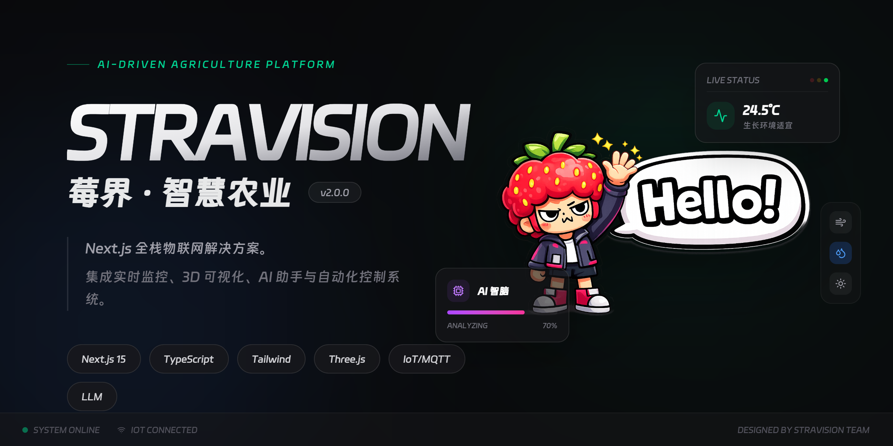

# Stravision 莓界 - 智慧农业物联网平台



[](https://opensource.org/licenses/Apache-2.0)
[](https://nextjs.org/)
[](https://www.typescriptlang.org/)
[](https://www.prisma.io/)
[](https://www.docker.com/)

## 项目简介

Stravision (莓界) 是一套面向现代农业生产场景的综合智能物联网管理系统。该平台深度融合物联网 (IoT)、人工智能 (AI) 与大数据分析技术，致力于为草莓种植及设施农业提供全链路的数字化解决方案。

通过构建“感知-分析-决策-控制”的闭环体系，Stravision 实现了农业环境的实时可视化监测、自动化精准调控以及基于大模型的智能种植辅助，有效解决了传统农业依赖经验、管理粗放、抗风险能力弱等痛点，推动农业生产向标准化、无人化和智能化转型。

官方网站：[https://stravision.cheesestrawberry.top/](https://stravision.cheesestrawberry.top/)

---

## 核心功能

### 1. 全栈环境感知与监控
平台通过多模态传感器网络，对温室大棚内的关键环境因子进行 7x24 小时实时监测：
*   **基础环境**：空气温度、空气湿度、光照强度、CO2 浓度。
*   **土壤状况**：土壤温度、土壤湿度、EC 值（电导率）、pH 值。
*   **视觉监控**：集成高清摄像头流媒体，支持远程实时查看作物生长状态。
*   **数据可视化**：提供直观的仪表盘（Dashboard）和历史数据趋势图，支持多维度数据分析。

### 2. 智能决策与自动化控制
基于预设的专家模型和实时环境数据，系统能够自动执行精准的调控策略：
*   **自动化规则引擎**：支持用户自定义触发条件（如“当温度高于 30°C 时”），自动执行设备动作。
*   **设备联动**：无缝对接水泵、风机、植物全光谱补光灯、遮阳网、卷膜机等各类农业设施。
*   **远程控制**：无论身在何处，用户均可通过 Web 端或移动端 App 对设备进行远程手动控制。

### 3. AI 农业助手 (Xiaozhi)
内置基于大语言模型 (LLM) 和检索增强生成 (RAG) 技术的智能助手：
*   **病害诊断**：通过上传作物照片，AI 可识别病虫害并提供防治建议。
*   **种植咨询**：提供基于农业知识库的实时问答，解答种植过程中的技术难题。
*   **自然语言交互**：支持通过语音或文字指令查询环境数据、控制设备（如“帮我打开排风扇”）。

### 4. 边缘计算与高可用性
*   **边缘节点支持**：关键控制逻辑可在边缘网关本地运行，确保断网情况下自动化任务仍能正常执行。
*   **数据安全**：采用端到端加密技术，保障农业生产数据与控制指令的传输安全。

---

## 技术架构

Stravision 采用现代化的前后端分离架构，确保系统的高性能、可扩展性与易维护性。

### 前端 (Frontend)
*   **框架**：Next.js 15 (App Router)
*   **语言**：TypeScript, React 19
*   **UI 组件库**：Tailwind CSS, Radix UI, Shadcn UI
*   **可视化**：ECharts, Recharts, React-Three-Fiber (3D 模型展示)
*   **状态管理**：Zustand, React Context

### 后端 (Backend)
*   **API**：Next.js Server Actions & API Routes
*   **数据库**：PostgreSQL
*   **ORM**：Prisma
*   **物联网协议**：MQTT (用于设备通信)
*   **AI 集成**：OpenAI SDK, Vercel AI SDK

### 部署与运维 (DevOps)
*   **容器化**：Docker, Docker Compose
*   **反向代理**：Nginx
*   **监控**：自定义日志与监控服务

---

## 快速开始

### 前置要求
在开始之前，请确保您的开发环境已安装以下工具：
*   Node.js (v18 或更高版本)
*   pnpm (推荐) 或 npm/yarn
*   Docker & Docker Compose (用于启动数据库和相关服务)

### 安装步骤

1.  **克隆仓库**
    ```bash
    git clone https://github.com/your-username/Stravision-IOT-PlatForm.git
    cd Stravision-IOT-PlatForm
    ```

2.  **安装依赖**
    ```bash
    pnpm install
    ```

3.  **配置环境变量**
    复制 `.env.example` 文件为 `.env`，并填入必要的配置信息（数据库连接、API 密钥等）。
    ```bash
    cp .env.example .env
    ```

4.  **启动数据库与基础设施**
    使用 Docker Compose 启动 PostgreSQL 和其他依赖服务。
    ```bash
    docker-compose up -d
    ```

5.  **数据库迁移**
    ```bash
    npx prisma migrate dev
    ```

6.  **启动开发服务器**
    ```bash
    pnpm dev
    ```

访问 [http://localhost:3000](http://localhost:3000) 即可查看运行中的应用。

---

## 项目结构

```text
Stravision-IOT-PlatForm
├── app/                  # Next.js 应用主目录 (App Router)
│   ├── (mobile)/         # 移动端适配路由
│   ├── api/              # 后端 API 接口
│   ├── dashboard/        # 控制台页面
│   └── ...
├── components/           # UI 组件库
│   ├── ui/               # 基础 UI 组件 (Shadcn UI)
│   └── ...
├── lib/                  # 工具函数与共享逻辑
│   ├── db/               # 数据库服务层
│   └── ...
├── prisma/               # Prisma 数据库 Schema 与迁移文件
├── public/               # 静态资源 (图片、3D 模型等)
├── docker-compose.yml    # Docker 编排文件
└── ...
```

---

## 许可证 (License)

本项目采用 [Apache License 2.0](LICENSE) 开源许可证。

Copyright (c) 2026 Stravision Team.

Licensed under the Apache License, Version 2.0 (the "License");
you may not use this file except in compliance with the License.
You may obtain a copy of the License at

    http://www.apache.org/licenses/LICENSE-2.0

Unless required by applicable law or agreed to in writing, software
distributed under the License is distributed on an "AS IS" BASIS,
WITHOUT WARRANTIES OR CONDITIONS OF ANY KIND, either express or implied.
See the License for the specific language governing permissions and
limitations under the License.
