<!-- README_SYNC: source=working-tree; updated=2026-10-27 -->

<p align="center">
  <a href="./README.md">简体中文</a> · English
</p>

<p align="center">
  <picture>
    <source media="(prefers-color-scheme: dark)" srcset="assets/readme/hero-dark.webp">
    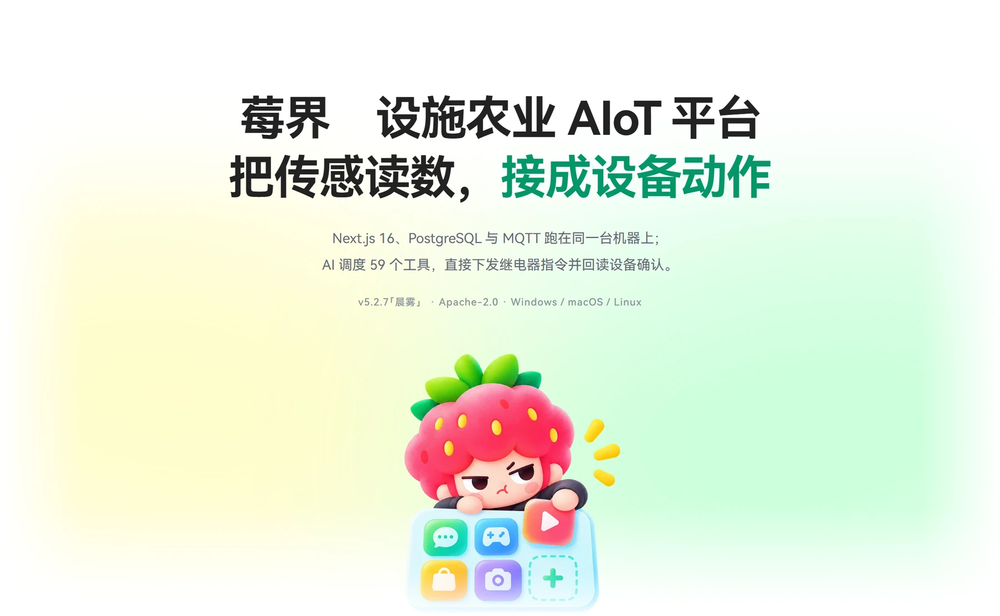
  </picture>
</p>

**An AIoT platform for controlled-environment agriculture. Sensor readings drive device actions directly — the model is a stage in the execution chain, not a chat window.**

<p align="center">
  If this project is useful to you, a Star helps you find it again and helps other growers and developers find it.
</p>

<p align="center">
  <a href="https://github.com/AcutaCM/BerryRealm-NewGen-AIOT-Platform/stargazers"></a>
  
  
  
  
  
  <a href="https://github.com/AcutaCM/BerryRealm-NewGen-AIOT-Platform/commits"></a>
</p>

- **Ships as a desktop bundle.** PostgreSQL, an MQTT broker, the Next.js app, speech and collaboration services are packaged into one installer and bind to loopback only.
- **The model performs physical actions.** 59 built-in tools cover devices, vision, data, medical records and documents. Relay (10 s), gimbal (90 s) and frame capture (20 s) each have independent timeouts, and every call returns device-confirmed state.
- **No ORM.** Hand-written SQL over `pg`; schema creation runs as 56 idempotent `CREATE TABLE IF NOT EXISTS` statements from the startup hook, and upgrades are additive.
- **Fully offline-capable.** Point the model at an OpenAI-compatible endpoint on the local network and the vision and chat paths never leave the site.

<p align="center">
  <picture>
    <source media="(prefers-color-scheme: dark)" srcset="assets/readme/hd01-dark.webp">
    
  </picture>
</p>

The data path in controlled-environment agriculture usually breaks in three places: readings are displayed but never used for decisions; control strategies live in one person's head and leave with them; and the step from detecting an anomaly to actually switching a device is a phone call.

This project closes those three gaps. Readings enter both the rule engine and the model context after landing in the database — one copy of the data, two consumers. Strategies become visual rule nodes that can be edited, reused and versioned. The model issues commands through tools and reads back the device-confirmed state instead of treating "sent" as done.

<p align="center">
  <picture>
    <source media="(prefers-color-scheme: dark)" srcset="assets/readme/hd02-dark.webp">
    
  </picture>
</p>

All screenshots below are from the running product, not redrawn. Numbers and error states are left as they appeared.

**Dashboard.** Today at a glance: temperature, humidity, light, CO₂, N-P-K, soil, spectrum and an hourly heatmap, with weather and to-dos pinned on top. Cold, dry and poor readings are labelled right on the cards — no mental arithmetic against thresholds — and when a sensor misbehaves, the number sits there as-is.

<p align="center">
  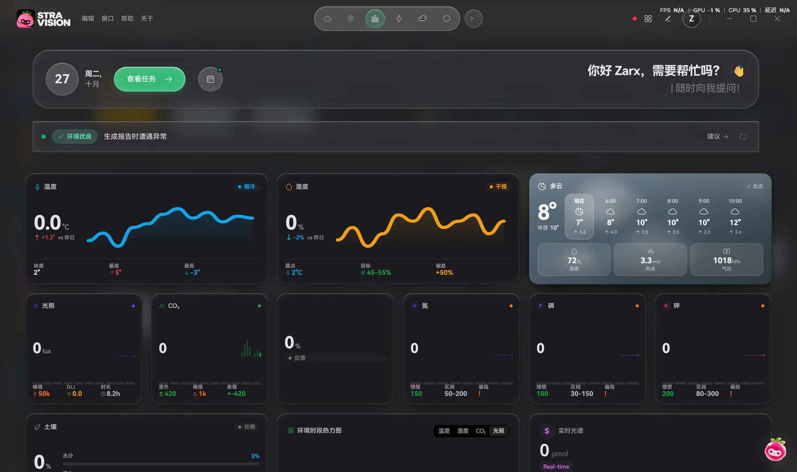
</p>

**Digital-twin monitoring.** The 3D greenhouse scene is the monitoring panel itself: cameras, sensors, fans and grow lights are clickable hotspots, device status and battery level sit on the left, and the operation log scrolls on the right.

<p align="center">
  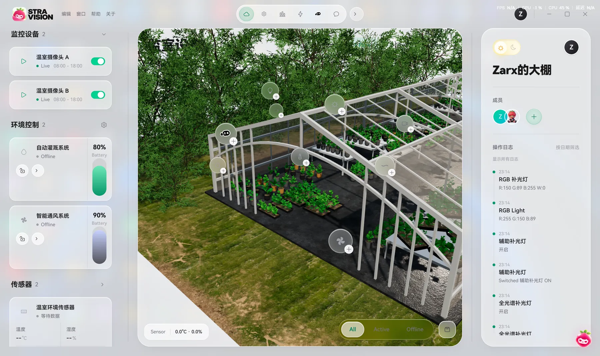
</p>

**Device control.** A roll-up of 9 devices: online / offline, alert count and today's operations at a glance. Relay cards switch remotely, the RGB grow light gets a colour picker with four sliders, and "update LED brightness" syncs it — weather and greenhouse readings hang on the right.

<p align="center">
  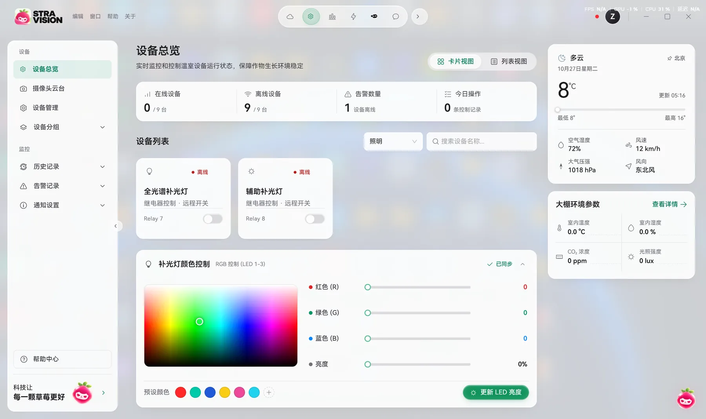
</p>

That is the platform itself. What follows is the main event — how the AI works on top of it.

**Device on / off.** Type "which devices are on right now? turn them off". The model loads the tool schema, calls `toggle_relay` twice, and stops at "device action · switch off relay 7" waiting for you to hit execute. A sent instruction is not a finished one — the relay state is read back before it counts.

<p align="center">
  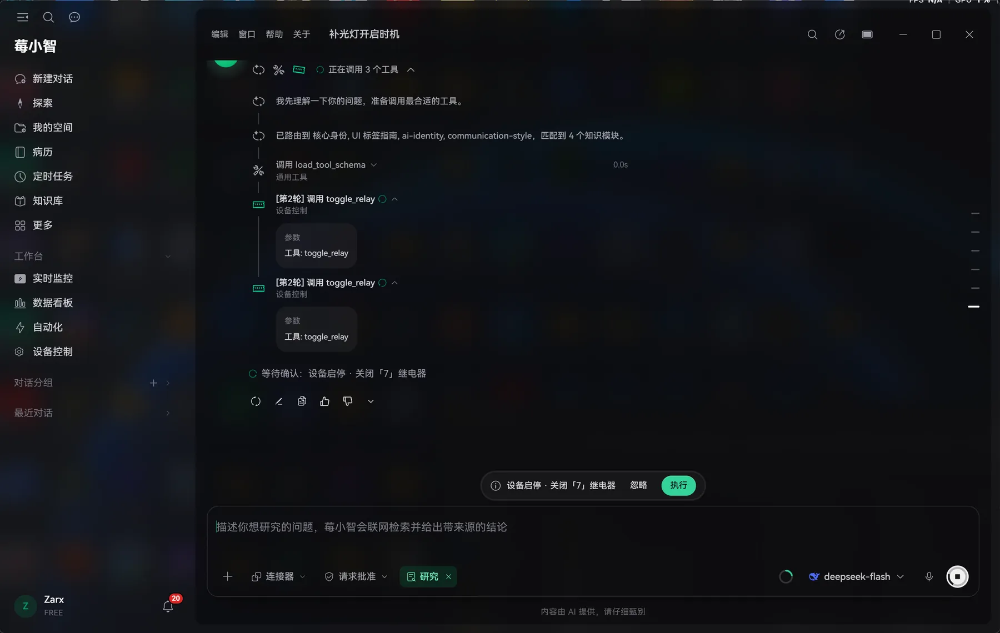
</p>

**Pest and disease diagnosis.** One photo of a strawberry, 12.4 seconds, powdery mildew at roughly 88% severity with three lesions located. Beyond the verdict: leaf appearance, lesion features and colour boundaries explained point by point against the image, then a five-step plan — what to pick, how to ventilate, what to spray.

<p align="center">
  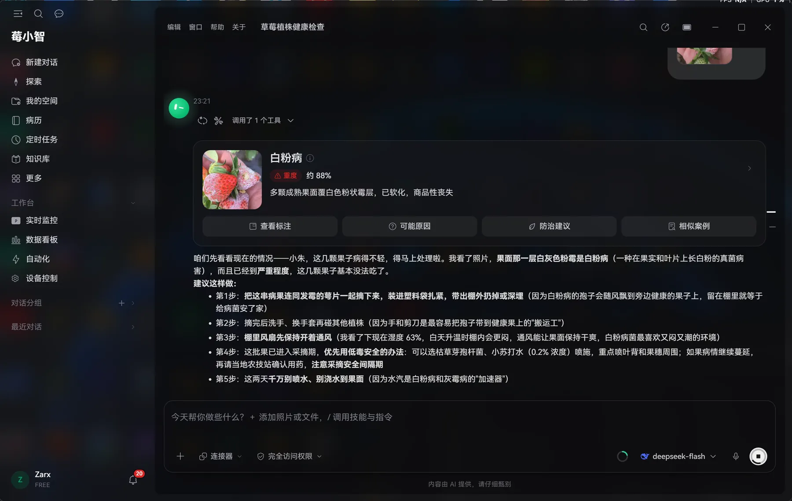
</p>

**Lesions marked on your own photo.** Hit "view annotations" and the outlines are drawn into the original image: three lesions, each labelled with its confidence (85% / 88% / 80%), switchable back to the raw photo and downloadable. Not a fresh diagram standing in for the real thing.

<p align="center">
  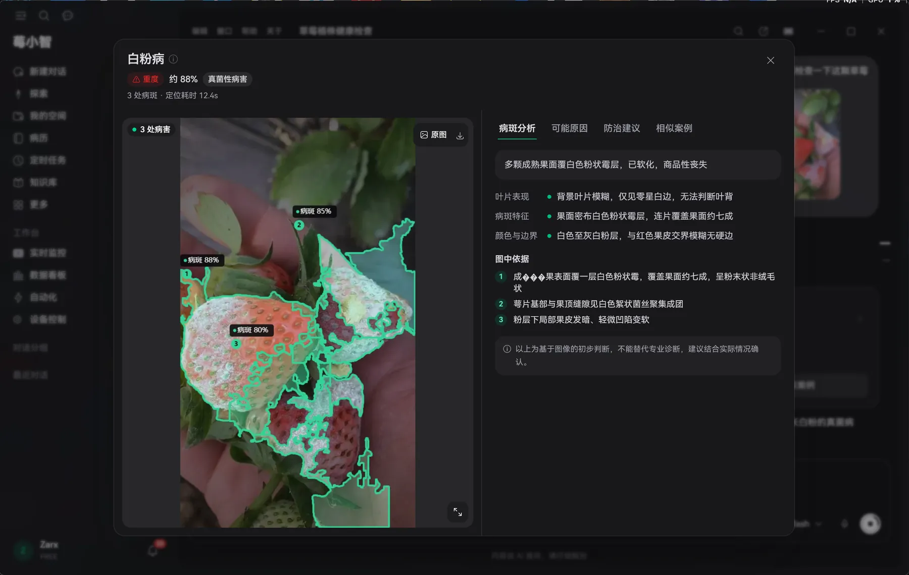
</p>

**Medical records.** A diagnosis is filed the moment it reaches a conclusion — disease name, severity, affected parts, thumbnail and the full diagnosis snapshot are kept, so you can replay what was seen two months later. After treatment, fill in a follow-up from the panel: cured / improved / unchanged / worse, plus a photo and a note. The status advances on its own and the course-of-disease curve grows with it.

<p align="center">
  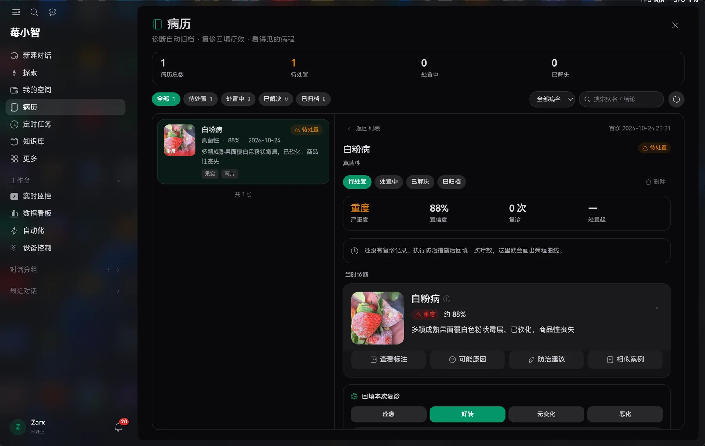
</p>

**The AI reads the real archive.** Ask "how many times have my strawberries been sick this cycle?" and it consults the archive before answering: #67 powdery mildew, severity 88%, first seen 10-24, zero follow-ups — then it says "so there is no cure rate to compute yet" instead of inventing a number. Say "mark it as cured" and the status moves from open to resolved, the note reads "user confirmed cured", and it tells you exactly what changed.

<p align="center">
  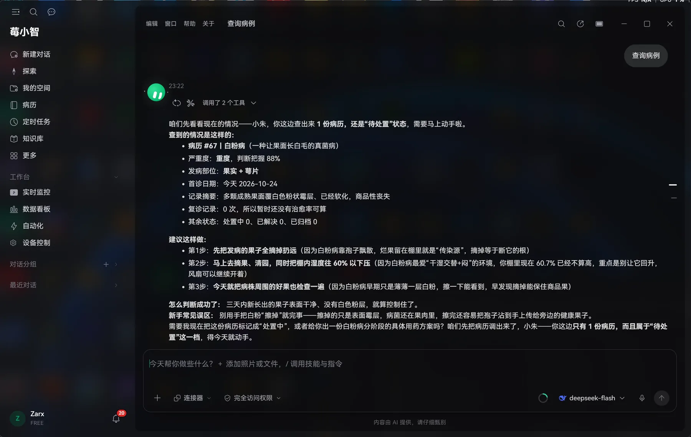
</p>

**Direct canvas editing.** Say "create a custom strategy"; the model asks for the trigger and the action, then draws the trigger, the condition and the execution branches straight into the flow you have open — `automation_canvas_apply` lands the nodes while a toast at the bottom reads "BerryXiao is editing the canvas". Afterwards it reminds you on purpose: not saved yet — hit Save if you like it, Ctrl+Z if you don't.

<p align="center">
  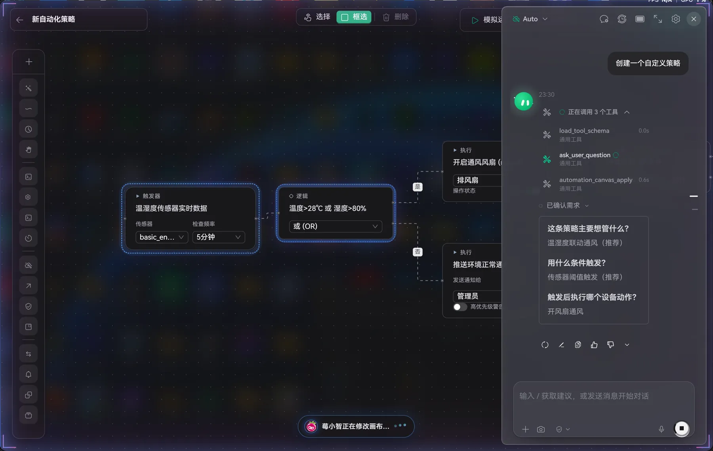
</p>

**Three ways to draw.** Decision procedures become flowcharts, symptom comparisons become science-education illustrations, lesion marks go back onto your photo. Mermaid for the chart, `<ILLU>` for the picture, detection masks for the annotation — the subject picks the tool; a new picture is never used to fob off "circle the lesions on my photo".

<p align="center">
  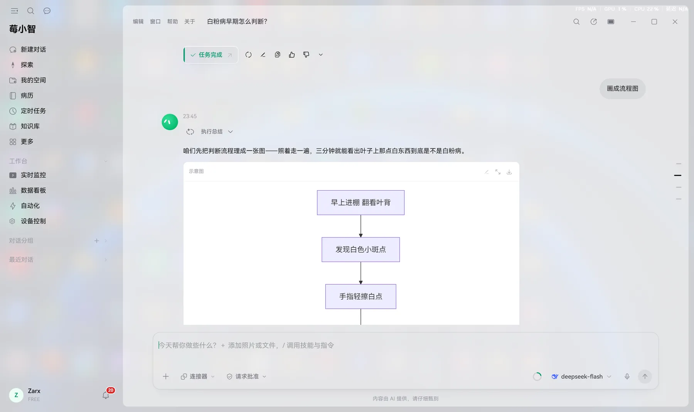
  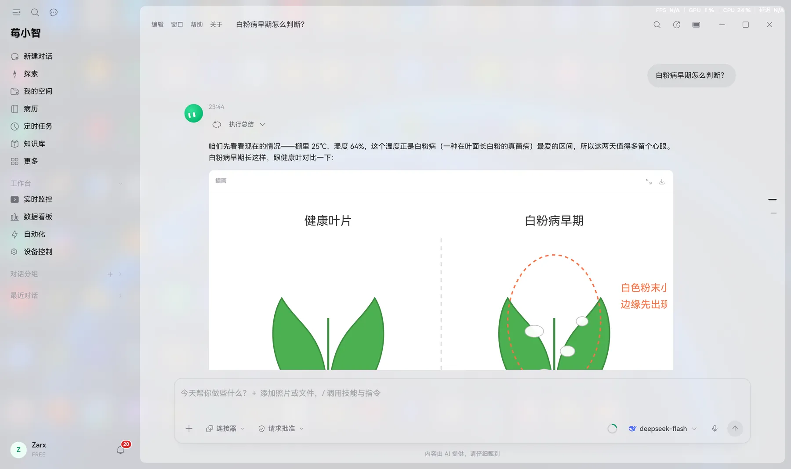
</p>

**Documents.** "Turn the existing data into a PPT report" → 8 tool calls, a 58.6 KB pptx, cover / chart page / bullet page previewed on the right — and it flags the data problem while it works: the latest soil-moisture reading is 2.8% from 25 days ago, N-P-K all zero, a sensor fault rather than a real value. Word is the same story: 13 KB, 8 chapters, table of contents and tables laid out, ready to download.

<p align="center">
  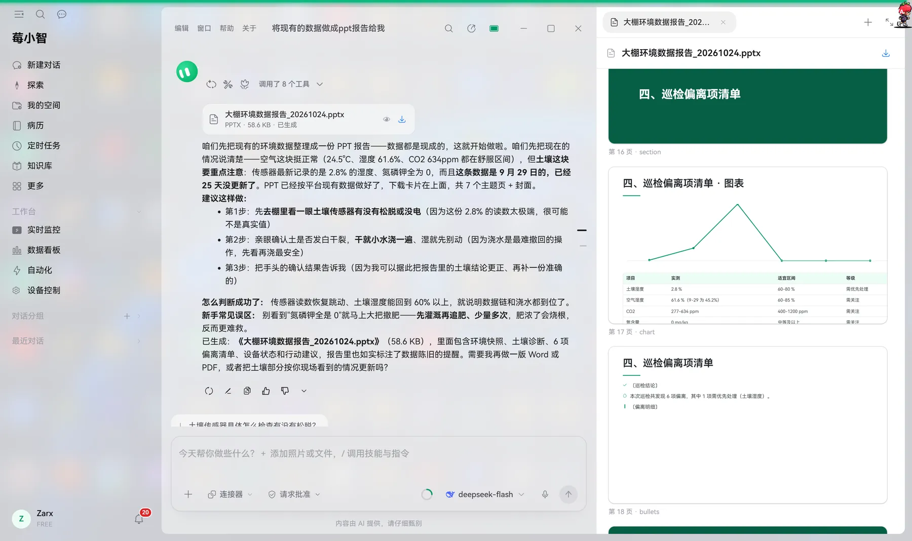
  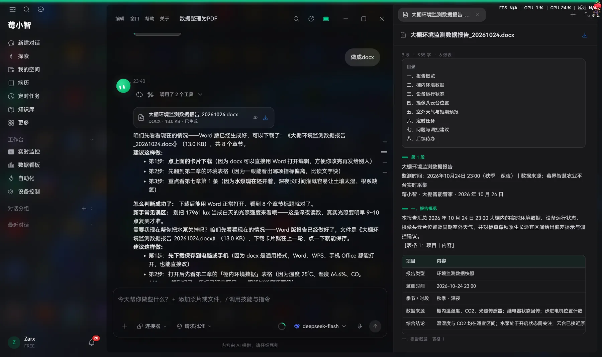
</p>

<p align="center">
  <picture>
    <source media="(prefers-color-scheme: dark)" srcset="assets/readme/hd03-dark.webp">
    
  </picture>
</p>

**Sense**　Air temperature/humidity, light, CO₂; soil temperature/humidity, EC, pH, N-P-K; 11-channel spectrum; camera feed and stepper gimbal (0–700 mm travel, scheduled frame capture).

**Decide**　Visual rule authoring (trigger / condition / action / AI decision nodes), scheduled jobs, proactive AI inspection; 59 built-in tools, plan mode, three personas, three memory tiers, real-time voice; the model can edit the rule canvas directly, and diagnoses file themselves into medical records.

**Act**　4 relays (pump, fan, grow light), 4 LED channels, stepper gimbal. Every command reads back a `confirmed` state.

**Retain**　Draggable dashboards, history trends, heatmaps, spectrum analysis, AI briefs; medical record archive (diagnosis snapshots, follow-up course, cure rate); knowledge base with vector search, versioning and permissions; multi-user real-time collaboration; in-browser Office editing; documents read / written / edited.

<p align="center">
  <picture>
    <source media="(prefers-color-scheme: dark)" srcset="assets/readme/hd04-dark.webp">
    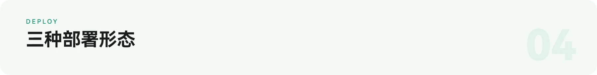
  </picture>
</p>

The primary delivery form is a desktop application, not a server. After a single-machine install, the database, message broker, app, speech and collaboration services all run locally with loopback-only ports.

- **All-in-one local** (primary) · Electron shell + embedded PostgreSQL 5433 + embedded MQTT 11883 + app 3000 + speech 3002 + collaboration 1234.
- **Centralised cloud** (optional) · multi-site management and remote operations, 7 containers: nginx 443 / web / db 5432 / yjs-ws 1234 / onlyoffice 8080 / cap / valkey 6379.
- **Development** · PostgreSQL + Node 22 + pnpm, `pnpm dev` on 3000.

Both production forms share the same business code and data model; only process layout, data location and licensing differ.

Offline, monitoring, history, device control, automation and alerting keep working; collaboration degrades to the LAN; vision and chat depend on where the model lives — point it at an OpenAI-compatible service inside the site network and the whole chain runs air-gapped, with web search as the only unavailable feature.

The desktop installer requires an activation code (Ed25519, verified offline; the app stays on the activation screen until activated). To build your own, use development mode or follow [docs/DESKTOP.md](docs/DESKTOP.md).

<p align="center">
  <picture>
    <source media="(prefers-color-scheme: dark)" srcset="assets/readme/hd05-dark.webp">
    
  </picture>
</p>

A chat request is an SSE stream on `/api/chat`: assemble system prompt, history, memory and tool definitions (trimmed against a budget) → stream model output that may carry tool calls → execute dependency-free tools in parallel → compact the results and feed them back → next turn. Five iterations per turn at most, then the loop is forced to close.

Four constraints live in code rather than in documentation:

- **Physical actions read back.** Relay, gimbal and capture have independent 10 s / 90 s / 20 s timeouts, and the result is device-confirmed state, not "sent".
- **Stop when unsure.** Missing information or a dangerous action suspends the turn for an answer; one pending checkpoint per session.
- **Compaction is visible.** Compressed context inserts a marker in the transcript, and failures are reported instead of silently dropping history.
- **Three memory tiers.** Short-term (recent actions), working (current goal), long-term (preferences, device patterns, strategies that worked) — long-term memory is readable and writable.

<p align="center">
  <picture>
    <source media="(prefers-color-scheme: dark)" srcset="assets/readme/ai-arch-dark.svg">
    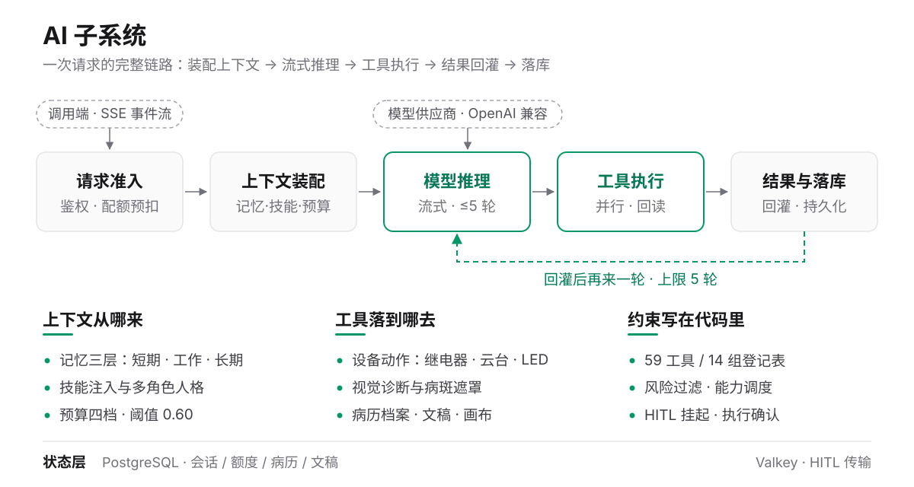
  </picture>
</p>

<p align="center">
  <picture>
    <source media="(prefers-color-scheme: dark)" srcset="assets/readme/hd06-dark.webp">
    
  </picture>
</p>

<p align="center">
  <picture>
    <source media="(prefers-color-scheme: dark)" srcset="assets/readme/icons-dark.svg">
    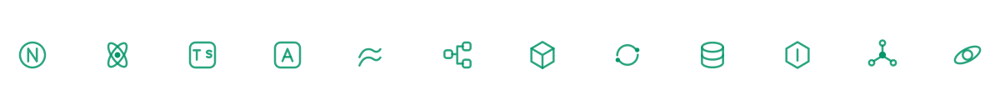
  </picture>
</p>

- **Frontend** Next.js 16.1.6 (App Router) · React 19.2.2 · TypeScript 5 · Ant Design 6.3.5 with Ant Design X 2.8 · Tailwind CSS 4 · React Flow 12.10 · Framer Motion 11 · three.js
- **Backend** Node.js 22 · PostgreSQL 16/18 (hand-written SQL over `pg`, no ORM) · MQTT 5 with an embedded `aedes` broker · Valkey (not a hard dependency)
- **AI** OpenAI-compatible protocol · `openai` 6 with Vercel AI SDK 5 · vision models · end-to-end speech with Silero VAD · local ASR (sherpa-onnx)
- **Desktop** Electron 44 · electron-builder 26 · embedded-postgres 18 · Ed25519 licensing · electron-updater
- **Quality** Vitest, Testing Library and fast-check (29 test files) · Playwright-driven UI acceptance against a real browser (145 scripts)

Choosing no ORM is deliberate: every telemetry write in an IoT workload would pay for a mapping layer, and connection-pool behaviour becomes harder to control. The schema only declares data sources and takes no part at runtime; table creation runs from the startup hook as 56 idempotent `CREATE TABLE IF NOT EXISTS` statements, and upgrades are additive only.

<p align="center">
  <picture>
    <source media="(prefers-color-scheme: dark)" srcset="assets/readme/hd07-dark.webp">
    
  </picture>
</p>

You need Node 22+, pnpm 10+ and a reachable PostgreSQL.

```bash
git clone https://github.com/AcutaCM/BerryRealm-NewGen-AIOT-Platform.git
cd BerryRealm-NewGen-AIOT-Platform
pnpm install

cp .env.example .env      # set DATABASE_URL; generate JWT_SECRET with openssl rand -hex 48
pnpm dev                  # → http://localhost:3000
pnpm dev:ws               # second terminal: speech and collaboration sockets
```

There is no migration step. The first `pnpm dev` creates tables, seeds 9 default devices and loads scheduled jobs; existing tables are skipped. AI variables may stay empty — the UI reports the model as unavailable and everything else keeps working.

<p align="center">
  <picture>
    <source media="(prefers-color-scheme: dark)" srcset="assets/readme/hd08-dark.webp">
    
  </picture>
</p>

In scope: receiving, storing and analysing sensor data; issuing commands and confirming state; visual recognition and diagnosis suggestions; model orchestration, tool dispatch and context management.

Out of scope: sensor firmware and acquisition hardware; the electrical implementation of relays and motor drivers; pesticide prescriptions and field operations; model training and fine-tuning.

Known limits:

- Diagnosis is an image-based preliminary judgement and does not replace an agronomist — the UI says so as well.
- No microservice split: the domain boundaries are clear, but the current team and deployment environment cannot absorb that operational load, so the system stays monolithic with a separate long-connection process.
- Three oversized files are queued for splitting: the assistant UI (7,495 lines), the chat API (4,025 lines) and the device console (3,828 lines).

## Documentation

- [TECHNICAL_MANUAL.md](TECHNICAL_MANUAL.md) — environment, architecture, AI pipeline, deployment (20 chapters)
- [docs/DESKTOP.md](docs/DESKTOP.md) — packaging, signing, licensing
- [docs/MQTT_DEVELOPMENT_MANUAL.md](docs/MQTT_DEVELOPMENT_MANUAL.md) — device onboarding
- [docs/SKILL_SYSTEM_GUIDE.md](docs/SKILL_SYSTEM_GUIDE.md) — skill system
- Everything else under [docs/](docs)

## Contributing

Issues and pull requests are welcome. Make sure `pnpm lint` and `pnpm test` pass before submitting; UI changes must use the existing design tokens rather than new accent colours or third-party icon sets; redact any secret-shaped values.

## License

Source code is released under the [Apache License 2.0](LICENSE). The desktop installer and activation-code system are separate from the source licence — read [docs/DESKTOP_LICENSE.md](docs/DESKTOP_LICENSE.md) before commercial use.

<p align="center">
  <sub><b>Stravision · BerryRealm</b>　Apache License 2.0　Copyright (c) 2026 Stravision Team</sub>
</p>
