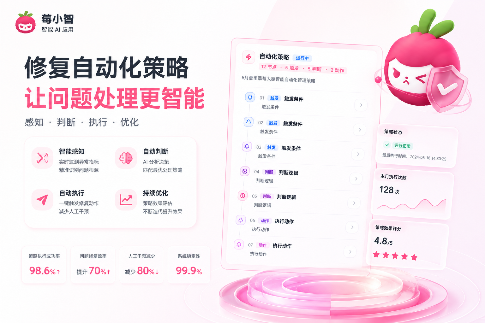
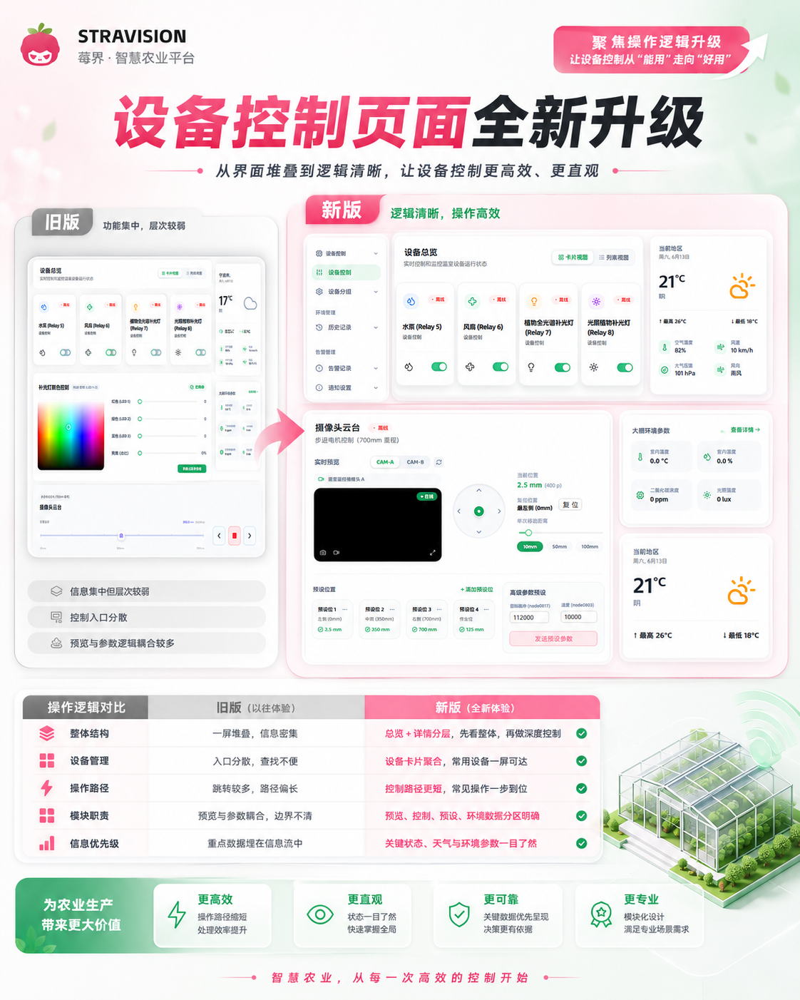

# Stravision 莓界 · Release Notes

> 一套面向现代农业生产场景的智能物联网管理系统。本文档汇总 v4.1.0 的主要更新与亮点。

<p align="center">
  <a href="https://opensource.org/licenses/Apache-2.0">
    
  </a>
  <a href="https://nextjs.org/">
    
  </a>
  <a href="https://www.typescriptlang.org/">
    
  </a>
  <a href="https://ant.design/">
    
  </a>
  <a href="https://www.prisma.io/">
    
  </a>
  <a href="https://www.docker.com/">
    
  </a>
</p>

<p align="center">
  
</p>

---

## v4.1.0 · Highlights

本次更新围绕「**AI 助手能力升级**、**A2UI 卡片协议**、**可视化自动化策略**、**我的空间沉淀**」四条主线展开。所有业务卡片从此共享同一套 A2UI Schema，AI 助手支持后台统一配置默认模型，我的空间让报告/记忆/任务一键沉淀，自动化策略编辑器带来节点式的新交互。

<p align="center">
  <table>
    <tr>
      <td align="center" width="25%"><b>1</b></td>
      <td align="center" width="25%"><b>2</b></td>
      <td align="center" width="25%"><b>3</b></td>
      <td align="center" width="25%"><b>4</b></td>
    </tr>
    <tr>
      <td align="center">AI 助手 UI</td>
      <td align="center">A2UI 协议</td>
      <td align="center">自动化策略</td>
      <td align="center">我的空间</td>
    </tr>
  </table>
</p>

---

## 1. AI 助手 UI 全面升级

<p align="center">
  
  <br/>
  <sub>Ant Design 主色统一 · 侧边栏浮卡 · 流式对话 · 自动选模</sub>
</p>

AI 助手完成端到端体验重构，重点优化侧边栏与会话区视觉一致性、流式输出体验和模型选择策略。

- **统一视觉语言** 会话区升级为顶层浮卡，12px 圆角、零阴影、悬浮于侧栏底色之上；侧栏背景透明，整体页面填充 `#f7f8fa` / `#0a0a0c` 主色。
- **侧边栏图标对齐** 插件/技能/MCP/应用/市场所有侧边栏入口的图标起点统一对齐，符合「对齐即秩序」的设计哲学。
- **流式思考链** 引入 `AgentThoughtChain`（@ant-design/x），思考过程可展开/收起；XMarkdown 关闭 `enableAnimation` 避免「Maximum update depth exceeded」。
- **Admin 可配置默认模型** AI 提供商管理新增「自动选择模型」卡片；PC + iOS 双端在刷新后自动回退到 admin 配置的 defaultModelId，校验写入必须是已启用的 provider 下的 enabled 模型。
- **去掉冗余星标** 动态模型选择器不再显示 Sparkles 图标，按钮字重 400，符合 Minimal Ant 风格。
- **A2UI 兜底渲染** 所有业务卡片统一接入 `BerryXCard` 组件，500ms 挂载超时回退到 `DirectRenderFallback`，避免空白等待。

> **关键文件** `app/ai-assistant/page.tsx` · `app/(mobile)/ai-assistant-ios/page.tsx` · `components/admin/ai-providers-manager.tsx` · `lib/hooks/use-ai-models.ts` · `lib/ai/provider-resolver.ts`

---

## 2. A2UI 卡片协议统一

<p align="center">
  
  <br/>
  <sub>统一 Catalog Schema · 业务卡片家族 · 类型安全 · 流式兼容</sub>
</p>

基于 `@ant-design/x-card` v0.9 封装统一 A2UI 协议 `berry-realm-catalog-v1`，所有业务卡片必须走该协议，禁止自定义样式与孤岛组件。

- **统一 Catalog** `lib/a2ui/berry-protocol.ts` 暴露 `BERRY_COMPONENTS`：`Column / Row / Stack / Card / CardHeader / Metric / StatusBadge / ActionButton / DeviceToggle / TaskList / TaskItem / DeviceCard / EnvironmentGauge / ScheduleItem`。
- **Schema 校验** 每个组件均声明 `properties` 与 `required`，由 A2UI 协议层做类型校验，杜绝「字段漂移」。
- **业务卡片家族** 任务计划 `berry-task-planner-catalog-v1`、自动化策略 `berry-automation-strategy-catalog-v1` 等专用 Catalog 复用 `berry-realm-catalog-v1` 的基础组件。
- **流式安全** 流式解析过程对 `<AUTOMATION_STRATEGY>` / `<TASK_LIST>` / `<SCHEDULE_TASK>` 等标签做 `pre-stash` 保护，JSON 内容不会被误判为外层任务列表。
- **视觉规范** 无渐变、无阴影、8px 圆角、Ant Design 主色 `#1677ff`，触发 = 蓝 / 逻辑 = 紫 `#722ed1` / 动作 = 绿 `#52c41a` / AI 节点 = 橙 `#fa8c16`。

> **关键文件** `lib/a2ui/berry-protocol.ts` · `components/ui/berry-xcard.tsx` · `lib/ai/prompt-templates.ts`

---

## 3. 可视化自动化策略

<p align="center">
  
  <br/>
  <sub>节点 · 边 · 触发 · 逻辑 · 动作 · AI · 一键保存与测试运行</sub>
</p>

把「if 温度 > 30 打开风机」式的自动化策略，升级为可视化的节点-边 DAG 编辑器。AI 助手能直接生成、保存、测试运行。

- **节点类型** 触发节点 `triggerNode` / 逻辑节点 `logicNode` / 动作节点 `actionNode` / AI 节点 `aiNode`，每个节点统一 `id` / `type` / `data.label` / `data.type`。
- **AI 一键生成** 用户在对话中描述需求，AI 输出 ` ```json ... ``` ` 代码块（包含 `nodes` / `edges`），前端实时解析渲染为 `AutomationStrategyCard`。
- **流式鲁棒性** 解析器在流式过程中实时检测未闭合的代码块、裸 JSON、JSON 不平衡等异常，统一降级为骨架卡片 + 「正在生成策略」加载态，绝不空白。
- **文本兜底** 当 AI 输出纯文本章节（策略说明 / 触发条件 / 诊断逻辑 / 动作执行 / AI 智能处理）时，`parseStrategyFromText` 自动按正则分章节重建节点 / 边。
- **保存与测试** 卡片底部内置「保存策略」主按钮 + 「测试运行」次按钮，写入后端 `/api/automation/rules` 并立即 dry-run。
- **协议保护** 自动化策略 JSON 通过 `pre-stash` 占位符 `00AUTO_BLOCK_N00` 保护，避免被 `TASK_LIST` JSON 过滤器误提取。

> **关键文件** `app/ai-assistant/_components/automation-strategy-card.tsx` · `app/api/automation/generate/route.ts` · `app/automation/editor/page.tsx` · `lib/automation/engine.ts`

---

## 4. 我的空间 · 报告与记忆的私人沉淀

<p align="center">
  
  <br/>
  <sub>侧边浮卡 · 报告列表 · 去重保存 · 一键召回到对话</sub>
</p>

把 AI 助手中的报告、记忆、任务统一沉淀到「我的空间」侧边面板，零层级跳转，随用随取。

- **布局规范** 严格遵循 `top-3 right-3 bottom-3 left-[272px]`（260 侧栏宽 + 12 gap）的固定定位，避免全屏覆盖。
- **极简风格** 圆角 12px、无阴影、半透明背景、Ant Design 主色高亮关键操作，与 AI 助手主区视觉一致。
- **报告管理** 一键「保存到我的空间」自动按报告 ID 去重，列表按时间倒序展示，支持删除与重命名。
- **召回对话** 点击列表中的报告，自动注入回当前会话上下文，实现「沉淀 - 复用」闭环。
- **任务面板** 定时任务、即时任务统一收纳，关联会话完成后自动归集。

> **关键文件** `components/ai/my-space-sidebar-panel.tsx` · `app/ai-assistant/page.tsx` · `lib/db/chat-service.ts`

---

## What's Changed

| 类别 | 内容 |
| --- | --- |
| **新增** | A2UI 统一协议 `berry-realm-catalog-v1` 与 `BerryXCard` 兜底渲染 |
| **新增** | 自动化策略可视化编辑器（节点 / 边 / 触发 / 逻辑 / 动作 / AI） |
| **新增** | 我的空间侧边面板（报告沉淀 / 召回 / 去重） |
| **新增** | Admin AI 提供商「自动选择模型」配置卡 |
| **优化** | AI 助手 UI 视觉与排版（侧栏浮卡 / 字体字重 / 图标对齐） |
| **优化** | 流式渲染鲁棒性（XMarkdown 关闭动画 / 标签 pre-stash / 文本兜底） |
| **修复** | 管理视图被 AnimatePresence 误隐藏的空白问题 |
| **修复** | 插件 / 技能管理图标加载失败导致浏览器 broken image 占位 |
| **修复** | 定时任务时间戳为秒级导致的 `NaN` 显示问题 |
| **修复** | 定时任务过期后被 2 分钟窗口误清理的问题 |
| **修复** | ScheduleTask JSON 被 `TASK_LIST` 过滤器误提取的问题 |

完整的文件级变更请参见 [`CHANGELOG.md`](./CHANGELOG.md)。

---

## Upgrade Notes

> **从 v4.0.x 升级到 v4.1.0**

1. **数据库无破坏性变更** `prisma migrate deploy` 后所有表结构兼容。
2. **新增 Admin 端点**
   - `GET  /api/admin/ai-providers/default-model` — 读取配置的默认模型
   - `PUT  /api/admin/ai-providers/default-model` — 写入 `{ modelId: string \| null }`
3. **新增强制约束** 所有业务卡片必须走 `BerryXCard` 与 A2UI 协议；自定义卡片需要先在 `lib/a2ui/berry-protocol.ts` 注册组件。
4. **环境变量** 无新增必填项；可选 `BERRY_DEFAULT_MODEL_ID` 兜底默认模型。
5. **依赖升级**
   - `next` → `16.1.6`
   - `react` / `react-dom` → `19.2.2`
   - `antd` → `6.3.5`
   - `@ant-design/x` → `2.8.0`
   - `prisma` / `@prisma/client` → `7.3.0`

```bash
# 升级步骤
pnpm install
pnpm prisma migrate deploy
pnpm build
pnpm start
```

---

## Compatibility

| 维度 | 兼容范围 |
| --- | --- |
| Node.js | ≥ 18（推荐 20 LTS） |
| pnpm | ≥ 10 |
| 浏览器 | Chrome 110+ / Edge 110+ / Safari 16.4+ / Firefox 115+ |
| 数据库 | PostgreSQL 14+ / SQLite（开发模式） |
| 移动端 | iOS 16+ / Android 10+（Web App） |

---

## Roadmap · v4.2.0 Preview

- 多温室 / 多基地集群管理
- 自动化策略版本与回滚
- 田间巡查 AR 标注
- 开放 API Gateway 与 Webhook
- 用户级模型覆盖（admin 全局默认 + 用户个人偏好）

---

## Acknowledgements

感谢所有为 **Stravision 莓界** 提交 Issue、PR、文档、测试与反馈的贡献者与农场伙伴。

> Made with care by the **Stravision Team** · 2026
