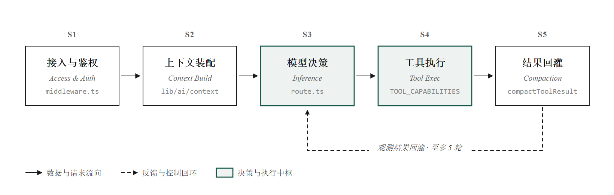
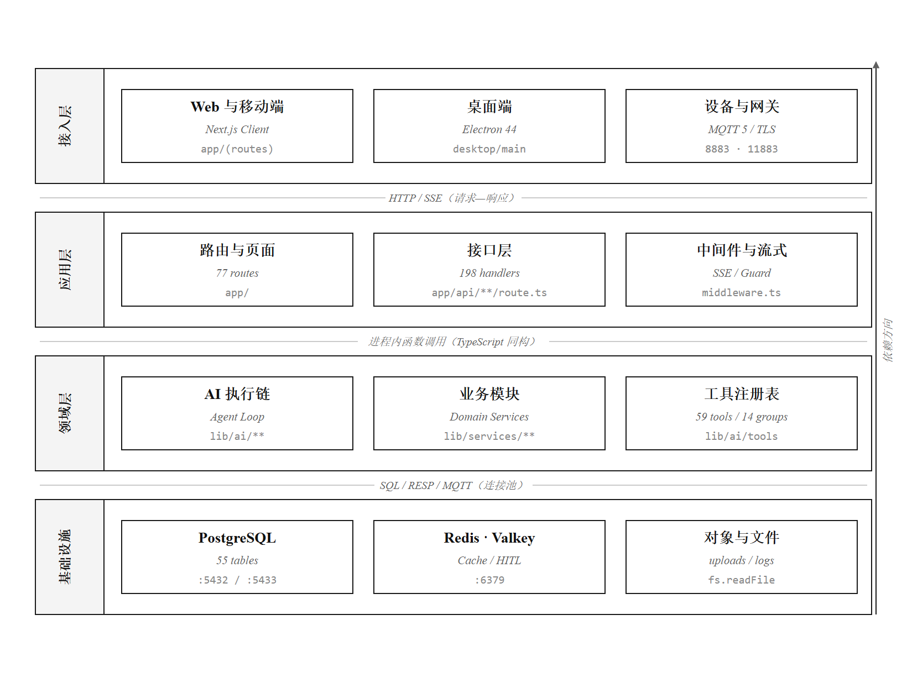
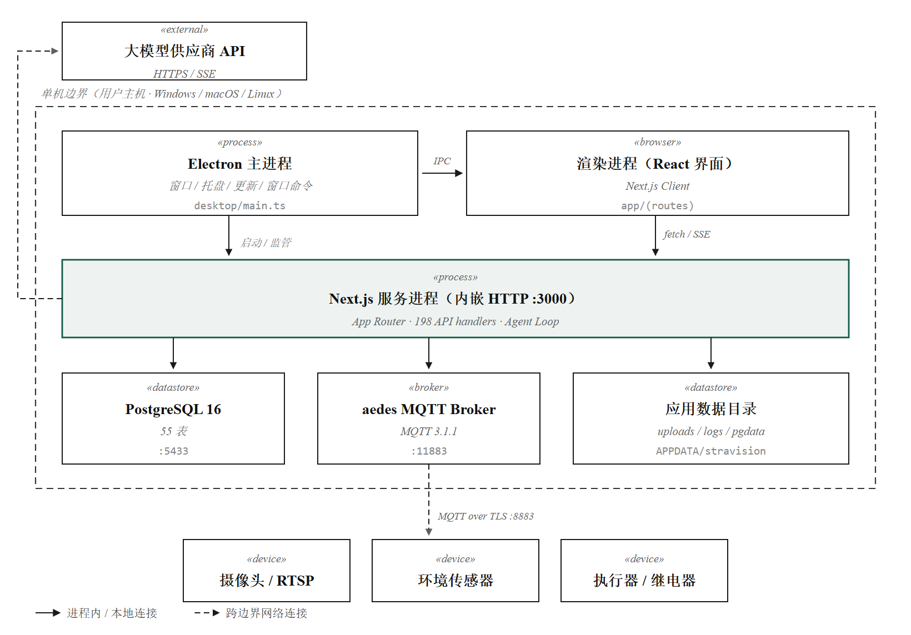
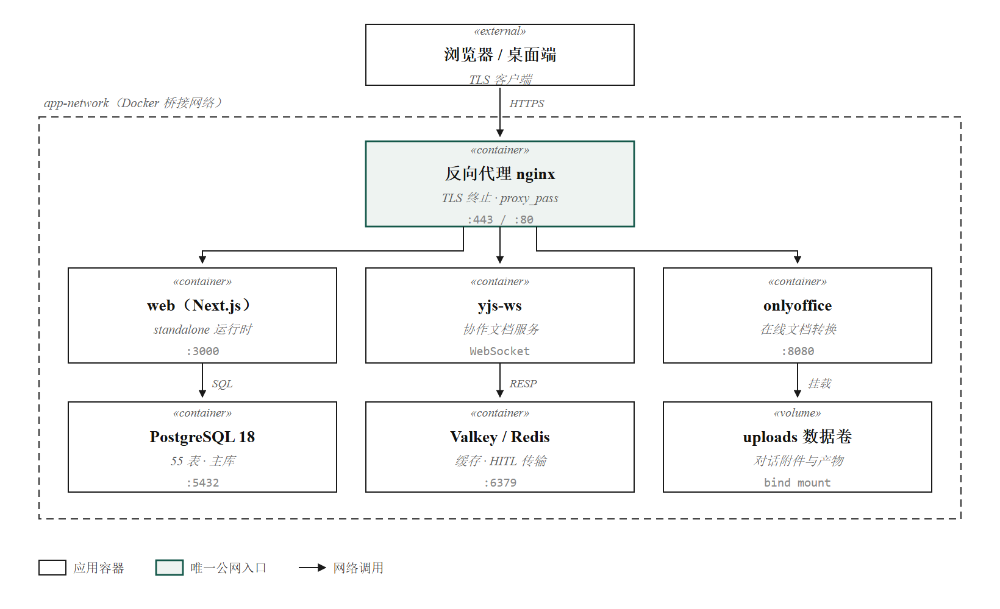
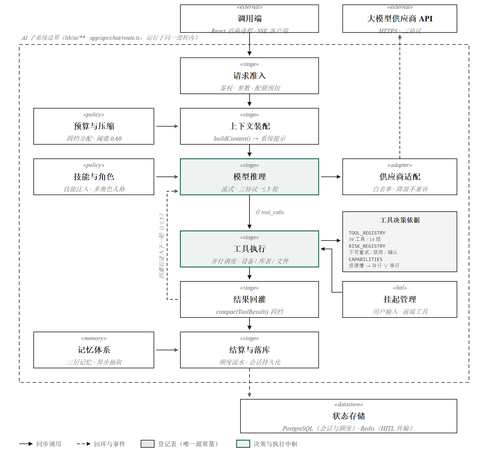
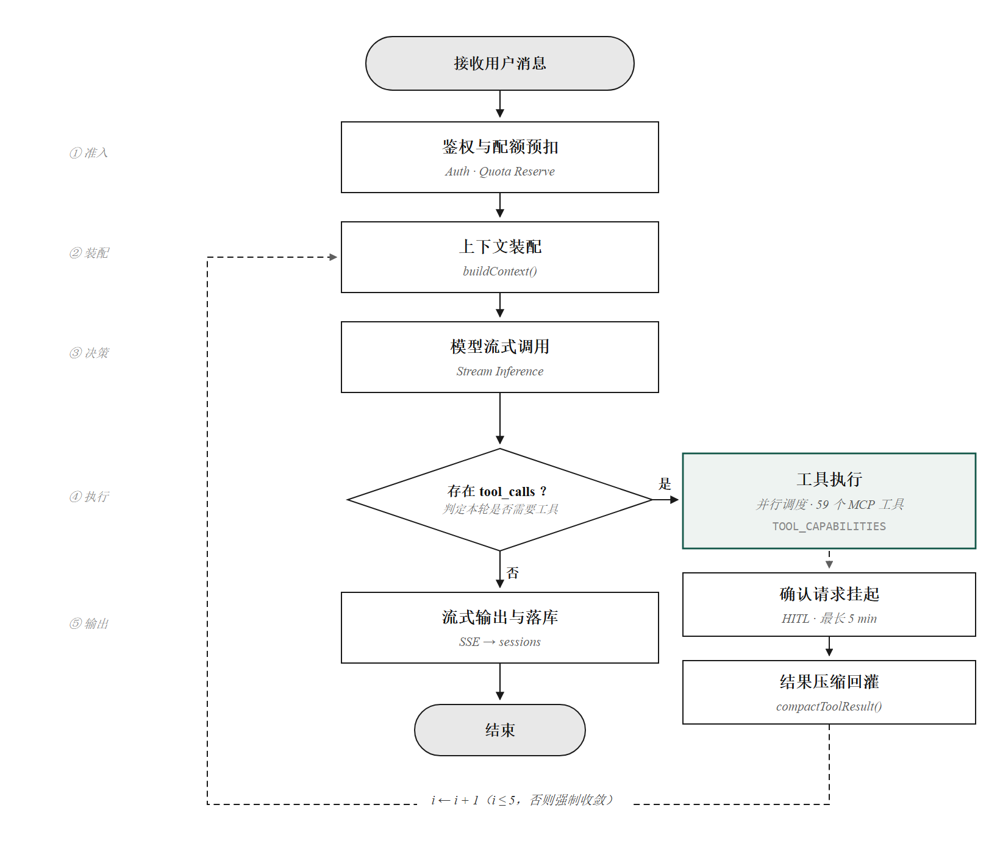
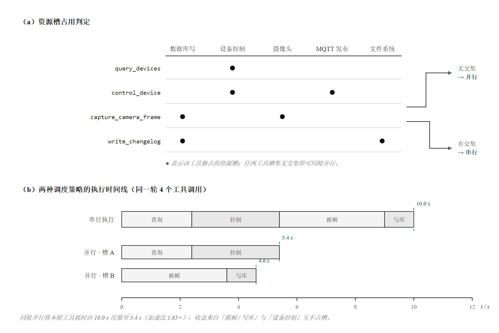
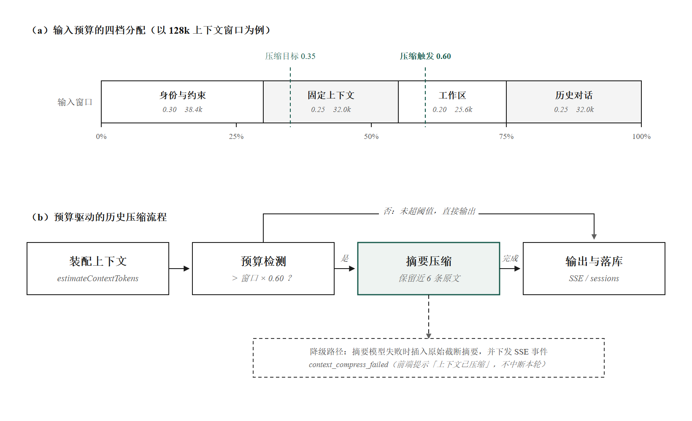

# Stravision 莓界 · 智慧农业一体化平台
## 技术手册

| 项 | 内容 |
| --- | --- |
| 文档名称 | Stravision 莓界 技术手册 |
| 适用系统 | berry-realm（平台代号：莓小智） |
| 软件版本 | 5.2.7 |
| 版本代号 | 晨雾 |
| 技术基线 | 2026 年 10 月 |
| 文档版本 | 2.0（评审版） |
| 密级 | 公开 |
| 编写 | 平台研发组 |

---

## 0. 文档说明

### 0.1 编写目的

本文档面向技术评审、系统验收与后续接手开发，完整描述 Stravision 莓界平台的技术实现，包括总体架构、技术选型、工程结构、数据模型、安全机制、业务模块、人工智能子系统、前端设计体系、接口规范、本地一体化部署与云端部署、测试体系与运维保障。

文档以代码实现为唯一事实来源。凡与代码不一致的表述，以代码为准。

### 0.2 目标读者

| 读者 | 建议阅读章节 |
| --- | --- |
| 技术评审专家 | 第 1、2、3、8、11、13 章 |
| 系统架构与开发人员 | 全文，重点第 2、4、5、7、8、9、10 章 |
| 部署与运维人员 | 第 2.4、11、12、14 章与附录 A |
| 产品与测试人员 | 第 1、7、11.2、13 章 |

### 0.3 名词与约定

| 名词 | 说明 |
| --- | --- |
| 本地一体化 | 平台以桌面应用形态交付，单机安装后内置数据库、消息代理与服务进程，无需外部服务器即可运行 |
| 云端集中 | 平台以容器集群形态部署，多站点、多组织共用一套服务与数据 |
| 莓小智 | 平台内置 AI 助手的产品名称 |
| Agent Loop | 大模型与工具之间的多轮"决策—执行—回灌"循环 |
| HITL | Human-In-The-Loop，AI 执行过程中挂起等待人工输入或确认 |
| 工具（Tool） | 供大模型调用的受控能力单元，如设备控制、视觉诊断、深度研究 |
| 上下文预算 | 单次请求可分配给系统提示、历史对话、工具结果的 token 上限 |
| 快照卡 | 摄像头抓帧后在对话流中渲染的图像卡片 |
| 交付物 | AI 产出的报告或代码产物 |
| 探针 | 通过真实浏览器驱动进行的自动化界面验收脚本 |

文档中所有路径均相对于工程根目录。文中标注"唯一来源"的模块，表示该概念在全平台只允许在此处定义，其他位置重复实现即视为缺陷。

---

## 1. 项目概述

### 1.1 建设背景

设施农业（温室、大棚）的日常管理长期依赖经验判断：环境参数分散在多个仪表，控制设备各自为政，病虫害识别依赖人工巡棚，历史数据难以形成决策依据。行业普遍存在三个断层：

1. **数据断层**：传感器数据只用于显示，未参与决策；
2. **决策断层**：调控策略存在于种植者经验中，无法沉淀与复用；
3. **执行断层**：从"发现异常"到"设备动作"需要人工中转，响应滞后。

Stravision 莓界以"感知—分析—决策—控制—沉淀"闭环为设计目标，将物联网数据、视觉识别、大模型推理与设备控制整合在同一系统内，使环境调控与农事决策可被自动执行、可被追溯、可被持续优化。



### 1.2 系统定位与交付形态

平台在架构上同时支持两种交付形态，并以本地一体化作为主要形态。

| 形态 | 适用场景 | 部署方式 | 依赖 |
| --- | --- | --- | --- |
| 本地一体化（主形态） | 单个园区、单栋温室、示范项目、无稳定公网的现场 | 桌面应用安装包，启动即用 | 无需外部服务器；数据库、消息代理、应用服务全部内置 |
| 云端集中（可选形态） | 多园区统一管理、多组织协作、远程运维 | 容器编排部署 | PostgreSQL、Nginx、缓存等由服务器提供 |

选择本地一体化作为主形态的原因：

1. **现场网络不可靠。** 农业现场普遍存在公网不稳定、带宽受限的情况，云端方案的可用性直接受制于网络质量。本地一体化将数据面与控制面全部下沉到现场设备，断网时监控、控制、自动化策略、历史数据查询均不受影响。
2. **数据主权与合规。** 生产数据、视频画面、诊断记录保留在园区本地，不上传第三方，降低数据出境与隐私风险。
3. **部署成本。** 无需公网地址、域名、证书与云服务器，安装即用，适合规模化复制到大量中小园区。
4. **可离线演进。** AI 能力既可接入公有云模型服务，也可指向园区内网部署的 OpenAI 兼容推理服务，形成完全离线的智能闭环。

两种形态共用同一套业务代码与数据模型，差异仅在于进程编排、数据存放位置与授权方式，因此功能一致、升级路径一致。

### 1.3 核心能力

| 能力域 | 具体内容 |
| --- | --- |
| 环境感知 | 空气温湿度、光照、二氧化碳；土壤温湿度、电导率、酸碱度、氮磷钾；11 通道光谱；摄像头画面 |
| 视觉巡检 | 云台步进控制、定时抓帧、基于视觉大模型的病虫害与长势识别、诊断病历经沉淀与复诊 |
| 设备控制 | 4 路继电器（水泵、风机、补光）、4 路 LED、步进云台（0 至 700 毫米行程），状态回读确认 |
| 自动化 | 可视化规则编排（触发、条件、动作、AI 决策节点）、定时任务、AI 主动巡检守护 |
| 智能助手 | 多轮对话、工具调用、计划模式、多角色人格、三层记忆、技能系统、语音实时对话 |
| 数据分析 | 可拖拽仪表盘、历史趋势、热力图、光谱分析、AI 简报与巡检报告 |
| 知识协作 | 知识库（分块、向量检索、版本、权限）、多人实时协同编辑、Office 文档在线编辑 |
| 组织与账号 | 三级角色、组织与温室层级、设备级授权、四类第三方登录（微信、企业微信、QQ、支付宝）与邮箱验证 |
| 商业与运营 | 会员档位、AI 额度与积分结算、桌面端授权码与租约 |

### 1.4 关键指标

| 指标 | 数值 | 说明 |
| --- | --- | --- |
| 业务代码规模 | 253,703 行（TypeScript / TSX） | app、lib、components 三目录合计 |
| 接口数量 | 198 个 | 接口路由处理器 |
| 页面数量 | 77 个 | 含移动端路由组 |
| 数据表 | 55 张 | 48 张由初始化脚本创建，7 张由业务服务自建 |
| 内置工具 | 59 个 | 14 组内置服务，另有外部工具接入 |
| 自动化测试 | 29 个测试文件，约 389 处断言 | Vitest |
| 界面验收脚本 | 145 个 | 真实浏览器驱动 |
| 单轮 AI 迭代上限 | 5 轮 | 由预算模块统一约束 |
| 设备控制超时上限 | 继电器 10 秒、云台 90 秒、抓帧 20 秒 | 均为上限值，实际动作更快 |

### 1.5 系统边界

| 属于本系统 | 不属于本系统 |
| --- | --- |
| 传感器数据的接收、存储、展示与分析 | 传感器硬件固件与采集电路 |
| 设备控制指令的下发与状态确认 | 继电器、电机驱动器的电气实现 |
| 视觉识别与诊断建议 | 农药处方与农事作业执行 |
| 大模型编排、工具调度、上下文管理 | 大模型本身的训练与微调 |
| 知识库构建、检索、协同编辑 | 第三方文档服务本身的维护（办公套件以容器方式集成） |

---

## 2. 总体架构

### 2.1 分层结构

系统自上而下分为四层，层间通过明确接口通信，不跨层直接访问。

| 层次 | 组成 | 职责 |
| --- | --- | --- |
| 接入层 | 反向代理（云端）或应用主进程（本地） | 传输加密、静态资源、反向代理、进程编排、窗口与权限管理 |
| 应用层 | Next.js 应用框架 | 页面渲染、198 个接口、全局守卫与限流 |
| 领域层 | 人工智能、工具、数据、调度、设备、安全等模块 | 业务规则、AI 编排、数据访问、设备协议、鉴权 |
| 基础设施层 | PostgreSQL、MQTT 代理、缓存（可选）、文件系统 | 持久化、消息、缓存、文件存储 |

跨层约束：

- 应用层不得直接拼接 SQL，一律经领域层的服务函数访问数据；
- 领域层不得感知 HTTP 语义，不读写请求对象；
- 基础设施层的连接由领域层以单例方式管理，避免多实例与连接泄漏。



### 2.2 本地一体化形态（主形态）

本地一体化由应用主进程担任编排器，按固定顺序拉起四类服务进程，全部运行在同一台终端上。

**进程与端口分配**

| 进程 | 端口 | 职责 | 启动方式 |
| --- | --- | --- | --- |
| 应用主进程 | 无 | 窗口、菜单、通知、授权校验、进程看护、自动更新 | 安装包启动 |
| 数据库（内置） | 5433 | 业务数据库，数据目录位于用户数据区 | 主进程拉起内置数据库组件 |
| 消息代理（内置） | 11883 | 局域网内设备接入，可切换为外部代理 | 主进程拉起内置代理 |
| 应用服务 | 3000 | 页面与接口，含事件流接口 | 主进程拉起独立服务进程 |
| 语音服务 | 3002 | 实时语音对话通道 | 主进程拉起 |
| 协同服务 | 1234 | 知识库多人协同编辑 | 主进程拉起 |

端口均绑定本机回环地址，不对外暴露。设备通过局域网连接内置消息代理，因此现场无需公网。



**启动顺序**

1. 加载应用修复层，解决打包后子进程调用异常；
2. 校验应用资源完整性，包括前端产物、服务端产物与外部可执行文件；
3. 建立可写目录映射，安装目录通常只读，运行期写入重定向到用户数据区；
4. 读取本地配置与密钥，缺失则进入首次配置向导；
5. 授权校验，未授权进入激活界面，校验失败直接退出；
6. 启动内置数据库，并接管上一次异常退出遗留的数据库进程；
7. 启动内置消息代理，或连接已配置的远程代理；
8. 启动应用服务、语音服务、协同服务；
9. 轮询健康检查接口，最长等待 180 秒，就绪后显示主窗口。

健康检查未通过时，主进程不直接退出，而是展示诊断界面，列出各子进程状态与最近日志，供现场人员截图反馈。

### 2.3 云端集中形态（可选）

云端形态以容器编排实现，七个服务处于同一桥接网络。

| 服务 | 职责 | 对外暴露 |
| --- | --- | --- |
| 反向代理 | 传输加密、反向代理、静态缓存、维护页 | 80 / 443 |
| 应用服务 | 页面、接口与语音服务 | 仅内网 3000 / 3002 |
| 数据库 | PostgreSQL | 仅内网 5432 |
| 协同服务 | 协同编辑 | 仅内网 1234 |
| 办公套件 | Office 文档在线编辑 | 8080 |
| 验证服务 | 人机行为验证 | 仅本机回环 |
| 缓存 | 验证码存储与跨实例挂起传输 | 仅内网 6379 |

缓存服务被刻意设置为非强依赖：应用在缓存不可用时自动退化为进程内实现，不阻塞启动。



### 2.4 启动时序与初始化

无论哪种形态，应用服务的启动钩子都执行同一套幂等初始化：

1. 连接数据库，执行建表与索引语句，已存在则跳过；
2. 写入默认设备注册表，幂等；
3. 装载数据库中的定时任务；
4. 注册每日数据清理任务，每日零点执行；
5. 注册 AI 主动巡检任务，默认每 10 分钟执行一次，可由环境变量调整。

初始化失败时记录日志并跳过后续定时任务注册，应用服务仍可提供只读页面，但不执行任何定时逻辑。该设计保证数据库故障不导致整个系统不可用，同时使故障原因在日志中一目了然。

### 2.5 一次请求的处理过程

以页面请求为例：

1. 接入层完成传输加密与路由分流；
2. 全局守卫判断登录态、角色、限流与维护模式；
3. 根布局在服务端完成访问日志记录与地址封禁检查；
4. 页面组件渲染，客户端按需请求接口；
5. 需要实时数据的场景建立事件流或长连接；
6. 接口层完成鉴权、参数校验、调用领域层、返回 JSON。

以 AI 对话请求为例，处理过程见 8.2 节。

### 2.6 实时通道

| 通道 | 端点 | 协议 | 用途 |
| --- | --- | --- | --- |
| 事件流 | /api/chat | 服务端事件流 | AI 逐字输出、工具事件、上下文用量 |
| 事件流 | /api/mqtt/stream | 服务端事件流 | 传感器实时读数 |
| 事件流 | /api/knowledge/activity | 服务端事件流 | 知识库协作动态 |
| 长连接 | /ws/voice | 二进制音频帧与 JSON 控制帧 | 实时语音对话 |
| 长连接 | /ws/yjs | 协同编辑协议 | 文档多人编辑 |

事件流格式为 `data: {JSON}`，以 `data: [DONE]` 结束，空闲期间每 5 秒发送一次注释帧保活，避免中间代理因空闲断开连接。反向代理必须对该类路径关闭缓冲与分块编码转换，否则表现为回答中途停顿、最后一次性输出。

---

## 3. 技术选型

### 3.1 前端

| 类别 | 选型 | 版本 | 选用理由 |
| --- | --- | --- | --- |
| 框架 | Next.js（App Router） | 16.1.6 | 服务端渲染与接口同栈，减少一层服务；原生支持流式输出 |
| 运行时 | React | 19.2.2 | 与服务端组件模型配套 |
| 语言 | TypeScript | 5.x | 严格模式，接口与数据模型可获得静态校验 |
| 组件库 | Ant Design | 6.3.5 | 企业级组件完备，表单、表格、弹层能力成熟 |
| 对话组件 | Ant Design X | 2.8.0 | 气泡列表、会话管理、代码块渲染开箱可用 |
| 样式 | Tailwind CSS | 4.x | 配置内置于样式文件，设计令牌集中管理，产物按需生成 |
| 原子组件 | Radix UI 与通用规范 | 1.x | 无样式、可访问性完备，便于统一视觉 |
| 流程编排 | React Flow | 12.10 | 自动化规则可视化编辑 |
| 图表 | 自研三件套与图表库 | 无 | 自研图表保证主题一致，复杂图表使用成熟库 |
| 动效 | Framer Motion、GSAP | 11 / 3 | 页面过渡与滚动叙事 |
| 平滑滚动 | Lenis | 0.0.47 | 统一滚动体验 |

### 3.2 后端

| 类别 | 选型 | 版本 | 选用理由 |
| --- | --- | --- | --- |
| 运行时 | Node.js | 22 | 与前端同语言，流式与长连接处理成熟 |
| 数据库 | PostgreSQL | 16 / 18 | 支持 JSON、全文检索、部分索引 |
| 数据访问 | node-postgres | 8.18 | 直连加手写 SQL，物联网高频写入可控，无隐式查询放大 |
| 消息协议 | MQTT 5 | 5.14 | 物联网事实标准，弱网适应性好 |
| 内置代理 | aedes | 1.1 | 纯 Node 实现，可随桌面端内置 |
| 缓存 | Redis 或 Valkey | 6 / 9 | 仅用于跨实例挂起状态与验证码，非核心路径 |
| 认证 | jose、bcryptjs | 6 / 3 | 令牌签名验签与口令哈希 |
| 校验 | Zod | 4 | 请求体与配置的结构化校验 |
| 调度 | node-cron、cron-parser | 4 / 5 | 进程内定时，无外部依赖 |
| 文档处理 | docx、mammoth、pdf-data-parser、xlsx | 无 | 报告导出与文档解析 |
| 邮件 | Resend | 6.7 | 事务邮件投递 |

### 3.3 人工智能

| 类别 | 方案 | 说明 |
| --- | --- | --- |
| 上游协议 | OpenAI 兼容协议 | 覆盖公有云模型服务与内网自建推理服务 |
| 开发工具包 | openai、Vercel AI SDK | 流式解析与工具调用 |
| 视觉 | 多模态大模型 | 图像诊断，支持候选模型链与超时均分 |
| 语音 | 端到端多模态实时模型 | 16 千赫兹 PCM 双向流，支持打断 |
| 语音活动检测 | Silero（浏览器端） | 本地推理，静音 150 毫秒断句 |
| 向量 | 文本嵌入模型 | 知识库分块向量化与相似检索 |

平台不绑定单一供应商：模型通过供应商与模型两级配置管理，支持为不同用途（对话、视觉、摘要、嵌入）指定不同模型，并支持用户自带密钥。

### 3.4 桌面与应用外壳

| 类别 | 选型 | 说明 |
| --- | --- | --- |
| 外壳 | Electron 44 | 跨平台、生态成熟、可内置本地服务 |
| 打包 | electron-builder 26 | 生成安装包与自动更新元数据 |
| 内置数据库 | embedded-postgres | 免安装 PostgreSQL，数据目录随应用迁移 |
| 内置代理 | aedes | 局域网设备直连 |
| 授权 | Ed25519 签名租约 | 离线可验签，支持吊销 |
| 更新 | electron-updater | 通用源，静默下载，重启生效 |
| 代码保护 | javascript-obfuscator 与 Electron Fuses | 混淆主进程代码，关闭调试通道 |

### 3.5 运维与质量

| 类别 | 方案 |
| --- | --- |
| 容器化 | 多阶段构建与容器编排 |
| 反向代理 | Nginx，负责传输加密、事件流、长连接、静态缓存 |
| 健康检查 | /api/health 分级探活，区分正常、降级、不可用 |
| 日志 | 容器标准输出滚动 10MB 三份，另写入数据库审计表 |
| 单元测试 | Vitest、Testing Library、fast-check |
| 界面验收 | Playwright 驱动真实浏览器，针对真实组件量测 |

### 3.6 未采用的方案及原因

| 方案 | 未采用原因 |
| --- | --- |
| 对象关系映射框架 | 物联网场景每条消息均写库，映射层带来额外开销，且连接池行为不易精确控制。工程中的 schema 文件仅保留数据源声明，不参与运行 |
| 微服务拆分 | 领域边界虽清晰，但团队规模与部署环境不支持相应运维复杂度；当前采用单体加独立长连接进程的折中方案 |
| 全站服务端渲染 | 设备控制、监控、AI 助手均为强交互页面，客户端渲染更利于状态管理与实时更新 |
| 强传染性许可证的视觉框架 | 许可证要求衍生作品同样开源，与产品分发方式冲突，全面禁用 |
| 通用工作流引擎 | 农业规则以条件动作为主，自研编排更贴合设备协议且易于嵌入 AI 节点 |

---

## 4. 工程结构

### 4.1 目录组织

```
berry-realm-v4.0/
├── app/                    应用层：页面、接口、全局样式
│   ├── api/                198 个接口路由
│   ├── (mobile)/           移动端路由组
│   ├── ai-assistant/       AI 助手主界面
│   ├── dashboard/          可拖拽仪表盘
│   ├── device-control/     设备控制台
│   ├── monitor/            实时监控
│   ├── automation/         自动化规则与编辑器
│   ├── kb-store/           知识库与协作
│   ├── admin/              管理后台
│   ├── layout.tsx          根布局与全局提供者
│   └── globals.css         设计令牌与全局样式
├── components/             展示层组件，共 410 个
│   ├── ui/                 基础原子组件
│   ├── ai/ chat/ device/   业务组件
│   ├── charts/             图表三件套
│   └── icon.tsx            图标唯一来源
├── lib/                    领域层，共 221 个模块
│   ├── ai/                 AI 编排、上下文、工具、记忆、挂起、视觉
│   ├── mcp/                工具定义与执行器
│   ├── db/                 数据服务，共 25 个服务模块
│   ├── scheduler/          定时调度
│   ├── voice/ xiaozhi/     语音
│   └── automation/         规则引擎
├── server/                 语音长连接服务
├── ws-server/              协同编辑长连接服务
├── desktop/                应用外壳主进程与打包配置
├── scripts/                构建、打包、运维脚本
├── nginx/                  反向代理配置与维护页
├── data/                   运行期数据
├── public/                 静态资源
├── Dockerfile              云端镜像定义
├── docker-compose.yml      云端编排定义
├── proxy.ts                全局守卫与限流
├── instrumentation.ts      启动钩子
└── next.config.ts          构建与安全响应头配置
```

### 4.2 分层职责

| 目录 | 允许依赖 | 禁止事项 |
| --- | --- | --- |
| app/ | components、lib | 直接写 SQL、直接连消息代理 |
| components/ | lib 中的纯函数与类型 | 发起服务端数据写入 |
| lib/db/ | 数据库连接模块 | 依赖 HTTP 请求对象 |
| lib/ai/ | lib/db、lib/mcp、视觉模块 | 直接操作页面状态 |
| lib/mcp/ | lib/db、设备服务、外部服务 | 直接渲染界面 |

### 4.3 关键模块索引

| 关注点 | 位置 | 说明 |
| --- | --- | --- |
| 全局守卫 | proxy.ts | 登录态、角色、限流、维护模式 |
| 启动钩子 | instrumentation.ts | 数据库初始化、种子数据、定时任务 |
| 数据库定义 | lib/db/database.ts | 连接池、建表语句、索引、列迁移 |
| AI 主循环 | app/api/chat/route.ts | 多轮决策与工具调度 |
| Agent 编排 | lib/ai/agent-orchestrator/ | 工具管理、记忆管理、监控告警 |
| 预算与风险 | lib/ai/agent-budget.ts | 迭代次数、超时、工具风险登记 |
| 并行判定 | lib/ai/tool-capabilities.ts | 工具读写资源声明 |
| 上下文工程 | lib/ai/context/ | 预算分配、token 估算、压缩 |
| 工具定义 | lib/mcp/mcp-tool-definitions.ts | 59 个工具的结构描述 |
| 挂起管理 | lib/ai/hitl/ | 进程内与跨实例两种传输 |
| 设备协议 | lib/mqtt-service.ts | 订阅、报文、控制指令 |
| 调度 | lib/scheduler/runner.ts | 周期任务与一次性任务 |
| 设计令牌 | app/globals.css | 颜色、圆角、字号、间距 |
| 图标 | components/icon.tsx | 248 个具名图标 |
| 应用主进程 | desktop/main.js | 启动编排、授权、通知、更新 |

### 4.4 AI 子系统结构

```
lib/ai/
├── agent-orchestrator/       编排器、工具管理、记忆管理、监控、告警
├── agent-loop/               响应过滤，清理裸数据结构与旧指令
├── agent-budget.ts           迭代次数、超时、工具风险登记，唯一来源
├── tool-capabilities.ts      工具资源声明与并行判定，唯一来源
├── context/                  预算、上下文构建、偏好、历史压缩、估算、结果压缩
├── hitl/                     挂起类型、传输实现、实例管理
├── skill-system/             技能加载、匹配、注入
├── vision/                   视觉网关、提示词、相似病例
├── provider-resolver.ts      模型与供应商解析
├── provider-body-adapter.ts  上游请求体白名单、图片降级
├── effective-model.ts        自动选模与候选链
├── parallel-tool-executor.ts 并行执行器
├── camera-snapshot.ts        抓帧结果转消息
├── deliverable-classifier.ts 交付物判定
├── pending-user-input.ts     等待用户输入
├── pending-client-tool.ts    等待前端工具结果
├── tool-confirmation.ts      执行前确认
├── guardian-service.ts       主动巡检与告警
├── ai-cron-service.ts        AI 定时任务
├── deep-research-service.ts  深度研究
├── memory-extraction-service.ts、user-memory-file-service.ts  记忆抽取与档案
└── persona-system.ts、prompt-templates.ts                      角色与提示词模板
```

### 4.5 代码规模分布

| 区域 | 文件数 | 行数 |
| --- | --- | --- |
| app/ | 约 280 | 约 118,000 |
| components/ | 410 | 约 96,000 |
| lib/ | 221 | 约 39,000 |
| 合计 | 约 911 | 253,703 |

单文件规模前三：AI 助手主界面 7,495 行、AI 对话接口 4,025 行、设备控制台 3,828 行。这三个文件是后续重构的重点对象，见第 16 章。

---

## 5. 数据层

### 5.1 连接与初始化

数据访问统一由 `lib/db/database.ts` 提供连接池与查询函数。连接池参数经过生产调优：

| 参数 | 取值 | 依据 |
| --- | --- | --- |
| 最大连接数 | 20 | 事件流长连接、每条消息写库、对话多次查询并发叠加，默认 10 会耗尽 |
| 空闲回收 | 30 秒 | 及时归还闲置连接 |
| 连接超时 | 5 秒 | 快速失败，避免请求堆积 |
| 单连接复用上限 | 1000 次 | 防止长连接导致状态积累与内存增长 |

连接池注册了错误监听：空闲连接被服务端断开时不抛出未捕获异常，仅记录日志，避免进程崩溃。

数据库模块在边缘运行时直接抛错，确保数据访问只发生在 Node 运行时。

初始化由模块级单例保证只执行一次，重复调用直接返回。

### 5.2 数据表清单

系统共 55 张表，按业务域分为八组。

**（一）账号与安全，8 张**

| 表 | 用途 | 主要字段 |
| --- | --- | --- |
| users | 账号主表 | 标识、邮箱、口令哈希、角色、权限、四类第三方标识、AI 日额度与用量、积分与会员、邮箱验证状态、时间戳 |
| email_verifications | 邮箱验证码 | 邮箱、六位验证码、过期时间、是否已用 |
| login_logs | 登录审计 | 地址、国家、省、市、客户端标识、设备类型 |
| banned_ips | 地址封禁 | 地址、原因、封禁人、过期时间 |
| access_logs | 访问审计 | 地址、方法、路径、状态码、耗时 |
| ip_locations | 地址归属地缓存 | 地址与归属地信息 |
| login_tickets | 一次性登录票据 | 用于跨端换取正式令牌 |
| system_settings | 系统配置 | 键值对 |

**（二）设备与物联网，6 张**

| 表 | 用途 | 主要字段 |
| --- | --- | --- |
| devices | 设备注册表 | 类型（继电器、传感器、摄像头、步进）、订阅主题、启用状态、排序 |
| device_sensor_data | 自定义传感器数据 | 设备标识与动态字段 |
| sensor_readings | 标准环境读数 | 温度、湿度、光照、二氧化碳、土壤五项 |
| device_logs | 设备操作审计 | 操作类型、参数、结果 |
| scheduled_tasks | 定时任务 | 周期表达式、执行时刻、动作类型、运行状态、错误 |
| ai_cron_jobs | AI 延迟任务 | 状态、计划时刻、任务类型 |

**（三）社交与会话，6 张**

| 表 | 用途 |
| --- | --- |
| messages | 私聊与群聊消息，含发送者、接收者、群标识、类型、附件、已读时间 |
| groups | 群组 |
| group_members | 群成员 |
| friends | 好友关系 |
| friend_requests | 好友申请 |
| typing_status | 输入状态 |

**（四）人工智能与自动化，7 张**

| 表 | 用途 |
| --- | --- |
| automation_rules | 自动化规则，含流程图结构、启用状态、执行计数 |
| user_preferences | 长期记忆：用户偏好 |
| device_patterns | 长期记忆：设备使用模式 |
| successful_strategies | 长期记忆：成功策略 |
| agent_execution_logs | 每次工具执行记录，按用户与会话建立索引 |
| agent_tasks | 助手任务清单 |
| ai_credit_logs | 积分流水，含消耗、模型倍率、全局系数、预估与退款标记 |

**（五）知识库与协作，16 张**

集合、条目、标签、条目标签关联、版本、分块、权限、查询日志、备份、推荐、市场订阅、协作者、邀请、操作日志、协同文档。

条目表建立了全文检索索引：

```sql
CREATE INDEX idx_kb_items_fts ON knowledge_items
USING gin(to_tsvector('simple', coalesce(title,'') || ' ' || coalesce(content,'')));
```

**（六）内容与商业，4 张**

| 表 | 用途 |
| --- | --- |
| changelog_entries | 版本更新记录 |
| desktop_licenses | 桌面端授权码 |
| desktop_license_activations | 授权激活与租约 |
| user_reports | AI 简报与个人空间文件 |

**（七）组织与病历，4 张**

| 表 | 用途 |
| --- | --- |
| organizations | 组织 |
| organization_members | 组织成员与授权 |
| diagnosis_records | 诊断病历，含图像、结论、置信度、检出框、所用模型 |
| diagnosis_followups | 复诊记录 |

**（八）服务自建，7 张**

告警记录、技能工坊报告、外部工具服务配置、技能商店条目、用户技能安装、助手任务、输入状态。这些表由对应服务在首次使用时创建，与主初始化脚本解耦。

### 5.3 字段约定

跨表统一遵循以下约定，新增表必须保持一致。

| 约定 | 说明 |
| --- | --- |
| 时间戳 | 统一使用 64 位整数毫秒，不使用时间类型。驱动返回字符串，参与比较与运算前必须显式转换 |
| 主键 | 自增 64 位整数；授权码等业务标识使用文本 |
| 结构化字段 | 统一以文本存储 JSON，读取后解析；不使用数据库 JSON 类型，便于跨版本演进 |
| 布尔值 | 使用整数 0 与 1，不使用布尔类型 |
| 数值 | 金额与积分使用定点数，驱动返回字符串，参与运算前转换 |
| 温湿度 | 消息上行以十倍整数传输，展示时除以十 |

写入约束：任何插入与更新操作必须在事务内实际执行并验证，不得仅凭只读查询通过即认为写入正常。历史上曾出现只读测试通过、写入静默失败的情况。

### 5.4 迁移策略

系统不引入迁移框架，通过三类幂等语句演进结构：

```sql
CREATE TABLE IF NOT EXISTS 表名 (...);
CREATE INDEX IF NOT EXISTS 索引名 ON 表名 (...);
ALTER TABLE 表名 ADD COLUMN IF NOT EXISTS 列名 类型;
```

- 建表错误中的"对象已存在"被显式忽略，其他错误记录日志；
- 初始化尾部依次调用协作、组织、病历三组补充建表函数，各自带进程内已执行标记；
- 提供一次性数据迁移函数，将早期 JSON 文件数据导入数据库后重命名原文件，并回填账号标识、创建系统机器人账号；
- 部署顺序为数据库先于应用服务，结构演进自动完成，无需手工执行迁移命令。

优点是无外部依赖、升级零操作；代价是无法自动回滚结构变更，因此约定"只增不减"，新增列必须可有默认值或允许为空。

### 5.5 备份与容量

备份以逻辑备份为主：

```
每日 02:30 执行
导出：整库 SQL 文本，压缩后按日期归档
保留：最近 30 天
```

容量观察：

| 表 | 增长特征 | 治理手段 |
| --- | --- | --- |
| sensor_readings | 随设备数与上报频率线性增长 | 每日零点清理过期数据 |
| access_logs | 随访问量增长 | 定期归档，仅保留近期 |
| agent_execution_logs | 随 AI 使用量增长 | 按会话清理 |
| 诊断图像 | 文件存储占用大 | 按园区配额与保留期管理 |

连接数规划：单实例 20 个连接，扩容应用副本前必须核算总量小于数据库最大连接数。

---

## 6. 安全与权限

### 6.1 身份认证

| 项 | 取值 |
| --- | --- |
| 算法 | HMAC-SHA256 |
| 有效期 | 7 天 |
| 载体 | HttpOnly Cookie，名称为 auth |
| 属性 | HttpOnly、SameSite=Lax、生产环境 Secure、Path=/ |
| 密钥 | 由环境变量提供，长度不足 32 字符时拒绝启动 |
| 取用户 | 每次请求验签后回查账号表，确保角色变更与封禁即时生效 |

密钥缺失或过短时直接抛错而非使用默认值，避免以公开的默认密钥签发令牌。

### 6.2 角色与权限

角色分为三级：普通用户、管理员、超级管理员。

权限以 JSON 存储，包含两项：可控设备白名单、设备控制总开关。

组织与温室采用层级授权：邀请成员加入组织时自动建立好友关系并授予设备控制权限；移出组织时自动回收。该机制保证"人员变动即权限变动"，无需管理员二次操作。

本地形态下，首次注册的账号自动获得超级管理员权限，不依赖外部账号体系。

### 6.3 全局守卫

守卫在请求进入页面前统一执行，覆盖仪表盘、监控、设备控制、个人中心、AI 助手、管理后台与全部接口。

| 路径类型 | 未登录时行为 | 说明 |
| --- | --- | --- |
| 公开页面 | 放行 | 首页、文档、博客、登录注册 |
| 业务页面 | 重定向登录页并携带来源 | 登录后原路返回 |
| 管理后台 | 重定向首页 | 不暴露后台入口存在 |
| 超管后台 | 重定向首页 | 同上，角色校验在接口层执行 |
| 内部接口 | 放行 | 由接口自身校验内部密钥 |
| 第三方回调 | 放行 | 回调请求不携带登录态 |
| 维护模式 | 仅放行认证、授权、登录与维护页 | 其余全部转维护页 |

### 6.4 限流与封禁

| 层 | 规则 |
| --- | --- |
| 全局 | 每地址每分钟 300 次 |
| 认证接口 | 每地址每 6 秒 1 次，当前账号查询除外 |
| 登录 | 每分钟 5 次 |
| 注册 | 每分钟 3 次 |
| 超限响应 | 接口返回 429 与错误信息；页面跳转限流提示页 |
| 本地形态 | 免限流，本地无公网攻击面 |
| 封禁 | 地址封禁表，业务接口执行前拦截，支持后台与内部接口写入 |

### 6.5 人机验证

生产环境使用自托管的工作量证明方案，无需第三方服务，不依赖外部可用性。

| 校验点 | 状态 |
| --- | --- |
| 登录 | 启用 |
| 发送验证码 | 启用 |
| 注册 | 未启用，属已知缺口，见第 16 章 |

### 6.6 数据保护

| 场景 | 方案 |
| --- | --- |
| 用户口令 | bcrypt，代价因子 10 |
| 第三方服务密钥 | AES-256-GCM，密钥由环境变量派生，缺失时不使用硬编码回退 |
| 桌面端授权 | Ed25519 签名，客户端内置公钥验签，支持在线吊销 |
| 内部接口 | 请求头校验内部密钥，缺失时相关函数直接抛错 |
| 传输 | 云端强制 HTTPS 与 HSTS；本地形态不经过网络 |

### 6.7 安全响应头

全站统一设置：

| 头 | 值 | 作用 |
| --- | --- | --- |
| Content-Security-Policy | 白名单式策略 | 限制脚本、样式、连接来源 |
| Strict-Transport-Security | 63072000 秒 | 强制后续请求使用加密传输 |
| X-Frame-Options | SAMEORIGIN | 防点击劫持 |
| X-Content-Type-Options | nosniff | 防类型嗅探 |
| Referrer-Policy | strict-origin-when-cross-origin | 控制来源信息泄露 |
| Permissions-Policy | camera=() | 页面不可直接调用摄像头，抓帧由后端完成 |
| Cross-Origin-Opener-Policy | same-origin | 进程隔离 |
| Cross-Origin-Embedder-Policy | credentialless | 满足浏览器端语音检测对共享内存的要求 |

### 6.8 第三方登录

| 渠道 | 说明 |
| --- | --- |
| 微信开放平台 | 保存用户唯一标识与联合标识 |
| 微信公众号 | 网页授权 |
| 企业微信 | 保存企业成员标识 |
| QQ 互联 | 保存用户唯一标识 |
| 支付宝 | 保存用户标识，回调地址在白名单内 |
| 邮箱 | 六位验证码，有效期 10 分钟 |

跨端登录使用一次性票据：一端生成票据，另一端凭票据换取正式令牌，票据使用后失效。

---

## 7. 业务模块

### 7.1 设备与物联网

#### 7.1.1 连接管理

设备通信由单例服务统一管理，热更新不重复建连。

| 项 | 取值 |
| --- | --- |
| 协议 | MQTT over TLS |
| 端口 | 8883（外部代理）或 11883（内置代理） |
| 服务质量 | 1，至少一次 |
| 客户端标识 | 随机生成，避免多实例互相踢下线 |
| 心跳 | 60 秒 |
| 重连间隔 | 5 秒 |
| 基础订阅 | 环境数据主题、光谱主题、十一路传感器主题 |
| 动态订阅 | 设备注册表中登记的自定义主题，建立主题到设备标识的映射 |
| 下行主题 | data/set |

#### 7.1.2 报文格式

上行报文为 JSON，温湿度以十倍整数传输：

```json
{
  "temperature": 236, "humidity": 658, "light": 12000, "co2": 820,
  "earth_temp": 198, "earth_water": 342, "earth_ec": 1250,
  "earth_n": 45, "earth_p": 32, "earth_k": 180,
  "relay5": 1, "relay6": 0, "relay7": 0, "relay8": 0,
  "led1": 0, "led2": 0, "led3": 0, "led4": 0,
  "channel1": 120, "channel11": 88, "stepper_pos": 3200
}
```

下行报文统一包裹在协议对象中：

```json
{
  "rw_prot": {
    "Ver": "1.0.1", "dir": "down", "id": "唯一请求号",
    "w_data": [{ "name": "node0601", "value": 1 }]
  }
}
```

| 类型 | 节点编号 | 说明 |
| --- | --- | --- |
| 继电器 | node0601 至 node0604 | 水泵、风机、RGB 补光、白光补光 |
| LED | node0605 至 node0608 | 四路调光 |
| 步进 | node0801、0803、0814、0815、0817 | 云台定位，采用预设加方向两步协议 |
| 复位 | 同步进 | 回到原点 |

#### 7.1.3 硬件参数

硬件标识与物理参数集中在常量模块，全平台引用同一份定义：

| 常量 | 取值 | 说明 |
| --- | --- | --- |
| 继电器设备标识 | 5 至 8 | 服务端校验取值范围 |
| 步进转换比 | 160 脉冲每毫米 | 丝杆导程换算 |
| 最大行程 | 700 毫米 | 物理限位 |
| 最大脉冲 | 112000 | 行程与转换比之积 |

设备类型枚举为继电器、传感器、摄像头、步进四类，数据库层设检查约束。默认种子数据包含九台设备：四台继电器、两台传感器、两台摄像头、一台云台。

#### 7.1.4 在线状态判定

判定顺序为：优先使用内存中最近一次收到数据的时间；内存无记录时回退查询传感器读数表的最新记录；超过阈值（默认 5 分钟）判定离线；无任何数据判定未接入。

该判定不依赖设备主动心跳，因此设备断网后仍能在一分钟内被发现。

#### 7.1.5 调试手段

| 手段 | 用途 |
| --- | --- |
| 模拟上报接口 | 构造一条上行数据，验证链路与页面展示 |
| 事件流接口 | 前端订阅实时读数 |
| 健康检查接口 | 返回消息代理连接状态 |
| 桌面端自检脚本 | 验证内置代理可用 |

### 7.2 监控与仪表盘

| 页面 | 实现要点 |
| --- | --- |
| 实时监控 | 指标卡、光谱弹窗、大棚三维模型、活动面板、成员面板；服务端强制动态渲染 |
| 仪表盘 | 网格可拖拽布局，布局持久化到本地存储；部件包括温度、湿度、光照、二氧化碳、土壤、天气、会员、AI 洞察、光谱卡、热力图 |
| 活动中心 | 设备操作与 AI 执行时间线 |

图表统一从图表三件套取用，禁止在业务页面内就地绘制：

| 组件 | 实现方式 | 用途 |
| --- | --- | --- |
| 热力图网格 | 样式网格加色标插值 | 四十二格温湿度分布 |
| 迷你趋势线 | 纯矢量图形加内存缓存 | 指标卡趋势 |
| 光谱图 | 十一通道独立实现 | 415 纳米至闪烁指数 |

统一实现的意义在于暗色适配、色标语义与交互提示一致，避免同类数据在不同页面呈现不同含义。

### 7.3 自动化规则引擎

| 组成 | 说明 |
| --- | --- |
| 规则列表 | 展示规则名称、状态、执行次数、最近执行结果 |
| 可视化编辑器 | 节点式编排，支持拖拽连线 |
| 节点类型 | 触发节点、动作节点、逻辑节点、AI 决策节点 |
| 执行器 | 接收上行数据，匹配条件，生成控制指令 |
| 持久化 | 规则以流程图结构存入数据库 |

执行链路：设备上行数据进入规则引擎，条件匹配成功后动作节点转换为控制指令，经设备服务下发，结果写入设备日志并累加执行计数。AI 决策节点会调用大模型对当前环境与历史数据做出判断，再决定是否执行后续动作。

规则编辑支持由 AI 生成：助手可产出规则草案，经用户确认后由前端画布落地，避免模型直接写库。

### 7.4 定时任务与调度

调度器为单例，内部维护任务映射表。

| 触发方式 | 实现 | 说明 |
| --- | --- | --- |
| 周期表达式 | 定时任务库 | 非法表达式拒绝装载并记录日志 |
| 指定时刻 | 延时执行 | 超过定时器最大延时上限时分片递归，避免溢出 |

动作类型分为四类：继电器、LED、AI 任务、提醒。前两类直接转换为设备指令；后两类由前端展示执行结果。

系统级定时任务：

| 任务 | 周期 | 作用 |
| --- | --- | --- |
| 数据清理 | 每日零点 | 清理过期传感器读数 |
| AI 主动巡检 | 默认每 10 分钟 | 检查设备离线与环境越界，生成告警 |
| AI 延迟任务轮询 | 每 60 秒 | 处理到期的 AI 任务 |

### 7.5 知识库与协作

| 能力 | 实现 |
| --- | --- |
| 目录与条目 | 集合树、条目、标签多对多 |
| 版本管理 | 每次保存生成版本号递增的快照 |
| 分块 | 按标题层级切分，内容哈希去重 |
| 向量化 | 异步生成嵌入，状态可查询 |
| 检索 | 向量相似度与全文检索混合排序 |
| 权限 | 支持按用户授予只读、编辑、管理 |
| 协同 | 协同文档服务，增量同步，断连后补写，定时生成快照 |
| 在线编辑 | 集成办公套件，支持表格与文档 |
| 市场 | 集合可发布到市场，其他用户订阅后复用 |

### 7.6 即时通讯

好友申请通过后建立双向好友关系；私聊消息按发送者与接收者存储，群聊按群标识存储；已读状态记录时间戳；输入状态写入独立表。

即时通讯与 AI 对话是两套独立链路：前者走常规请求，后者走事件流，共用账号体系但不共用接口。

### 7.7 诊断病历

一次诊断生成一条病历，记录图像、结论、置信度、检出框与所用模型；复诊记录关联主病历，用于跟踪同一植株的恢复过程。

入口为 AI 助手内嵌面板，不设独立页面。该面板层级较高，会覆盖普通弹层，调整层级时需整体校验。

### 7.8 计费与额度

| 机制 | 规则 |
| --- | --- |
| 日额度 | 账号表记录日上限与当日用量；发送前原子预扣，异常时回退；免费档拒绝超额，高档位不设实际限制 |
| 积分 | 按输入与输出分别计权，输出权重为 3；每千 token 折算一积分；乘以模型倍率与全局系数 |
| 单轮上限 | 输入 30 万 token、输出 6 万 token |
| 流水 | 每次结算写入流水，记录消耗、倍率、系数、是否为预估、是否已退款 |
| 月度 | 按会员档位分配月度额度，跨月自动重置 |

预扣加回退的设计保证并发场景下不会出现超额使用，也不会因请求失败而误扣。

### 7.9 通知

| 通道 | 实现 | 说明 |
| --- | --- | --- |
| 邮件 | 事务邮件服务 | 验证码、告警；模板集中管理 |
| 企业微信 | 机器人回调 | 环境异常汇总，全局 30 分钟冷却 |
| 桌面通知 | 主进程通知接口 | 仅后台且开关开启时发送，同标识替换，1.2 秒去重 |
| 站内公告 | JSON 文件 | 轻量场景，不入库 |

---

## 8. 人工智能子系统

本章描述平台 AI 助手的完整实现，是系统技术复杂度的核心。所有改动的风险评估与预算约束集中在本章所述模块中。

### 8.1 组成与职责

| 模块 | 职责 |
| --- | --- |
| 对话接口 | 接收请求、装配上下文、驱动主循环、输出事件流、结算额度 |
| 上下文工程 | 计算预算、估算 token、构建系统提示、压缩历史与工具结果 |
| 供应商适配 | 解析模型对应的地址与密钥、裁剪请求体字段、降级不兼容内容 |
| 工具系统 | 定义工具结构、执行工具、超时与重试、并行调度 |
| 挂起管理 | 等待用户输入、等待前端工具结果、执行前确认 |
| 记忆体系 | 短期、工作、长期三层记忆与自动沉淀 |
| 技能与角色 | 技能匹配注入、多角色人格 |
| 视觉 | 候选模型链、结构化输出解析、相似病例检索 |
| 语音 | 实时音频上下行、断句、打断 |
| 交付物 | 判定输出类型并选择渲染方式 |

AI 子系统的组件构成、数据流向与关键契约如图 5 所示。虚线框表示进程内边界，实线箭头为同步调用，虚线箭头为回环与事件流，右侧登记表为编译期常量，是工具风险判定与并行调度的唯一来源。



组件的职责边界由三条约束固定：其一，全部环节运行于同一 Node.js 进程，跨模块调用为函数调用而非网络调用，因此不存在序列化开销与分布式事务问题；其二，凡是「多个调用点需要保持一致」的判定，均收敛为登记表常量，禁止在调用点就地书写；其三，凡跨边界的交互（模型供应商、设备、数据库）必须经过图中标注的适配层或状态层，不得由业务代码直连。

### 8.2 主循环

单次请求的处理流程如下：

1. 校验登录态与请求参数；
2. 预扣额度，失败直接返回配额不足；
3. 读取会话历史、用户记忆、设备上下文；
4. 装配系统提示与上下文预算；
5. 进入迭代循环，最多 5 轮：
   1. 以流式方式请求上游模型，携带工具定义；
   2. 文本增量即时转发给前端；
   3. 若本轮返回工具调用，则先做风险过滤（计划模式禁用、不可重试、需要确认）；
   4. 按资源冲突判定并行或串行执行工具；
   5. 工具结果压缩后回灌对话，进入下一轮；
   6. 若本轮无工具调用，正常结束循环；
6. 结算额度，写入积分流水；
7. 异步抽取记忆，更新用户档案；
8. 消息落库，发送结束标记。



**循环终止条件**

| 情形 | 处理 |
| --- | --- |
| 无工具调用 | 正常结束 |
| 提交计划 | 注入计划标记后结束，等待用户审批 |
| 需要用户输入 | 挂起，用户提交后继续循环 |
| 上游超时、网络错误、非成功状态、响应体为空 | 标记异常结束；若末轮仍有工具调用，转为不带工具的强制收尾 |
| 达到 5 轮上限 | 同上 |

**预算常量**（唯一来源为预算模块，其他位置禁止写字面量）

| 常量 | 取值 | 含义 |
| --- | --- | --- |
| 最大迭代轮数 | 5 | 单次请求的模型与工具往返上限 |
| 单轮模型超时 | 90 秒 | |
| 流式空闲超时 | 90 秒 | 超时即判定连接中断 |
| 强制收尾超时 | 60 秒 | 末轮不带工具时的上限 |
| 保活间隔 | 5 秒 | 事件流注释帧间隔 |
| 总摘要阈值 | 12,000 字符 | 超长输出触发摘要 |
| 工具默认超时 | 60 秒 | |
| 工具最大重试 | 2 次 | |
| 重试退避基数 | 1 秒 | 指数退避 |
| 等待用户输入超时 | 5 分钟 | |
| 等待前端工具超时 | 2 分钟 | |
| 辅助模型超时 | 180 秒 | 技能生成、设备语义解析等 |
| 技能生成管线预算 | 300 秒 | 内层预算 |
| 设备接入管线预算 | 240 秒 | 内层预算 |
| 视觉诊断默认超时 | 60 秒 | |
| 候选模型最小份额 | 20 秒 | 多模型链均分时的下限 |

**工具级超时覆盖**：物理动作类工具按实际耗时单独设定，避免统一超时误杀。

| 工具 | 超时 | 依据 |
| --- | --- | --- |
| 继电器开关 | 10 秒 | 动作瞬时，留足状态确认时间 |
| LED 设置 | 8 秒 | 动作瞬时 |
| 云台控制与复位 | 90 秒 | 满行程约 30 至 40 秒，另需位置稳定轮询 |
| 摄像头抓帧 | 20 秒 | 取流与单帧编码 |
| 移动并抓帧 | 120 秒 | 移动与抓帧组合 |
| 任务更新 | 5 秒 | 纯内存操作 |
| 联网检索 | 30 秒 | 超时即视为失败 |
| 深度研究 | 480 秒 | 多轮检索与正文抓取 |
| 视觉诊断 | 120 秒 | 图像理解与结构化输出 |
| 技能生成、技能优化、设备接入 | 480 秒 | 内层管线最长 300 秒，外层必须更大 |

内层管线预算与外层工具超时构成"外层必须大于内层"的契约，由测试断言，防止内层尚未完成就被外层判超时。

### 8.3 事件流协议

事件流为逐行 JSON，格式见下表。

| 事件 | 载荷要点 | 前端用途 |
| --- | --- | --- |
| 文本增量 | 增量内容 | 逐字渲染 |
| 工具调用清单 | 本轮工具与迭代序号 | 执行链建立条目 |
| 单个工具开始 | 工具名与参数摘要 | 条目进入执行态 |
| 工具进度 | 阶段与文案 | 条目副标题 |
| 工具结果 | 结果摘要，图像转快照描述 | 条目结果与图像卡片 |
| 前端工具调用 | 需前端执行的工具与参数 | 前端执行后回传结果 |
| 工具确认请求 | 待确认工具与风险说明 | 渲染确认层 |
| 工具确认结果 | 允许或拒绝 | 收起确认层 |
| 用户输入请求 | 检查点类型与表单定义 | 渲染表单 |
| 用户输入已收 | 提交内容摘要 | 继续生成 |
| 用户输入超时 | 超时提示 | 提示重新发起 |
| 代理状态 | 选择工具中、工具执行中 | 顶部状态指示 |
| 研究进度 | 阶段与已完成项 | 研究进度条 |
| 技能选择 | 命中技能标识 | 显示所用技能 |
| 上下文用量 | 本轮 token 占用 | 上下文计量条 |
| 上下文更新 | 压缩后的用量 | 同步计量条 |
| 上下文压缩失败 | 失败原因 | 显式提示用户 |
| 模型错误 | 错误码与信息 | 错误提示 |
| 记忆已保存 | 保存条目摘要 | 记忆摘要卡 |
| 积分消耗 | 本次消耗与余额 | 余额提示 |
| 通用错误 | 错误信息 | 失败态 |
| 结束 | 结束标记 | 收尾 |

前端消费事件流必须使用流式读取，不得等待完整响应；事件内容可能是二次转义的 JSON 字符串，需按行解析两层。

### 8.4 模型与供应商适配

| 项 | 实现 |
| --- | --- |
| 协议族 | 仅 OpenAI 兼容协议，覆盖公有云与内网自建服务 |
| 供应商类型 | 通用兼容、云厂商原生、自定义网关、国内两家兼容服务 |
| 分支策略 | 云厂商应用原生、云厂商原生、通用兼容三条分支 |
| 字段白名单 | 上游请求体只允许角色、内容、名称、工具调用、工具调用标识，以及推理字段 |
| 参数清洗 | 仅对特定供应商清理采样参数并改写输出上限字段 |
| 图片降级 | 助手角色消息中的图片在发送前降级为文本描述 |

**两条关键规则**

1. 推理模式下，助手消息中的推理字段必须原样回传。缺失会导致多轮对话在第二轮报参数错误。
2. 非用户角色的图片必须在进入上游前降级，但仅限助手角色。工具结果中的图片是视觉巡检的输入，用户消息中的图片是用户意图，二者必须原样上传。若不降级，上游会拒绝包含图片的助手消息，表现为用户发送第二句即报错。

**选模策略**

- 自动选模：优先选择支持推理的模型，其次支持视觉的模型，最后使用默认模型；
- 指定模型：平台可路由时按指定执行；用户自带密钥时不做替换，尊重用户配置；
- 候选链：默认最多 6 个候选，按供应商优先级排序，用于视觉诊断与故障转移。

### 8.5 工具系统

#### 8.5.1 分层

| 层 | 职责 |
| --- | --- |
| 定义注册表 | 描述工具名称、说明、参数结构、所属服务 |
| 执行器 | 内置工具分发与外部工具转发 |
| 工具管理 | 超时控制、失败重试、指数退避、执行记录 |
| 并行执行器 | 按资源冲突判定并行批次 |

当前注册 59 个工具，分属 14 组内置服务，另有外部工具通过标准协议接入。

#### 8.5.2 工具分类

| 类别 | 代表工具 | 说明 |
| --- | --- | --- |
| 设备查询 | 列出设备、查询传感器历史、查询通道值、查询全部光谱 | 只读 |
| 设备控制 | 继电器开关、LED 设置、云台控制与复位、抓帧、移动并抓帧、删除设备 | 物理动作，阻塞等待真实状态 |
| 交互与任务 | 提问、进入计划模式、提交计划、任务增删改查、定时任务、加载工具结构、加载技能 | 元工具 |
| 自动化 | 策略查询、创建、修改、删除、执行 | 与规则引擎联动 |
| 前端工具 | 画布落地 | 需前端执行，回传结果 |
| 研究 | 联网检索、深度研究、沉淀知识库 | 需外部检索服务 |
| 农场分析 | 当前环境、土壤分析、巡检报告、设备活跃度 | 读农场服务 |
| 记忆 | 偏好读写、模式读写、策略读写 | 长期记忆 |
| 视觉 | 植株图像诊断 | 多模态 |
| 病历 | 查询、写入、复诊、统计 | 病历沉淀 |
| 工坊 | 技能生成与优化、设备接入 | 多轮模型管线 |
| 外部 | 天气、路线、检索服务、网页抓取、结构化思考 | 标准协议接入 |

#### 8.5.3 风险登记

每个工具在注册表中登记三项属性：类别、不可重试原因、计划模式是否禁用、是否需要确认。

| 派生集合 | 数量 | 用途 |
| --- | --- | --- |
| 不可重试工具 | 17 | 物理动作重试可能造成设备损坏或误动作 |
| 计划模式禁用工具 | 13 | 计划阶段只允许只读 |
| 需确认工具 | 13 | 执行前必须人工确认 |

三个集合必须由注册表派生，禁止手写第二份。新增工具未登记时，预算校验函数会断言失败，从而在测试阶段暴露遗漏。

#### 8.5.4 并行调度

每个工具声明其读写的资源槽，资源槽包括继电器、LED、摄像头、设备注册表、任务、自动化、定时任务、病历、知识、用户记忆、技能。

判定规则：

- 同一轮内若两个工具的写资源有交集，串行执行；
- 无交集则并行执行；
- 未登记的工具保守处理，独占执行；
- 同一轮的多个工具调用天然无法相互引用结果，因此只存在资源冲突，不存在数据依赖，禁止用参数文本匹配推断依赖关系。

实测三个相互独立的工具并行后，总耗时由 12 至 15 秒降至 4 至 6 秒。



### 8.6 上下文工程

#### 8.6.1 预算分配

```
输出预留 = 最小值(8192, 最大值(1024, 模型窗口 × 25%))
安全边际 = 最大值(256, 模型窗口 × 2%)
输入预算 = 模型窗口 − 输出预留 − 安全边际
```

上下文按四档分配：

| 档位 | 默认份额 | 内容 | 截断策略 |
| --- | --- | --- | --- |
| 身份 | 30% | 身份定义、安全边界、能力声明 | 永不截断 |
| 固定 | 25% | 用户画像、全局约束、当前设备快照 | 谨慎截断 |
| 工作 | 20% | 本轮任务、工具结构、技能清单 | 可截断 |
| 历史 | 25% | 历史消息 | 可压缩 |

身份档永不截断，是系统提示完整性的底线。



#### 8.6.2 token 估算

| 字符类别 | 权重 |
| --- | --- |
| 中日韩字符 | 1.0 |
| 全角标点 | 0.8 |
| 拉丁字母与数字 | 0.28 |
| 表情符号 | 1.5 |

估算前必须剥离内联图片数据与长串编码数据，否则单张图片即可占满预算。剥离规则需同时匹配大小写，否则纯大写长串会被严重低估。推理字段同样计入估算，因为它会回传上游并按输入计费。禁止以字符串长度直接作为阈值判断。

#### 8.6.3 工具结果压缩

| 结果规模 | 策略 | 行为 |
| --- | --- | --- |
| 1,500 字符以内 | 原样 | 不处理 |
| 1,500 至 6,000 | 结构保留 | 去冗余，保留结构 |
| 6,000 至 20,000 | 摘要 | 生成摘要，白名单字段原样保留 |
| 20,000 以上 | 指针 | 摘要加指针，提示模型可重新取数 |

#### 8.6.4 历史压缩

| 参数 | 取值 |
| --- | --- |
| 触发条件 | 估算 token 超过输入预算的 60% |
| 保留原文 | 最近 6 条 |
| 压缩目标 | 输入预算的 35% |
| 摘要模型 | 由配置解析，禁止硬编码 |
| 用户可见性 | 插入压缩标记；失败时下发失败事件 |

压缩过程必须对用户可见。若摘要模型配置错误导致鉴权失败，必须显式提示，而不是让用户面对"AI 突然失忆"。

容量与压缩点由用户偏好接口管理，接口必须声明为动态且不缓存。参数取空值表示跟随模型窗口，该语义在改造中必须保持等价。

### 8.7 挂起与人工确认

#### 8.7.1 两类挂起

| 类型 | 超时 | 触发场景 | 回传接口 |
| --- | --- | --- | --- |
| 等待用户输入 | 5 分钟 | 模型输出检查点，或调用提问工具 | 用户输入回传接口 |
| 等待前端工具 | 2 分钟 | 工具需前端执行 | 前端工具结果接口 |

#### 8.7.2 传输层

挂起状态需要跨进程访问，因此提供两种传输实现：

| 实现 | 触发条件 | 机制 |
| --- | --- | --- |
| 进程内 | 未配置缓存地址或连接失败 | 内存映射 |
| 跨实例 | 配置了缓存地址 | 哈希表存索引、发布订阅投递、实例心跳 |

跨实例实现要点：

- 以哈希表字段删除的返回值作为原子认领依据，谁删除成功谁处理；
- 判活使用多键读取后逐个判断，不使用存在性判断，因为后者无法区分已清理与已过期；
- 实例心跳有效期 20 秒，每 6 秒刷新一次；
- 解析函数全部为异步，禁止把语言级异步句柄放入跨实例结构。

缓存不可用时自动退化为进程内实现，不影响启动，这是"可选依赖"设计原则的体现。

#### 8.7.3 回传匹配

用户输入回传按三级顺序匹配：用户加检查点、仅用户、仅检查点。三级都未命中时必须返回失败状态或降级处理。

禁止返回"成功"但实际未唤醒挂起点。该情形会让前端静默等待至超时，表现为助手无响应。

#### 8.7.4 执行前确认

确认判据为请求体中的确认标志，不使用审批模式字段。误用审批模式会使侧栏会话挂起至超时。前端工具同样需要确认，确认界面在输入框的覆盖层渲染。

### 8.8 记忆体系

| 层 | 存储位置 | 内容 | 生存周期 |
| --- | --- | --- | --- |
| 短期 | 进程内滑动窗口 | 最近动作与观察，容量 10 条，观察窗口 20 条 | 单会话 |
| 工作 | 进程内 | 当前目标、子目标、已完成步骤、待执行动作 | 单次请求 |
| 长期 | 数据库与本地档案文件 | 用户偏好、设备使用模式、成功策略 | 跨会话 |

- 抽取：由模型从对话与设备动作中抽取，置信度达到 0.6 才写库，避免噪声污染；
- 注入：生成记忆摘要注入系统提示，同时在本地档案文件中维护结构化条目；
- 学习：识别昼夜周期、天气响应、手动覆盖等模式，形成可复用策略。

本地档案文件存放于数据目录，随账号迁移，可人工审阅与修订。

### 8.9 技能、角色与计划模式

**技能系统**

| 来源 | 位置 |
| --- | --- |
| 磁盘 | 工程内技能目录，每个技能一个说明文件 |
| 数据库 | 技能商店条目与用户安装记录 |
| 内置 | 身份与界面标记两类基础技能 |

匹配按关键词与依赖两类规则执行。系统提示只注入技能清单与加载指令，正文按需加载，避免一次性占用大量上下文。

**角色人格**

内置三种人格：种植专家、新手向导、技术工程师。每种人格有独立的提示增量、决策偏好、语气约束与示例。人格差异在回复开头即可辨识。

**计划模式**

1. 进入计划模式后，按禁用清单过滤可用工具，仅保留只读；
2. 模型产出计划并提交；
3. 系统注入计划标记并结束本轮，等待用户审批；
4. 审批通过后按计划执行，执行过程可观测、可中断。

### 8.10 视觉诊断与抓帧

#### 8.10.1 诊断链路

1. 输入图像来自用户上传或设备抓帧；
2. 视觉网关按供应商优先级挑选支持视觉的候选模型；
3. 候选链总超时按候选数量均分，单个候选不低于 20 秒；
4. 输出解析失败时尝试修复被截断的 JSON；
5. 结果包含结论、置信度、检出区域与防治建议；
6. 写入病历，并检索相似病例作为参考。

限制：单次最多 3 张图像，单张内联数据不超过 700 万字符。

#### 8.10.2 抓帧参数按协议择一

抓帧由外部媒体工具完成，输入参数必须按流协议选择：

| 协议 | 参数 |
| --- | --- |
| 实时流协议 | 传输方式指定为 TCP |
| 推流与超文本协议 | 读写超时 |

无条件写死传输方式参数会让媒体工具因不支持该选项立即退出。表现为助手回答"画面无法获取"，而监控页播放正常，因为两者走不同的播放链路。该逻辑由测试锁定。

#### 8.10.3 抓帧结果的投递要求

抓帧成功后必须在前端渲染才算完成"发给用户"。历史缺陷为：工具结果回灌给模型时声称已转发，但前端未做任何渲染，用户看不到图像。

当前实现由五处协同完成：

| 序号 | 位置 | 职责 |
| --- | --- | --- |
| 1 | 抓帧消息转换模块 | 将图像转为独立助手消息，附加摄像头标识，去重并截断查询文本 |
| 2 | AI 助手主页面 | 暂存待渲染快照，在流式结束时统一刷入 |
| 3 | 快照卡片组件 | 展示画面与图注 |
| 4 | 消息渲染组件 | 按消息快照字段分流渲染 |
| 5 | 消息类型定义 | 声明快照字段 |

**卡片形态**：画面本体使用大圆角与淡边框，图注位于画面下方一行，右侧仅保留下载操作。不设置独立标题条，不提供"查看大图"按钮，因为画面本身可点击展开。

**落库要求**：消息落库的字段白名单唯一来源为会话保存接口。客户端禁止以仅保留角色与内容的方式重建消息对象，否则自定义字段会被静默丢弃，刷新后图像退化为缩略预览。

验收脚本覆盖画面贴合、图注位置、无标题条、画面可点击、无冗余按钮等 36 项断言。

### 8.11 语音

| 项 | 取值 |
| --- | --- |
| 端口 | 3002，云端经反向代理暴露为 /ws/voice |
| 上游 | 端到端多模态实时模型 |
| 音频 | 16 千赫兹单声道，二进制帧上下行 |
| 断句 | 浏览器端语音活动检测，静音 150 毫秒 |
| 模式 | 实时对话为主，另有语音识别代理路径 |
| 配置来源 | 内部配置接口 |
| 额度 | 请求前查询，结束后扣减 |
| 打断 | 支持，用户开口即中断播报 |

桌面端为满足浏览器端语音检测对共享内存的要求，关闭了渲染进程沙箱，并通过跨源隔离响应头启用相关能力。

### 8.12 交付物判定

| 用户意图 | 判定 | 渲染方式 |
| --- | --- | --- |
| 需要报告、简报、分析文档 | 报告 | 报告卡片，支持导出 |
| 需要代码、页面、组件 | 代码 | 代码块组件，含语言标识、复制与下载 |

规则：

1. 禁止把完整的代码块整体替换为报告卡片，这等同于删除用户需要的源码；
2. 不引入内嵌预览卡，代码以代码块形式交付；
3. 代码文本提取必须兼容无子节点的动画文本组件，否则渲染为空白；
4. 自定义代码块头部必须复刻默认头部的按钮与标识；
5. 语言标识需从子节点推导，因为上层标签不传递该属性；
6. 代码块组件不做词法级着色，此为已知限制；
7. 组件内所有钩子必须位于条件返回之前。

### 8.13 执行链可视化

- 视觉实现唯一来源为工具调用区块组件，思考链组件仅做数据结构适配；
- 该契约被主页面、侧栏助手、落地页演示三处消费，修改字段前需全库检索；
- 分类关键词表顺序敏感，研究类与历史类关键词必须排在检索类之前，且不收录过于宽泛的词；
- 展开状态必须由数据纯推导，禁止在副作用中同步设置状态；
- 本轮结束时自动折叠，延迟 1.2 秒；折叠判定依赖内容快照键匹配；用户手动展开后不再自动折叠；演示场景显式关闭自动折叠；
- 图标使用裸字形，不绘制带背景的图标卡片。

### 8.14 GrokBot 表情协议

助手头像（Grok Orb）的表情不再只靠正则从文本反推，改为**模型显式声明**：

| 环节 | 位置 | 约定 |
| --- | --- | --- |
| 协议定义 | `lib/ai/orb-expression.ts` | 标签 `<EMO:id/>`，id 白名单 12 项，必须与姿态数据表逐项一致 |
| 提示词 | `app/api/chat/route.ts` 静态段 | 要求回复首行输出唯一表情标签，工具调用本身不输出标签 |
| 解析 | `lib/ai/orb-expression.ts` | 取第一个合法 id；非法 id 照剥但视为未命中；流式额外掐掉未闭合尾巴 |
| 应用 | `app/ai-assistant/_components/chat-bubble-list.tsx` | 标签优先，无标签才回落到关键词评分推断；工具执行中的"工作态"优先级最高 |
| 剥离 | 消息渲染组件 / 移动端内容组件 / 语音清洗 | 标签属协议层，任何时候不得作为正文、朗读或复制内容出现 |

规则：

1. 新增表情必须同时改姿态数据表与白名单，漏改会导致模型输出的 id 被静默丢弃；
2. 显式标签永远压过文本推断，推断仅作老消息与模型漏写时的兜底；
3. 标签剥离需覆盖流式未闭合场景，否则用户会看到半截标签闪动；
4. 白名单外 id 不得直接透传给渲染层，否则姿态查表失败会回落到默认表情并掩盖问题。

---

## 9. 前端架构与设计体系

### 9.1 根布局与全局提供者

应用根布局负责三件事：服务端访问日志与地址封禁检查、全局能力的提供者嵌套、运行期材质样式注入。

提供者自外向内依次为：主题、长辈模式、天气、设备、懒加载能力、页面过渡、桌面窗口框架。页面过渡对首页、文档、申请页与移动端子页面直通，不做转场。

懒加载能力包含平滑滚动与消息提示，均为浏览器专属，采用禁用服务端渲染的动态导入方式。

### 9.2 路由划分

| 域 | 路由 |
| --- | --- |
| 入口 | 首页、旧版落地页、登录、注册、找回密码 |
| 核心 | 仪表盘、设备控制、实时监控、AI 助手、自动化列表、自动化编辑器、活动中心、即时通讯 |
| 知识内容 | 知识库、文档、接口文档、架构说明、博客、更新日志、新版本说明、帮助、公告 |
| 商业 | 套餐、订阅、申请、模型商店、工具商店、我的工具 |
| 账号 | 个人中心、无权限、限流提示 |
| 管理 | 管理后台、超管后台、超管入口 |
| 其他 | 维护页、桌面端配置向导、作品展示、宣传片、虚拟形象测试、隐私、条款 |
| 移动端 | 首页、仪表盘、AI 助手、设备控制、监控、个人中心、地块、种植计划、设备列表、设备详情、扫码 |

另设 22 个调试页面，用于组件验收：这些页面不接入登录校验，直接以真实组件配合量测接口，供自动化脚本读取尺寸与样式。

### 9.3 设计令牌

设计令牌集中定义在全局样式文件中，是全站唯一的视觉参数来源。

| 组 | 内容 |
| --- | --- |
| 灰阶 | 从 50 到 950 共 11 档 |
| 画布 | 亮色接近纯白，暗色接近纯黑 |
| 表面 | 四层级，用于卡片、浮层、弹层分层 |
| 文本 | 三级，主、次、弱 |
| 品牌色 | 亮色为深翠绿，暗色为亮翠绿 |
| 语义色 | 成功、警告、危险、提示各三档 |
| 圆角 | 控件 8、卡片 12、外壳 16，另有大圆角 20 与 32 用于特殊容器 |
| 阴影 | 小、中、大、内阴影四档 |
| 容器宽度 | 主容器 1400，窄容器 800 |

间距基数为 8，字号序列为 12、14、16、18、20 与辅助 11。设备控制台另有局部令牌，圆角与字号在其作用域内独立，避免与其他页面耦合。

**语义色一对一**：警告使用琥珀、危险使用红、成功使用翠绿。历史上曾出现警告与危险共用橙色，导致用户无法区分，现已禁止两档共用同一色相。

### 9.4 图标

图标唯一来源为图标组件，共 248 个具名图标，全部映射至系统符号字体。

- 无第三方图标库兜底，名称写错即渲染占位框，因此重命名必须全库检索；
- 组件统一修正垂直对齐，避免图标与文字基线错位；
- 描边宽度属性无效，因为符号为填充字形；
- 禁止使用表情符号替代图标。

### 9.5 组件分层

| 层 | 位置 | 约束 |
| --- | --- | --- |
| 原子 | 基础组件目录，共 51 个 | 无业务状态，只接收属性 |
| 业务通用 | 按域划分 | 一个文件只服务一个业务域 |
| 页面级 | 各页面目录 | 允许持有页面状态，标记为客户端组件 |
| 图表 | 图表目录 | 业务页面禁止自行绘制 |

### 9.6 主题、滚动与动效

| 项 | 实现 |
| --- | --- |
| 主题 | 基于类名的主题切换，默认跟随系统，切换时禁用过渡避免闪烁 |
| 平滑滚动 | 全站包裹惯性滚动容器，参数为插值 0.15 |
| 滚轮仲裁 | 在捕获阶段判断指针下的最近可滚祖先，可滚时交还原生滚动，放行输入框与缩放操作 |
| 滚动条 | 统一样式，仅滚动时出现，禁止使用浏览器私有伪元素重复定义 |
| 动效 | 页面过渡与滚动叙事分别使用两套动效库 |

动效约束：

1. 动画中的透明度以内联样式下发，会覆盖同名的类名样式，需要弱化时必须写在动画定义中；
2. 动画宽度自动值时，若子元素也在做宽度动画，测量结果为 0，应改由内容驱动宽度；
3. 无统一动效按需加载封装，依赖包体优化配置控制体积。

### 9.7 布局约束

| 约束 | 说明 |
| --- | --- |
| 对话区宽度 | 消息列、输入框展开态、空态上区三处必须同源，修改一处需同步另两处 |
| 文本宽度瓶颈 | 对话组件内置百分比内衬，已对助手侧清零；用户侧留白属于设计语言，不得同时清理 |
| 顶部导航 | 常规宽度下三段占位紧凑，新增元素前需重新计算可用空间；菜单显隐使用容器查询而非媒体查询 |
| 自绘标题栏页面 | 不使用通用页头的自绘布局页，必须自行注册桌面端标题栏宿主 |
| 卡片浮层 | 高度由内容驱动；圆点与文字同行时禁止截断，否则圆点被压扁；验证溢出需检查卡片、后代与文本节点三层 |
| 弹层滚动 | 弹层主体不能附加属性，需自行建立滚动层；操作按钮不得放入滚动区域 |
| 弹窗宿主 | 全局弹窗宿主必须自带应用上下文与同一套配置，否则命令式弹窗不可用 |

---

## 10. 接口规范

### 10.1 通用约定

| 项 | 约定 |
| --- | --- |
| 前缀 | 统一以 api 开头 |
| 认证 | 会话 Cookie 携带签名令牌；内部接口使用内部密钥请求头 |
| 返回 | JSON；错误统一为错误字段加信息 |
| 限流 | 见 6.4 节，超限返回 429 |
| 动态声明 | 依赖会话或数据库的接口必须声明为动态渲染，禁止被静态化 |
| 运行时声明 | 访问数据库的接口必须声明 Node 运行时 |
| 长任务 | 少数接口声明最长执行时间 |

新增接口的硬性要求：凡读写数据库必须声明 Node 运行时；凡依赖会话必须声明动态且不缓存，否则可能出现"本地正常、线上鉴权失败"。

### 10.2 接口分组

**认证，18 个**

| 方法 | 路径 | 说明 |
| --- | --- | --- |
| POST | /api/auth/register | 注册 |
| POST | /api/auth/login | 登录，含人机验证 |
| POST | /api/auth/logout | 退出 |
| GET | /api/auth/me | 当前账号 |
| POST | /api/auth/send-verification | 发送邮箱验证码 |
| POST | /api/auth/verify-email | 校验验证码 |
| POST | /api/auth/forgot-password | 申请重置 |
| POST | /api/auth/reset-password | 执行重置 |
| GET | /api/auth/{wechat,qq,alipay,wework}/login | 第三方登录 |
| GET | /api/auth/{wechat,qq,alipay,wework}/callback | 第三方回调 |
| POST | /api/auth/ticket/check | 票据换取令牌 |

**人工智能与对话，27 个**

| 方法 | 路径 | 说明 |
| --- | --- | --- |
| POST | /api/chat | 对话主入口，事件流 |
| POST | /api/chat/respond | 用户输入回传 |
| POST | /api/chat/client-tool-result | 前端工具结果回传 |
| POST | /api/chat/upload | 附件上传 |
| POST | /api/chat/typing | 输入状态 |
| GET POST | /api/ai/cron | AI 定时任务 |
| POST | /api/ai/cron/execute | 触发到期任务 |
| POST | /api/ai/device-control | 非对话式设备指令 |
| GET | /api/ai/daily-briefing | 每日简报 |
| POST | /api/vision/diagnose | 视觉诊断 |
| GET PUT | /api/user/context-prefs | 上下文容量与压缩点 |
| GET PUT | /api/user/memory | 用户记忆档案 |
| GET PUT | /api/sessions/{id} | 会话消息读写，字段白名单唯一来源 |

**设备与物联网**

| 方法 | 路径 | 说明 |
| --- | --- | --- |
| GET POST | /api/devices | 设备注册表 |
| GET | /api/device-history | 历史读数 |
| GET | /api/device-logs | 操作日志 |
| POST | /api/mqtt/control | 设备控制 |
| GET | /api/mqtt/stream | 实时读数事件流 |
| POST | /api/mqtt/simulate | 模拟上报 |
| POST | /api/monitor/snapshot | 监控抓帧 |

**知识库，33 个**：条目、集合、标签、搜索、版本、权限、市场、动态事件流、在线编辑、上传、统计。协作者与邀请分别由独立路径管理。

**管理后台，34 个**：账号、封禁地址、访问日志、登录日志、模型供应商、模型列表、桌面授权、更新日志、文档管理、系统设置（限流、图标、摄像头、语音密钥）、统计。

**其他**：组织 6 个、内部接口 6 个（安全检查、封禁、配置、维护检查、语音配置）、自动化 4 个、调度 2 个、技能 3 个、工具 3 个、好友 3 个、群组 4 个，以及报表、天气、品牌、授权、健康检查等。

### 10.3 状态码语义

| 码 | 场景 | 客户端处理 |
| --- | --- | --- |
| 200 | 成功；健康检查的降级状态同样返回 200 | 正常渲染 |
| 302 | 未登录访问受限页 | 跳转登录并携带来源 |
| 400 | 参数非法，或上游拒绝请求 | 展示错误信息，不盲目重试 |
| 401 | 未登录或令牌失效 | 清理本地状态并登录 |
| 403 | 角色不足或非组织成员 | 提示无权限 |
| 404 | 资源不存在；后台伪装；挂起点未命中 | 不按服务端错误处理 |
| 409 | 并发冲突或重复提交 | 幂等重放 |
| 429 | 触发限流 | 退避重试，页面跳提示页 |
| 500 | 服务端异常，常见于数据库断连 | 查看服务日志 |
| 503 | 健康检查判定不可用 | 摘除流量并重启 |

### 10.4 健康检查

健康检查接口返回各依赖项状态与整体状态：

| 整体状态 | HTTP | 含义与处理 |
| --- | --- | --- |
| 正常 | 200 | 数据库与消息代理均可用 |
| 降级 | 200 | 数据库可用但消息代理断开，仍接流量，页面显示设备离线 |
| 不可用 | 503 | 数据库不可用，负载均衡应摘除实例 |

降级状态返回 200 是刻意设计：消息代理断开不影响页面浏览与历史数据查看，若返回 5xx 会导致整个实例被摘除，损失可用性。

---

## 11. 本地一体化部署（主形态）

### 11.1 运行环境要求

| 项 | 最低配置 | 推荐配置 | 说明 |
| --- | --- | --- | --- |
| 操作系统 | Windows 10 64 位、macOS 12、Ubuntu 20.04 | Windows 11、macOS 14、Ubuntu 22.04 | 三者功能一致 |
| 处理器 | 双核 | 四核 | 视觉诊断与语音对算力敏感 |
| 内存 | 4 GB | 8 GB | 内置数据库与四个服务进程并行 |
| 磁盘 | 20 GB 可用 | 80 GB 固态 | 视频与诊断图像占用较大 |
| 显示分辨率 | 1280 × 720 | 1440 × 900 及以上 | 主窗口最小宽 1280 |
| 网络 | 无强制要求 | 局域网 + 可选公网 | 离线可运行，AI 能力取决于模型来源 |
| 端口 | 3000、3002、1234、5433、11883 可用 | 同左 | 均绑定回环地址 |

安装包为单文件，安装过程不需要管理员权限，用户数据写入当前用户目录，卸载不删除数据目录。

### 11.2 安装与首次启动

1. 运行安装包，选择安装目录；
2. 启动应用，主进程依次完成资源校验、目录映射、配置读取、授权校验；
3. 若未授权，进入激活界面，输入授权码完成激活；
4. 首次启动进入配置向导，共四步：

| 步骤 | 内容 | 说明 |
| --- | --- | --- |
| 一 | 创建管理员账号 | 首个账号自动获得超级管理员权限 |
| 二 | 配置模型服务 | 可填写公有云服务地址与密钥，也可填写园区内网推理服务地址；可跳过，后续在设置中补充 |
| 三 | 选择消息代理模式 | 内置代理（默认，端口 11883）或外部代理（填写地址、端口、账号、TLS） |
| 四 | 导入设备 | 可沿用默认九台设备，也可按实际硬件修改标识与订阅主题 |

5. 完成后进入主界面，健康检查通过即表示系统就绪。

向导可重复进入：设置中提供"重新运行配置向导"入口，便于现场调整模型或代理。

### 11.3 数据与文件布局

所有可变数据集中在用户数据目录，与安装目录分离，升级覆盖安装不影响数据。

| 路径 | 内容 | 备份建议 |
| --- | --- | --- |
| 用户数据目录/server-data/ | 数据库文件、配置文件、密钥、授权文件 | 必须备份 |
| 用户数据目录/uploads/ | 用户上传的图片与附件 | 建议备份 |
| 用户数据目录/docs/ | 知识库文档、在线编辑文件 | 建议备份 |
| 用户数据目录/logs/ | 主进程与服务进程日志 | 按需 |
| 用户数据目录/user-memory/ | AI 记忆档案 | 建议备份 |

授权文件权限为仅当前用户可读写。数据库端口不与系统已安装的 PostgreSQL 冲突，采用 5433。

迁移到新机器时，复制整个用户数据目录即可，无需重新初始化。

### 11.4 离线能力边界

| 能力 | 断网时是否可用 | 说明 |
| --- | --- | --- |
| 实时监控与历史查询 | 可用 | 数据在本机数据库 |
| 设备控制与自动化 | 可用 | 设备经局域网连接内置代理 |
| 告警与通知 | 可用 | 桌面通知、局域网通知 |
| 知识库读写与协同 | 局域网内可用 | 协作者需在同一网络 |
| 视觉诊断 | 视模型来源 | 使用内网推理服务时可用，使用公有云时不可用 |
| 对话助手 | 视模型来源 | 同上；未配置模型时界面提示不可用 |
| 联网检索与深度研究 | 不可用 | 依赖外部检索服务，工具会返回明确失败原因 |
| 版本更新 | 不可用 | 需联网检查 |

离线设计的核心是"数据面与控制面完全本地化，智能能力可插拔"。园区部署时推荐在内网提供 OpenAI 兼容推理服务，即可实现全链路离线。

### 11.5 授权与激活

| 项 | 实现 |
| --- | --- |
| 绑定 | 设备指纹与授权码绑定，指纹由硬件与系统信息生成 |
| 签名 | Ed25519，客户端内置公钥，离线可验签 |
| 租约 | 激活后生成本地租约，离线宽限 7 天 |
| 复检 | 联网状态下每 6 小时复检吊销状态 |
| 吊销 | 服务端发布吊销列表，客户端复检后使租约失效 |
| 存储 | 用户数据目录内的授权文件，权限受限 |
| 生成 | 授权码由服务端密钥签发，支持单条生成、批量生成、远程签发 |
| 恢复 | 更换硬件需重新签发，旧授权可由管理端吊销 |

授权校验失败时应用直接退出，不进入主界面，避免未授权使用。

### 11.6 打包与分发

打包链路分三步：前端构建、独立产物整理、媒体工具准备。

1. **应用构建**：以桌面构建模式产出独立运行产物；
2. **产物整理**：按白名单重建依赖目录，扫描并剔除开发凭据与调试文件；
3. **媒体工具**：下载并内置媒体处理可执行文件，用于摄像头抓帧。

随后由打包工具生成安装包，并执行代码混淆与运行时加固：

| 环节 | 作用 |
| --- | --- |
| 主进程代码混淆 | 提高逆向成本 |
| 运行时加固 | 关闭调试端口、限制加载未签名代码 |
| 安装包签名 | Windows 与 macOS 分别签名，避免系统安全提示 |
| 更新元数据 | 生成版本清单，供自动更新比对 |

打包注意事项：

1. 打包入口必须指向应用外壳目录，而非工程根目录；
2. 数据库等外部依赖在打包时会被重命名到哈希目录，整层复制会得到空目录，必须按白名单重建；
3. 子进程调用必须显式指定标准输入输出，默认管道模式在 Windows 上会因句柄占用失败。

### 11.7 自动更新

| 项 | 取值 |
| --- | --- |
| 机制 | 通用更新源，版本清单比对 |
| 检查时机 | 启动后 20 秒首次检查，此后每 6 小时 |
| 下载策略 | 静默下载，下载完成后提示重启 |
| 回滚 | 保留上一版本安装包，更新失败可回退 |
| 发布 | 上传安装包与清单至下载目录 |

更新不涉及数据迁移风险：数据库结构演进采用只增不减策略，旧版本读取新结构不会报错。

### 11.8 本地运维

| 任务 | 操作 |
| --- | --- |
| 查看日志 | 用户数据目录 logs 子目录，按日期分文件 |
| 备份数据 | 关闭应用后复制整个用户数据目录 |
| 恢复数据 | 关闭应用后覆盖用户数据目录 |
| 重置数据库 | 删除 server-data 目录，重启后自动重新初始化 |
| 更换模型服务 | 设置中的 AI 服务分区，修改后即时生效 |
| 切换消息代理 | 设置中的设备接入分区，切换后需重启应用 |
| 诊断启动失败 | 主进程诊断界面列出各进程状态与最近日志 |

### 11.9 本地形态排障

| 现象 | 可能原因 | 处理 |
| --- | --- | --- |
| 启动后停在诊断界面 | 数据库未起来，或端口被占用 | 查看诊断页进程状态；检查 5433 是否被其他程序占用 |
| 数据显示为离线 | 消息代理未连接 | 检查设备接入配置；内置模式确认 11883 监听 |
| 助手提示模型不可用 | 未配置模型或密钥失效 | 设置中校验模型服务连通性 |
| 语音无响应 | 麦克风权限未授予 | 系统设置中授予麦克风权限后重启应用 |
| 刷新后图像消失 | 客户端重建消息时丢失字段 | 见 8.10.3 节，检查落库字段白名单 |
| 打包后页面空白 | 依赖目录未正确重建 | 检查产物整理脚本的白名单 |
| 更新后无法启动 | 安装包损坏或签名校验失败 | 回退上一版本安装包，重新下载 |

---

## 12. 云端集中部署（可选形态）

### 12.1 镜像构建

镜像采用四阶段构建，产物只包含运行必需文件。

| 阶段 | 基础 | 关键动作 |
| --- | --- | --- |
| 基础 | Node 22 精简镜像 | 启用指定版本包管理器 |
| 依赖 | 基础 + 编译工具链 | 复制补丁目录，安装依赖，使用国内镜像与长超时 |
| 构建 | 依赖 + 全量源码 | 限制堆内存 3 GB，关闭源码映射，执行生产构建 |
| 运行 | 基础 + 时区、进程切换、媒体工具 | 创建非特权用户，复制构建产物与服务进程，声明端口与健康检查 |

构建需要至少 4 GB 内存。低于该值会在构建阶段因内存不足失败。

### 12.2 容器编排

七个服务处于同一桥接网络，对外仅暴露反向代理。服务清单与端口见 2.3 节。

编排要点：

- 应用服务依赖数据库启动，但缓存服务不设强依赖，缓存不可用时自动退化；
- 办公套件以只读方式挂载上传目录，避免写入冲突；
- 验证服务仅绑定本机回环，管理界面通过隧道访问；
- 每个服务配置日志滚动，避免磁盘写满。

### 12.3 反向代理

| 路径 | 关键配置 | 目的 |
| --- | --- | --- |
| 上游 | 应用服务与语音服务，使用容器内置域名解析 | 容器地址会变化，需动态解析 |
| 接口 | 读超时 600 秒，关闭请求缓冲 | 支持大文件与长请求 |
| 事件流 | 关闭代理缓冲、关闭缓存、关闭分块转换，读超时 24 小时 | 保证逐字输出 |
| 长连接 | 升级头透传，读超时 24 小时 | 语音与协同 |
| 办公套件 | 请求体上限 100 MB，超时 120 秒 | 文档上传 |
| 验证服务 | 超时 30 秒 | |
| 静态资源 | 缓存一年并标记不可变 | 降低回源 |

### 12.4 首次部署

1. 准备环境变量文件，至少填写令牌密钥、内部接口密钥、数据库连接、消息代理参数、模型服务密钥、天气服务密钥、外部访问地址；
2. 准备证书，文件名必须与反向代理配置中引用的名称完全一致；
3. 执行部署脚本，脚本会校验必填变量，缺失则退出；
4. 等待构建完成，服务启动后数据库结构自动初始化；
5. 访问健康检查接口，确认整体状态为正常；
6. 浏览器访问域名，完成注册与登录验证。

注意事项：部署脚本在缺少证书时会生成自签名证书，但其文件名与反向代理配置引用的名称不一致，首次部署前必须核对，否则反向代理无法启动。该问题已列入第 16 章的改进项。

### 12.5 更新与回滚

```
更新：拉取代码 → 重新构建应用镜像 → 滚动替换容器 → 观察健康检查
回滚：保留上一版本镜像标签 → 替换回原镜像 → 观察健康检查
```

结构变更只增不减，因此代码回滚不需要回滚数据库。

### 12.6 容量规划

| 维度 | 估算 |
| --- | --- |
| 连接数 | 单实例 20 个数据库连接，副本数乘以 20 必须小于数据库上限 |
| 传感器写入 | 单设备每秒 1 条，一万条每秒需要独立评估写入批次 |
| 事件流并发 | 受内存与文件描述符限制，建议单实例不超过 500 并发 |
| 存储 | 读数表按月分区或定期清理，图像文件单独统计 |
| 带宽 | 视频流不经过应用服务，由媒体链路直连 |

---

## 13. 测试与质量保障

### 13.1 测试体系

| 层次 | 手段 | 覆盖对象 |
| --- | --- | --- |
| 单元测试 | Vitest | 纯函数、预算计算、估算、压缩策略 |
| 契约测试 | Vitest + 属性测试 | 上游请求体、设备参数、挂起传输、风险派生 |
| 界面验收 | Playwright 驱动真实浏览器 | 布局尺寸、暗色适配、交互链路 |
| 类型检查 | TypeScript 严格模式 | 全量类型 |
| 静态检查 | ESLint | 规范与常见错误 |
| 端到端验证 | 真实服务加真实模型 | 对话、工具、设备控制 |

### 13.2 契约测试清单

以下测试锁定的是"改动即破坏"的关键行为，修改相关模块必须全部通过。

| 测试 | 锁定内容 |
| --- | --- |
| 预算契约 | 常量取值、风险派生三集合、内层管线与外层超时的"必须大于"关系 |
| 上下文契约 | token 估算、预算分配、四档截断、压缩触发与目标 |
| 对话接口契约 | 裸数据结构过滤、事件帧结构、异常路径 |
| 挂起契约 | 挂起、认领、超时、跨实例投递 |
| 确认契约 | 确认判据为请求体标志而非审批模式 |
| 并行契约 | 资源槽冲突判定 |
| 抓帧参数契约 | 按流协议择一 |
| 上游消息契约 | 图片降级仅限助手角色、推理字段必传 |

### 13.3 类型检查口径

工程开启了严格模式，但构建流程未阻断类型错误，因此类型检查需单独执行。

类型错误基线约 199 条，其中包含自动生成产物，开发服务运行时数量会浮动。评审与提交时的判定标准不是"总数",而是"本次改动涉及的文件是否为零错误"。

### 13.4 界面验收方法

验收脚本通过真实浏览器加载页面，读取元素几何与计算样式，与预期值比对。

| 规则 | 原因 |
| --- | --- |
| 浏览器启动时禁用代理 | 本机代理会拦截回环地址请求 |
| 本地接口请求禁用代理 | 同上 |
| 等待条件为"目标元素出现或空态出现" | 等待加载指示消失会误判 |
| 颜色断言不使用固定格式匹配 | 现代浏览器的计算颜色可能为其他色彩空间表达式 |
| 组件改动至少真实渲染一次 | 条件返回后的钩子错位无法被类型检查发现 |
| 端到端断言前先新建会话 | 历史失败消息会污染整页文本断言 |

### 13.5 发布前验收矩阵

| 改动范围 | 最低验收 |
| --- | --- |
| 文案与样式 | 调试页目视，明暗两套对照 |
| 组件逻辑 | 真实渲染一次，单元测试通过 |
| AI 链路 | 契约测试通过，新建会话跑完整一轮，检查工具结果帧 |
| 数据写入 | 事务内实际写入并回查 |
| 接口 | 带会话请求验证，覆盖未登录与限流分支 |
| 云端部署 | 健康检查正常，首页、登录、对话、设备控制可用 |
| 桌面端 | 自检脚本全部通过，安装包在干净系统验证 |

---

## 14. 运维保障

### 14.1 故障速查

| 现象 | 判定依据 | 处理 |
| --- | --- | --- |
| 页面可开但设备数据不更新 | 健康检查消息代理为断开 | 检查代理配置与网络；核对账号权限 |
| 整站异常或健康检查不可用 | 数据库不可用 | 查看数据库日志；核算连接数；重启应用服务 |
| 定时任务全部不执行 | 启动日志出现初始化失败 | 先恢复数据库，再重启应用服务 |
| 助手回答中途停顿 | 反向代理缓冲未关闭 | 核对事件流路径的代理配置 |
| 助手第二轮报错 | 助手消息含图片未降级 | 检查图片降级调用位置 |
| 助手称画面无法获取但监控正常 | 抓帧参数与流协议不匹配 | 按协议选择参数 |
| 抓帧成功但界面无图像 | 前端未渲染快照 | 检查五处协同与消息快照字段 |
| 刷新后图像消失 | 落库时字段被裁剪 | 使用会话保存接口的字段白名单 |
| 确认弹层不出现 | 确认判据使用错误字段 | 改为请求体确认标志 |
| 用户提交后助手无响应 | 回传接口返回假成功 | 未命中挂起点必须返回失败 |
| 压缩后上下文丢失且无提示 | 摘要模型配置错误 | 使用配置解析，失败时下发事件 |
| 暗色下对比度不足 | 使用了固定色值 | 改用设计令牌 |
| 桌面端子进程句柄占用 | 标准输入输出未显式指定 | 显式声明 |

### 14.2 常用操作

| 目的 | 操作 |
| --- | --- |
| 查看服务状态 | 容器编排状态命令 |
| 查看日志 | 容器日志命令，或桌面端日志目录 |
| 手动健康检查 | 请求健康检查接口 |
| 备份数据库 | 导出整库压缩归档 |
| 重启应用服务 | 重启对应容器或桌面应用 |
| 查看在线设备 | 设备注册表页面或接口 |

### 14.3 日志与审计

| 类型 | 位置 |
| --- | --- |
| 服务运行日志 | 容器标准输出，滚动保留 |
| 访问审计 | 数据库访问日志表 |
| 登录审计 | 数据库登录日志表 |
| AI 执行审计 | 数据库执行记录表 |
| 设备操作审计 | 数据库设备日志表 |
| 桌面端日志 | 用户数据目录日志子目录 |

审计表按账号建立索引，可按时间与账号检索，满足事后追溯需求。

### 14.4 关键监控指标

| 指标 | 阈值建议 |
| --- | --- |
| 健康检查状态 | 非正常持续 1 分钟即告警 |
| 数据库连接使用率 | 超过 80% 告警 |
| 设备在线率 | 低于 90% 告警 |
| AI 请求失败率 | 5 分钟内超过 10% 告警 |
| 事件流建立失败率 | 5 分钟内超过 5% 告警 |
| 磁盘使用率 | 超过 85% 告警 |

---

## 15. 开发规范

### 15.1 唯一来源清单

修改以下概念时只允许修改对应模块，其他位置重复实现视为缺陷。

| 概念 | 唯一来源 |
| --- | --- |
| 图标 | 图标组件 |
| 主题 | 主题提供者与全局样式令牌 |
| 图表 | 图表三件套 |
| 滚轮仲裁 | 滚轮守卫组件 |
| 滚动条 | 全局样式统一段落 |
| 预算与超时 | 预算模块 |
| 工具风险 | 风险登记表，派生三个集合 |
| 工具并行 | 工具能力声明 |
| 上游字段 | 请求体适配器 |
| token 估算 | 估算模块 |
| 上下文容量 | 上下文偏好模块 |
| 挂起传输 | 挂起模块 |
| 交付物判定 | 交付物分类模块 |
| 执行链视觉 | 工具调用区块组件 |
| 设计令牌 | 全局样式 |
| 设备硬件标识 | 常量模块 |
| 快照渲染判据 | 消息快照字段 |
| 落库字段白名单 | 会话保存接口 |
| 工具定义 | 工具注册表 |

### 15.2 新增工具的五处同步

1. 注册表增加结构定义；
2. 对应内置服务实现逻辑，或接入外部服务；
3. 执行器增加分发分支；
4. 风险登记表登记类别与三项属性；
5. 工具能力声明读写资源。

漏第 4 项会被契约测试断言失败；漏第 5 项会导致并行调度保守独占，性能退化但不报错。

### 15.3 禁止事项

| 禁止 | 原因 |
| --- | --- |
| 就地编写超时或迭代次数 | 破坏预算契约，AI 行为不可预测 |
| 手写风险派生集合 | 与登记表脱钩，后续必然漂移 |
| 用参数文本匹配推断工具依赖 | 产生假依赖，串行化降低性能 |
| 把异步句柄放入跨实例结构 | 多实例下无法解析 |
| 等待完整响应读取事件流 | 请求会挂起到流结束 |
| 将代码块替换为报告卡片 | 删除用户需要的源码 |
| 在助手气泡中增加头像或头部槽 | 与既定设计冲突 |
| 使用矢量图替代产品形象 | 与既定设计冲突 |
| 引入强传染性许可证的视觉框架 | 许可证风险 |
| 重复定义浏览器私有滚动条样式 | 与统一样式冲突 |
| 在已删除的设置页新增内容 | 该页已下线 |
| 直接结束占用开发端口的进程 | 可能中断他人调试会话 |

### 15.4 协作流程

| 环节 | 要求 |
| --- | --- |
| 分支 | 功能分支开发，评审后合并主干 |
| 提交信息 | 祈使句 + 范围前缀，说明改动目的 |
| 评审要点 | 是否引入重复来源、是否破坏契约、是否补充验收 |
| 发布记录 | 同步写入更新日志表，版本页自动展示 |
| 文档 | 行为变更同步更新本手册对应章节 |

---

## 16. 后续演进规划

| 序号 | 事项 | 现状 | 规划 |
| --- | --- | --- | --- |
| 1 | 大文件拆分 | 对话接口与助手页面单文件过大 | 按上下文装配、工具调度、事件编码拆模块，拆分前先补齐契约测试 |
| 2 | 通知配置外置 | 企业微信回调地址写在源码中 | 迁至系统配置并加密存储 |
| 3 | 注册人机验证 | 仅登录与发码校验 | 注册环节补齐校验 |
| 4 | AI 定时任务启动 | 执行器未随应用启动 | 纳入启动钩子，或由外部调度触发 |
| 5 | 数据访问层残留 | 存在未使用的映射框架配置 | 清理依赖或补全模型定义 |
| 6 | 文档一致性 | 部分说明与实现不符 | 以本手册为准，逐步修订 |
| 7 | 页面守卫缺口 | 即时通讯页未纳入守卫匹配 | 补充匹配规则 |
| 8 | 空目录 | 预留目录未使用 | 补实现或删除 |
| 9 | 持续集成 | 依赖人工执行测试 | 建立最小流水线：增量类型检查、单元测试、构建校验 |
| 10 | 结构版本管理 | 无迁移版本表 | 引入版本记录表，支持结构变更追溯 |
| 11 | 验收脚本归置 | 脚本散落根目录 | 统一目录并补使用说明 |
| 12 | 类型错误清零 | 基线约 199 条 | 分批清理后开启构建阻断 |
| 13 | 多园区协同 | 云端形态已具备组织隔离 | 增强跨园区数据汇总与权限委派 |
| 14 | 边缘模型部署 | 支持内网推理服务 | 提供模型服务一键部署包，完善离线智能闭环 |

---

## 附录 A 环境变量

### A.1 必填项

| 变量 | 说明 |
| --- | --- |
| 令牌密钥 | 签名密钥，长度不少于 32 字符 |
| 内部接口密钥 | 服务间调用校验，缺失时相关功能直接报错 |
| 数据库连接 | 完整连接串 |
| 数据库名、用户、口令 | 容器初始化使用，口令需与连接串一致 |
| 消息代理主机、端口、账号、口令、订阅主题、发布主题 | 设备通信 |
| 天气服务密钥 | 天气数据 |
| 模型服务密钥 | 视觉、语音与默认对话模型 |
| 内部访问地址、公网访问地址 | 服务端回调与客户端访问 |

### A.2 可选项

| 分组 | 变量 |
| --- | --- |
| 消息代理细节 | 是否加密、心跳、重连间隔 |
| 模型服务 | 系统默认地址与密钥、摘要服务地址与模型 |
| 跨实例挂起 | 缓存连接地址，任一别名 |
| 人机验证 | 前端接入地址、服务端校验地址、密钥、管理口令 |
| 邮件 | 服务密钥、发件人 |
| 第三方登录 | 微信、企业微信、QQ、支付宝各自的标识与密钥 |
| 天气与地图 | 两家天气服务、地图服务 |
| 办公套件 | 签名密钥、服务地址、前端访问前缀 |
| 协同编辑 | 端口、监听地址、鉴权令牌、前端地址 |
| 语音 | 端口、密钥加密口令、是否跳过鉴权 |
| 调度 | 巡检周期表达式、触发令牌 |
| 设备 | 光谱服务地址 |
| 桌面端 | 授权签名公钥与私钥 |
| 运行模式 | 本地模式、桌面构建标记、并行开发产物目录 |
| 构建 | 产物目录、堆内存上限 |

---

## 附录 B 任务导向索引

| 需要修改 | 入口 |
| --- | --- |
| AI 行为与预算 | 人工智能目录下的预算、上下文、工具模块 |
| 设备协议与指令 | 设备服务、常量模块、设备控制工具 |
| 数据表结构 | 数据库定义模块与对应服务 |
| 登录与权限 | 认证模块、令牌模块、全局守卫 |
| 页面视觉 | 全局样式令牌与基础组件 |
| 主题配色 | 全局样式中的品牌与语义色 |
| 自动化规则 | 规则引擎与编辑器 |
| 部署 | 镜像定义、编排文件、反向代理配置、部署脚本 |
| 桌面端 | 应用外壳目录与打包脚本 |
| 验收脚本 | 根目录脚本，读取登录令牌后驱动浏览器 |

---

## 附录 C 验收口径速记

| 改动类型 | 验收口径 |
| --- | --- |
| 文案与样式 | 调试页目视，明暗对照，无溢出 |
| 组件逻辑 | 真实渲染一次，单元测试通过，类型零新增错误 |
| AI 链路 | 契约测试全绿，新建会话跑完整轮次，检查事件流与工具结果 |
| 数据写入 | 事务内实际写入并回查结果 |
| 接口 | 带会话请求通过，覆盖未登录、无权限、限流三类分支 |
| 云端部署 | 健康检查正常，四项核心功能可用 |
| 桌面端 | 安装包在干净系统验证，自检脚本通过 |

---

文档结束。本手册基于软件版本 5.2.7（代号：晨雾）与 2026 年 10 月的代码基线整理；如与代码不一致，以代码为准，并同步修订本文。
