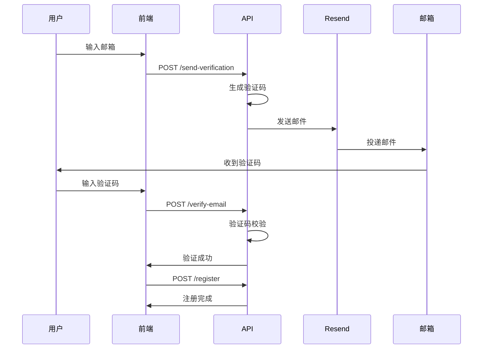

# 📧 邮箱验证功能

基于 [Resend](https://resend.com) 的邮箱验证系统，用于验证用户注册时邮箱的真实性。

## ✨ 功能特性

- ✅ **6位数字验证码** - 简单易记，100000-999999范围
- ✅ **10分钟有效期** - 平衡安全性和用户体验
- ✅ **60秒冷却时间** - 防止验证码滥发
- ✅ **一次性使用** - 验证成功后自动失效
- ✅ **美观邮件模板** - 响应式设计，品牌化展示
- ✅ **速率限制保护** - 防止暴力破解和垃圾邮件
- ✅ **自动清理** - 定期清理过期验证码
- ✅ **完整错误处理** - 友好的错误提示

## 🚀 快速开始

### 1. 安装依赖

```bash
npm install resend
```

### 2. 配置环境变量

在 `.env.local` 中添加：

```env
RESEND_API_KEY=re_your_actual_api_key_here
RESEND_FROM_EMAIL=Stravision <onboarding@resend.dev>
```

### 3. 获取 API Key

1. 访问 [Resend](https://resend.com) 并注册
2. 进入 [API Keys](https://resend.com/api-keys) 页面
3. 创建并复制 API Key

### 4. 测试功能

```bash
# 测试邮件服务
npx tsx scripts/test-email-service.ts your-email@example.com

# 启动开发服务器
npm run dev
```

访问 http://localhost:3000/register 测试注册流程。

## 📁 项目结构

```
├── app/
│   ├── api/
│   │   └── auth/
│   │       ├── send-verification/
│   │       │   └── route.ts          # 发送验证码 API
│   │       └── verify-email/
│   │           └── route.ts          # 验证邮箱 API
│   └── register/
│       └── page.tsx                  # 注册页面（已集成验证）
├── lib/
│   ├── email-verification-service.ts # 邮件验证核心服务
│   └── email-templates.tsx           # 邮件模板
├── docs/
│   ├── email-verification-setup.md   # 详细配置文档
│   └── email-verification-quickstart.md # 快速开始指南
└── scripts/
    └── test-email-service.ts         # 邮件服务测试脚本
```

## 🔌 API 接口

### 发送验证码

```http
POST /api/auth/send-verification
Content-Type: application/json

{
  "email": "user@example.com"
}
```

**响应**:
```json
{
  "success": true,
  "message": "验证码已发送，请查收邮件"
}
```

**速率限制**: 每IP每分钟最多3次

### 验证邮箱

```http
POST /api/auth/verify-email
Content-Type: application/json

{
  "email": "user@example.com",
  "code": "123456"
}
```

**响应**:
```json
{
  "success": true,
  "message": "邮箱验证成功"
}
```

**速率限制**: 每IP每分钟最多5次

## 💾 数据库结构

### users 表新增字段

```sql
email_verified INTEGER DEFAULT 0      -- 邮箱是否已验证
email_verified_at INTEGER             -- 验证时间戳
```

### email_verifications 表

```sql
CREATE TABLE email_verifications (
  id INTEGER PRIMARY KEY AUTOINCREMENT,
  email TEXT NOT NULL,
  code TEXT NOT NULL,
  expires_at INTEGER NOT NULL,
  used INTEGER DEFAULT 0,
  created_at INTEGER NOT NULL
)
```

## 🎨 邮件模板预览

邮件采用现代化设计：

- 🎨 渐变色背景（紫色系）
- 🍓 品牌 Logo 展示
- 🔢 突出显示的验证码
- ⏰ 过期时间提醒
- ⚠️ 安全提示信息

## 🔒 安全特性

1. **随机验证码** - 6位数字，100000-999999范围
2. **时效限制** - 10分钟后自动过期
3. **一次性使用** - 验证后立即失效
4. **速率限制** - 防止暴力破解
5. **数据库索引** - 优化查询性能
6. **输入验证** - Zod schema 验证

## 📊 使用流程



## 🧪 测试

### 单元测试

```bash
npm test
```

### 手动测试

1. **测试发送验证码**:
   ```bash
   npx tsx scripts/test-email-service.ts your-email@example.com
   ```

2. **测试完整流程**:
   - 访问注册页面
   - 输入邮箱并获取验证码
   - 检查邮箱收到验证码
   - 输入验证码完成注册

### 测试环境注意事项

⚠️ **重要限制**: 使用 `onboarding@resend.dev` 作为发件人时，**只能发送到你的 Resend 账号注册邮箱**。

对于当前账号，只能发送到：`jokertenseven@gmail.com`

**要支持其他邮箱，必须配置自己的域名**（见"生产环境部署"部分）。

## 🌍 生产环境部署

### 1. 配置域名

1. 在 Resend 控制台添加域名
2. 配置 DNS 记录：
   - SPF: `v=spf1 include:_spf.resend.com ~all`
   - DKIM: 按照 Resend 提供的记录配置
   - DMARC: `v=DMARC1; p=none;`

### 2. 更新环境变量

```env
RESEND_FROM_EMAIL=Stravision <noreply@yourdomain.com>
```

### 3. 测试生产配置

```bash
npx tsx scripts/test-email-service.ts test@yourdomain.com
```

## 💰 成本估算

Resend 定价（2024年）：

| 套餐 | 价格 | 邮件数量 |
|------|------|----------|
| 免费 | $0/月 | 3,000封/月 |
| 付费 | $20/月 | 50,000封/月 |

对于中小型应用，免费套餐通常足够使用。

## 🔧 故障排查

### 收不到邮件

1. ✅ **确认使用的是你的 Resend 账号邮箱**（测试环境限制）
2. ✅ 检查 RESEND_API_KEY 配置
3. ✅ 确认 API Key 有效
4. ✅ 检查垃圾邮件文件夹
5. ✅ 查看 Resend 控制台日志

⚠️ **测试邮箱限制**: `onboarding@resend.dev` 只能发送到你的 Resend 账号邮箱。要支持其他邮箱，必须配置域名。

### 验证码无效

1. ✅ 检查是否已过期（10分钟）
2. ✅ 确认验证码未被使用
3. ✅ 验证邮箱地址匹配
4. ✅ 检查数据库连接

### 请求频繁

1. ✅ 等待冷却时间（60秒）
2. ✅ 检查速率限制配置
3. ✅ 确认IP未被封禁

## 📚 文档

- [详细配置指南](./docs/email-verification-setup.md)
- [快速开始](./docs/email-verification-quickstart.md)
- [Resend 官方文档](https://resend.com/docs)
- [Resend Next.js 集成](https://resend.com/docs/send-with-nextjs)

## 🎯 后续优化

- [ ] 支持多语言邮件模板
- [ ] 添加邮件统计和分析
- [ ] 集成短信验证作为备选
- [ ] 支持自定义邮件模板
- [ ] 添加邮件预览功能
- [ ] 实现邮件队列系统

## 🤝 贡献

欢迎提交 Issue 和 Pull Request！

## 📄 许可证

MIT License

---

**需要帮助？** 查看 [故障排查](#-故障排查) 或访问 [Resend 文档](https://resend.com/docs)
